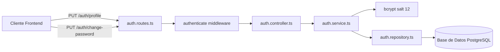

# Sprint 5 — Especificación de Backend: Gestión de Perfil y Credenciales de Usuario

**Estado:** Aprobado & Implementado  
**Fecha:** Octubre 2026  
**Autores:** Nathaniel Muller & Equipo de Arquitectura DevSculptor  
**Módulo:** `devsculptor-backend/src/modules/auth/`  
**Patrón:** Monolito Modular Layered MVC (Controller -> Service -> Repository)

---

## 1. Justificación y Alcance

Para dar soporte a la gestión autónoma del usuario en la plataforma de gobernanza técnica DevSculptor, se diseñaron e implementaron los endpoints protegidos para la modificación de datos de identidad (nombre completo) y la actualización segura de contraseñas de acceso.

---

## 2. Especificación de Endpoints

### 2.1. Actualización de Perfil (`PUT /auth/profile`)

Permite al usuario autenticado modificar su nombre para mostrar dentro de la plataforma y en las actas de gobernanza.

- **Método HTTP:** `PUT`
- **Ruta:** `/auth/profile`
- **Autenticación:** Requerida (`Bearer <JWT>` verificado por `authenticate` middleware).
- **Cuerpo de la Solicitud (JSON):**
  ```json
  {
    "fullName": "Nathaniel Muller"
  }
  ```
- **Validaciones:**
  - `fullName` debe ser una cadena no vacía con una longitud mínima de 2 caracteres tras aplicar `trim()`.
- **Flujo de Ejecución:**
  1. El middleware extrae y valida el JWT, inyectando `req.user.id`.
  2. `AuthController.updateProfile` valida la presencia y formato de `fullName`.
  3. `AuthService.updateProfile` invoca a `AuthRepository.updateProfile(userId, fullName)`.
  4. La consulta SQL `UPDATE users SET full_name = $2, updated_at = NOW() WHERE id = $1 RETURNING ...` actualiza y retorna el registro saneado.
- **Respuesta Exitosa (`200 OK`):**
  ```json
  {
    "user": {
      "id": "e2c34d10-...",
      "email": "nmullersm@gmail.com",
      "role": "SUPERADMIN",
      "full_name": "Nathaniel Muller",
      "mfa_enabled": false,
      "created_at": "2026-10-01T..."
    }
  }
  ```

---

### 2.2. Cambio Seguro de Contraseña (`PUT /auth/change-password`)

Permite al usuario autenticado cambiar su contraseña previa validación criptográfica de su clave actual.

- **Método HTTP:** `PUT`
- **Ruta:** `/auth/change-password`
- **Autenticación:** Requerida (`Bearer <JWT>`).
- **Cuerpo de la Solicitud (JSON):**
  ```json
  {
    "currentPassword": "ClaveActual123!",
    "newPassword": "NuevaClaveSegura2026!"
  }
  ```
- **Validaciones Criptográficas y de Seguridad:**
  1. `currentPassword` y `newPassword` son requeridas.
  2. `newPassword` debe tener al menos 8 caracteres.
  3. La contraseña actual se verifica con `bcrypt.compare(currentPassword, user.password_hash)`. Si no coincide, se arroja un error `400 Bad Request: La contraseña actual es incorrecta`.
  4. La nueva contraseña se cifra con salting mediante `bcrypt.hash(newPassword, 12)`.
  5. Se actualiza el hash en la base de datos y se registra la fecha de modificación.
- **Respuesta Exitosa (`200 OK`):**
  ```json
  {
    "message": "Contraseña actualizada con éxito."
  }
  ```

---

## 3. Arquitectura por Capas



### 3.1. Archivos Modificados
- `src/modules/auth/auth.repository.ts`: Métodos `updateProfile(userId, fullName)` y `updatePasswordHash(userId, newHash)`.
- `src/modules/auth/auth.service.ts`: Lógica de validación de contraseña actual y cálculo de hash seguro.
- `src/modules/auth/auth.controller.ts`: Manejo de peticiones HTTP, validación de parámetros y serialización.
- `src/modules/auth/auth.routes.ts`: Registro de rutas con middleware `authenticate`.

---

## 4. Garantías de Seguridad

1. **Protección contra Fuerza Bruta:** Las rutas `/auth/*` están resguardadas por `rateLimit` global de Express.
2. **Cero Exposición de Hashes:** La entidad de usuario retornada excluye estrictamente los campos `password_hash` y `mfa_secret`.
3. **Aislamiento Multi-Inquilino (RLS):** Las consultas se ejecutan restringidas al `userId` autenticado, imposibilitando la modificación de registros de terceros.
