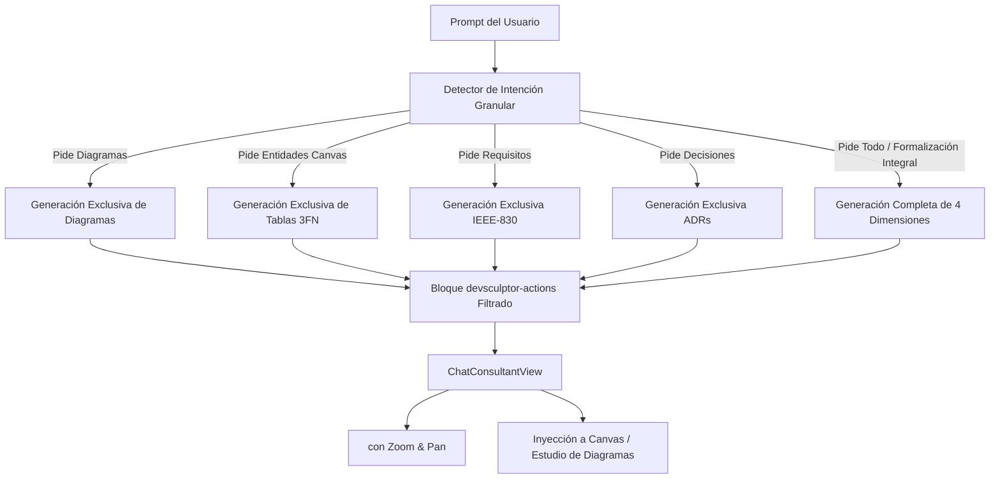

# Sprint 6 — Especificación del Paradigma de Diagramación Formal OKF e Inyección de Discernimiento Granular en la IA

**Proyecto:** DevSculptor Core Backend & Studio Frontend  
**Módulo:** Motor de Inteligencia Artificial & Estudio de Diagramas  
**Estándar Normativo:** OKF (Open Knowledge Framework) — Estándar v2.0  
**Estado:** IMPLEMENTADO Y VERIFICADO EN `feat/diagrams-studio`  
**Patrón Arquitectónico:** Monolito Modular Layered MVC + Strategy Provider Pattern  

---

## 1. Resumen Ejecutivo y Diagnóstico

### 1.1. Causa Raíz del Comportamiento Previo
Con anterioridad a esta especificación, el motor de inteligencia artificial de DevSculptor (tanto en sus adaptadores `GeminiProvider` / `OpenAiProvider` como en el simulador heurístico `MockAiProvider`) operaba bajo una directiva bimodal rígida en su Modo 2: cada vez que el usuario solicitaba formalizar o diseñar cualquier aspecto técnico, el sistema generaba invariablemente todos los artefactos a la vez (`suggestedRequirements`, `suggestedEntities` y `suggestedDecisions`), sin discriminar la intención específica ni el alcance del prompt.

Asimismo, los diagramas arquitectónicos de modelado visual no formaban parte de los axiomas del asistente ni existían estructuras DTO para transportarlos dentro de los bloques de acción estructurada (`devsculptor-actions`).

### 1.2. Solución Arquitectónica Implementada
1. **Axioma de Discernimiento Granular e Intencionalidad Selectiva:** La IA analiza la semántica del prompt del usuario y determina si la solicitud exige una categoría exclusiva (solo diagramas, solo entidades para el canvas, solo requisitos IEEE-830, o solo decisiones ADR), una combinación explícita (ej. tablas + diagramas), o una formalización integral de la suite completa.
2. **Inyección del Paradigma de Diagramación Formal OKF:** Se incorpora a la instrucción de sistema de la IA y a los bloques de acción el contrato tipado `AiSuggestedDiagram`, permitiendo generar diagramas Mermaid v10+ sintácticamente estrictos y funcionales (Secuencia transaccional con locks, Máquinas de estado de ciclo de vida, Diagramas de clases y topologías C4).
3. **Integración Reactiva en el Chat:** Las sugerencias de diagramas se visualizan en el chat con previsualización interactiva desplegable mediante `<MermaidVisualizer />`, botones para copiar código y acción directa `+ Ver en Diagramas` para conmutar al Estudio de Diagramas del proyecto.

---

## 2. Axiomas del Paradigma de Diagramación Formal OKF

El motor de IA incorpora el **Principio 7: Paradigma de Diagramación Formal OKF (Mermaid UML)** en su axioma arquitectónico:



### Axioma 1: Intencionalidad Granular y Respuesta Focalizada
- Si el usuario solicita **diagramas** (ej. *"diseña el diagrama de secuencia del login"*, *"genera diagramas para el carrito"*), la IA formula **exclusivamente diagramas**. El texto markdown no promete tablas ni requisitos que no hayan sido incluidos en el bloque de acción.
- Si el usuario solicita **entidades para el canvas** (ej. *"crea las tablas de inventario"*), la IA formula **exclusivamente entidades relacionales en 3FN**.
- Si el usuario solicita **requisitos** (ej. *"genera los RF de pagos"*), la IA formula **exclusivamente requisitos IEEE-830**.
- Si el usuario solicita **decisiones** (ej. *"qué ADRs recomiendas"*), la IA formula **exclusivamente ADRs**.
- Si el usuario solicita una **combinación específica** o **todo / formalización completa**, la IA genera las dimensiones pertinentes de forma balanceada.

### Axioma 2: Validez Sintáctica Estricta de Mermaid v10+
Todo código generado dentro de la propiedad `mermaidCode` debe ser directamente interpretable por el motor Mermaid v10+:
- Debe incluir encabezado de tipo válido: `sequenceDiagram`, `stateDiagram-v2`, `classDiagram`, `erDiagram`, `flowchart TB`, etc.
- No debe contener bloques envolventes de markdown (como ```` ```mermaid ````) incrustados dentro del string JSON; el backend sanitiza automáticamente cualquier fence residual.
- En diagramas de secuencia transaccionales, se emplean directivas formales como `autonumber`, declaraciones de `actor` y `participant` tipados, y llamadas explícitas a transacciones relacionales (`BEGIN TRANSACTION`, `SELECT FOR UPDATE`, `COMMIT`).

---

## 3. Especificación de Tipos y Contratos DTO

### 3.1. Interfaz `AiSuggestedDiagram`
```typescript
export interface AiSuggestedDiagram {
  code: string;       // Identificador correlativo (ej. 'DIAG-01', 'DIAG-02')
  title: string;      // Título formal del diagrama arquitectónico
  type: 'class' | 'sequence' | 'er' | 'state' | 'c4' | 'deployment' | 'activity' | 'flowchart';
  format: 'mermaid';  // Formato normativo de renderizado
  mermaidCode: string;// Código fuente Mermaid v10+ limpio
  description?: string;// Explicación de las decisiones de diseño representadas
}
```

### 3.2. Bloque de Acción Normalizado (`devsculptor-actions`)
```json
```json:devsculptor-actions
{
  "suggestedDiagrams": [
    {
      "code": "DIAG-01",
      "title": "Diagrama de Secuencia - Reserva y Transición de Órdenes",
      "type": "sequence",
      "format": "mermaid",
      "mermaidCode": "sequenceDiagram\n  autonumber\n  actor User as Cliente\n  participant Web as Frontend Web\n  participant GW as API Gateway\n  participant OrderSvc as Order Service\n  participant DB as PostgreSQL\n  User->>Web: Confirmar Orden\n  Web->>GW: POST /api/v1/orders\n  GW->>OrderSvc: dispatch(CreateOrderCommand)\n  OrderSvc->>DB: BEGIN TRANSACTION (SERIALIZABLE)\n  OrderSvc->>DB: SELECT * FROM stock WHERE id = $1 FOR UPDATE\n  OrderSvc->>DB: INSERT INTO orders ...\n  OrderSvc->>DB: COMMIT\n  OrderSvc-->>GW: OrderCreatedDTO (201 Created)\n  GW-->>Web: 201 Created { orderId }\n  Web-->>User: Pedido Confirmado",
      "description": "Flujo de ejecución E2E conforme a especificación OKF con bloqueo pesimista."
    }
  ]
}
```
```

---

## 4. Implementación en el Backend

### 4.1. `MockAiProvider` (`devsculptor-backend/src/modules/ai/providers/mock.provider.ts`)
- Implementa `detectActionIntent(prompt, actionContext)`: evalúa palabras clave semánticas excluyendo stopwords, detecta si la consulta es consultiva (Modo 1) o de formalización (Modo 2), y extrae las banderas booleanas `wantsDiagrams`, `wantsEntities`, `wantsRequirements`, `wantsDecisions`, `wantsAll`, e `isExclusive`.
- Incorpora diagramas Mermaid funcionales de alta precisión para los dominios de **E-Commerce / Dark Stores**, **Pagos / Idempotencia**, **Auth / RBAC y RLS**, **Catálogo / Inventario** y **Dominio Dinámico**.
- Implementa `buildSelectiveResponse`: estructura el texto en Markdown de acuerdo con la categoría solicitada y construye el bloque `json:devsculptor-actions` conteniendo única y exclusivamente las claves pedidas por el usuario.

### 4.2. `ai.prompts.ts`
- Actualiza `SYSTEM_INSTRUCTION_ARCHITECT` con la regla de discernimiento selectivo y el Principio 7 de diagramas Mermaid.
- Actualiza `parseDevSculptorActions`: extrae y sanitiza `suggestedDiagrams`, limpiando fences anidados y validando tipos admitidos.

### 4.3. `gemini.provider.ts` y `openai.provider.ts`
- Mapean el array `suggestedDiagrams` y exponen el objeto `actions.diagrams` hacia el consumidor de la API.

### 4.4. `ai.dto.ts` y Validación de Contexto de Acción
- Se actualizó el esquema Zod `chatRequestDtoSchema` incorporando `'conversation'` a los valores permitidos del enum `actionContext`:
  ```typescript
  actionContext: z.enum(['general', 'requirements', 'canvas', 'decisions', 'diagrams', 'conversation']).optional().default('general'),
  ```
- Permite la activación del modo de asesoría técnica pura sin generar bloques de inyección automáticos involuntarios.

### 4.5. Soporte Formal para Diagramas de Proceso BPMN y Sanitización de Stopwords
- **Diagramas BPMN (`flowchart TD`)**: Detección semántica de intenciones (`bpmn`, `proceso`, `workflow`, `flujo`, `actividad`) formulando diagramas de procesos de negocio válidos con eventos de inicio/fin `(( ))`, tareas operativas `[ ]` y compuertas de decisión `{"¿Es válido?"}`.
- **Diccionario de Stopwords Purificado**: Se incorporaron más de 30 palabras de parada conversacionales (`unicamente`, `solamente`, `pedi`, `quiero`, `generar`, `diagrama`, `bpmn`, etc.), evitando que adverbios o verbos del prompt sean erróneamente interpretados como nombres de entidades de base de datos.
- **Fallback al Nombre del Proyecto**: Si tras filtrar las stopwords no se detecta una entidad válida, el generador toma como contexto canónico el nombre del proyecto activo en lugar de inventar entidades artificiales.

---

## 5. Implementación en el Frontend

### 5.1. Store de Chat (`useAiChatStore.ts`)
- **Persistencia de Diagramas Inyectados:** La interfaz `ProjectChatSession` ahora preserva `injectedDiagrams?: AiSuggestedDiagram[]` junto con `injectedKeys`.
- **Método `injectDiagram`:** Registra el diagrama completo en la sesión activa y emite notificaciones reactivas a través de `sessionStorage`.
- **Método `injectAllActions`:** Itera sobre `actions.diagrams` inyectando todos los diagramas sugeridos de forma atómica.

### 5.2. Vista de Consultoría (`ChatConsultantView.tsx`)
- **Corrección Crítica de `hasActions`:** Se incorporó `|| (m.actions.diagrams && m.actions.diagrams.length > 0)` en la condición de visualización del bloque de acciones, garantizando que cuando la IA formula exclusivamente diagramas, el contenedor de tarjetas y botones de inyección se renderice correctamente.
- **Selector ComboBox de Modo Preset en Cabecera:**
  - Sustituyó los antiguos botones de prompt prefabricado por un selector contextual en la cabecera del chat con 5 modos:
    1. 🏛️ `General (Integral)`: Suite completa (Requisitos, Canvas ERD, Diagramas y ADRs).
    2. 💬 `Conversación (Asesoría)`: Consulta y diálogo técnico puro sin inyecciones automáticas.
    3. 📐 `Diagramado (UML / BPMN)`: Generación exclusiva de diagramas de arquitectura en Mermaid.
    4. 🗄️ `Canvas ERD (Tablas 3FN)`: Modelado de tablas y relaciones para el canvas.
    5. 📋 `Requisitos (IEEE-830)`: Requerimientos funcionales y no funcionales.
  - El campo de entrada adapta su *placeholder* dinámicamente al modo seleccionado.
  - Al enviar una consulta, `sendMessage` propaga el `actionContext` correspondiente hacia el backend.
- **Desacoplamiento de Acciones en Tarjetas de Diagrama:**
  - `+ Inyectar` / `Inyectado ✓`: Inyecta el diagrama en el estado de la sesión y muestra notificación *toast* sin expulsar al usuario del hilo de conversación.
  - `Previsualizar / Ocultar`: Alterna el render interactivo con zoom y paneo mediante `<MermaidVisualizer />`.
  - `Código`: Copia el código fuente Mermaid.
  - `Estudio ↗`: Enlace voluntario directo hacia el Estudio de Diagramas.
- **Barra Inferior Informativa:** Actúa como indicador del preset activo y provee accesos rápidos directos (`Diagramas ↗`, `Canvas ↗`, `Requisitos ↗`).

### 5.3. Sincronización en el Estudio de Diagramas (`DiagramsView.tsx`)
- Subscripción reactiva a `injectedAiDiagrams` desde `useAiChatStore`.
- Los diagramas inyectados se despliegan en el catálogo de la pestaña **UML OKF (Mermaid)** bajo la insignia `OKF IA`, con soporte para renderizado interactivo, zoom, paneo y exportación a SVG/PNG/HTML.

---

## 6. Verificación de Conformidad y Compilación

- **Backend:** `npm run build` ejecutado exitosamente con TypeScript en modo estricto (`tsc && tsc-alias`).
- **Backend Tests:** 25/25 pruebas unitarias y de integración pasando con Vitest y Supertest.
- **Frontend:** `npm run build` (`vite build`) completado con código 0 y bundles optimizados.
- **Linting:** 0 errores en backend (`eslint src`) y frontend (`oxlint`).
- **Pruebas Automatizadas de Navegador:** Inyección de diagramas probada con éxito en navegador, confirmando el funcionamiento del botón `+ Inyectar`, el ComboBox de modos y la persistencia en el Estudio de Diagramas.
- **Políticas de Control de Cambios:** Ningún commit ni merge ejecutado, preservando el estado de trabajo en la rama `feat/diagrams-studio`.
