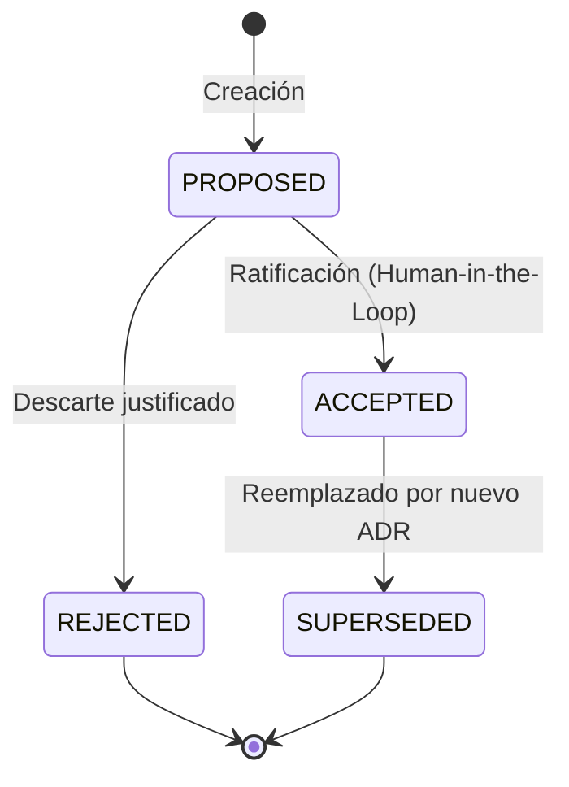

# DevSculptor Backend — Especificación Maestra de Características y Evolución por Sprints

> **Documento Maestro:** `Documentation/Backend/Backend_Features_and_Sprints_Specification.md`  
> **Proyecto:** DevSculptor Backend Core (`devsculptor-backend`)  
> **Autor:** Nathaniel Muller San Martín & AI Pair Programming Architect  
> **Fecha:** Octubre 2026 (Consolidación Integral Sprints 1 a 6)  
> **Estado:** COMPLETADO, VERIFICADO Y DOCUMENTADO EN `develop`  
> **Cobertura Funcional:** S1 (Core & ADRs) ➔ S3 (AI Engine & Governance) ➔ S4 (Admin & OKF) ➔ S5 (BYOK & Perfil) ➔ S6 (AI Diagrams & DDL)  

---

## 📑 Tabla de Contenidos

1. [Visión General de la Evolución Funcional del Backend](#1-visión-general-de-la-evolución-funcional-del-backend)
2. [Sprint 1: Núcleo Transaccional, Persistencia ACID y ADRs Fundamentales](#2-sprint-1-núcleo-transaccional-persistencia-acid-y-adrs-fundamentales)
   - 2.1. [Esquema Relacional Inicial y Entidades Canónicas](#21-esquema-relacional-inicial-y-entidades-canónicas)
   - 2.2. [Procedimientos Almacenados y Triggers PL/pgSQL](#22-procedimientos-almacenados-y-triggers-plpgsql)
   - 2.3. [Compendio de las 8 Decisiones Arquitectónicas Fundamentales (ADRs)](#23-compendio-de-las-8-decisiones-arquitectónicas-fundamentales-adrs)
3. [Sprint 3: Motor de Inteligencia Artificial y Gobernanza de Decisiones](#3-sprint-3-motor-de-inteligencia-artificial-y-gobernanza-de-decisiones)
   - 3.1. [Motor de Consultoría de Arquitectura con IA](#31-motor-de-consultoría-de-arquitectura-con-ia)
   - 3.2. [Máquina de Estados Finitos para ADRs (ADR Lifecycle)](#32-máquina-de-estados-finitos-para-adrs-adr-lifecycle)
   - 3.3. [Generador de DDL Multi-Dialecto (Postgres, MySQL, SQLite, Oracle)](#33-generador-de-ddl-multi-dialecto-postgres-mysql-sqlite-oracle)
4. [Sprint 4: Control de Acceso Maestro (RBAC), Bóveda Global y Manifiestos OKF](#4-sprint-4-control-de-acceso-maestro-rbac-bóveda-global-y-manifiestos-okf)
   - 4.1. [Módulo de Superadministrador y Middleware `requireSuperAdmin`](#41-módulo-de-superadministrador-y-middleware-requiresuperadmin)
   - 4.2. [Bóveda de Plantillas Globales (`global_vault_templates`)](#42-bóveda-de-plantillas-globales-global_vault_templates)
   - 4.3. [Estándar OKF (*One Knowledge Format*) y Compilación de Manifiestos](#43-estándar-okf-one-knowledge-format-y-compilación-de-manifiestos)
5. [Sprint 5: Perfil de Usuario, Rotación Criptográfica y Autenticación 2FA TOTP](#5-sprint-5-perfil-de-usuario-rotación-criptográfica-y-autenticación-2fa-totp)
   - 5.1. [Gestión de Perfil y Auditoría de Identidad](#51-gestión-de-perfil-y-auditoría-de-identidad)
   - 5.2. [Rotación de Contraseñas e Invalidación Instantánea (`token_version`)](#52-rotación-de-contraseñas-e-invalidación-instantánea-token_version)
   - 5.3. [Segundo Factor de Autenticación (2FA / TOTP con AES-256-GCM)](#53-segundo-factor-de-autenticación-2fa--totp-con-aes-256-gcm)
6. [Sprint 6: Inyección de Diagramas Vectoriales IA y Sincronización de Canvas](#6-sprint-6-inyección-de-diagramas-vectoriales-ia-y-sincronización-de-canvas)
   - 6.1. [Generador de Especificaciones Mermaid (C4, Arquitectura, Secuencias)](#61-generador-de-especificaciones-mermaid-c4-arquitectura-secuencias)
   - 6.2. [Discernimiento Arquitectónico Granular y Sugerencia de Índices](#62-discernimiento-arquitectónico-granular-y-sugerencia-de-índices)
   - 6.3. [Sincronización Bidireccional de Entidades Canvas y DDL](#63-sincronización-bidireccional-de-entidades-canvas-y-ddl)
7. [Matriz de Trazabilidad de Endpoints por Módulo](#7-matriz-de-trazabilidad-de-endpoints-por-módulo)

---

## 1. Visión General de la Evolución Funcional del Backend

El backend de **DevSculptor** se concibió como un motor determinista de gobernanza arquitectónica previa a la codificación (*pre-code technical governance*). Su desarrollo modular garantizó que cada sprint ampliara la superficie funcional sin degradar el rendimiento ni violar las reglas de separación en capas:

```
┌────────────────────────────────────────────────────────────────────────────────────────┐
│                                EVOLUCIÓN POR SPRINTS                                   │
├────────────────────┬────────────────────┬────────────────────┬─────────────────────────┤
│ Sprint 1           │ Sprint 3           │ Sprint 4           │ Sprint 5 - 6            │
│ Core Transaccional │ Motor IA & Gov     │ RBAC & Bóveda OKF  │ Perfil, 2FA & Diagramas │
│ - MVC en Capas     │ - Consultoría IA   │ - Master Admin     │ - 2FA TOTP AES-256-GCM  │
│ - 6 Tablas Base    │ - FSM de ADRs      │ - requireSuperAdmin│ - Rotación token_version│
│ - Triggers & SP    │ - DDL Multi-Dialec │ - Bóveda Global    │ - Mermaid Generator     │
│ - BaseRepository   │ - Context Inject   │ - Storage RLS      │ - Canvas Sync & Index   │
└────────────────────┴────────────────────┴────────────────────┴─────────────────────────┘
```

---

## 2. Sprint 1: Núcleo Transaccional, Persistencia ACID y ADRs Fundamentales

### 2.1 Esquema Relacional Inicial y Entidades Canónicas
El Sprint 1 modeló las 6 entidades fundamentales que estructuran los proyectos de software:
1. `users`: Identidad, credenciales con hash bcrypt, rol del sistema (`USER`, `SUPERADMIN`) y estado de activación.
2. `projects`: Proyectos de software gobernados por el usuario, con cálculo reactivo de madurez.
3. `requirements`: Requerimientos funcionales y no funcionales bajo estándar IEEE-830, categorizados por prioridad y esfuerzo.
4. `canvas_entities`: Entidades de modelado relacional (tablas, columnas, tipos de datos, constraints) manipuladas visualmente en el ERD.
5. `architecture_decisions`: Registro formal de ADRs (Contexto, Decisión, Consecuencias, Estado).
6. `audit_logs`: Trazabilidad inmutable de todas las mutaciones realizadas en el sistema.

### 2.2 Procedimientos Almacenados y Triggers PL/pgSQL
Conforme a las exigencias académicas e institucionales, la persistencia delegó la integridad relacional al motor PostgreSQL:

- **Trigger de Auditoría Automática (`trg_audit_log`):**  
  Captura eventos `INSERT`, `UPDATE` y `DELETE` en tablas críticas, serializando el estado previo (`OLD`) y posterior (`NEW`) en formato JSONB e inyectando el `user_id` de sesión extraído de variables de transacción PostgreSQL (`SET LOCAL app.current_user_id`).
- **Trigger de Timestamp Determinista (`trg_update_timestamp`):**  
  Actualiza automáticamente `updated_at = NOW()` en cada mutación, evitando depender del reloj del servidor de aplicaciones.
- **Stored Procedure de Madurez de Proyecto (`sp_calculate_project_maturity`):**  
  Calcula un indicador porcentual ponderado (0% a 100%) evaluando completitud de requerimientos aprobados, ADRs ratificados y modelos ERD definidos:
  $$\text{Maturity} = (W_{\text{req}} \times \%_{\text{req}}) + (W_{\text{adr}} \times \%_{\text{adr}}) + (W_{\text{erd}} \times \%_{\text{erd}})$$

### 2.3 Compendio de las 8 Decisiones Arquitectónicas Fundamentales (ADRs)
1. **ADR-01: Monolito Modular Layered MVC:** Selección de arquitectura de despliegue único con límites modulares claros (`modules/{name}/`) para evitar el costo operativo de microservicios en ciclos ágiles.
2. **ADR-02: BaseRepository con `pg.Pool` Nativo:** Descarte de ORMs pesados (Prisma/TypeORM) para tener control total sobre triggers avanzados, procedimientos almacenados y consultas SQL optimizadas con tipado genérico.
3. **ADR-03: Cadena de Responsabilidad en Middlewares:** Canalización secuencial estricta en Express: Helmet ➔ CORS ➔ RateLimiter ➔ RequestId ➔ RequestLogger ➔ Zod Validation ➔ Authentication ➔ ErrorHandler.
4. **ADR-04: Autenticación Transversal desde Sprint 1:** Adelanto estratégico del módulo de autenticación para garantizar que la autoría en auditorías y el aislamiento multi-inquilino existieran desde la primera iteración.
5. **ADR-05: Zod como Fuente Única de Verdad (SSOT):** Unificación de validación en runtime y tipos en compile-time mediante `z.infer<typeof schema>`, eliminando discrepancias entre contratos.
6. **ADR-06: Logging Estructurado con Pino:** Uso de Pino JSON de alto rendimiento con correlación obligatoria mediante cabecera `X-Request-Id`.
7. **ADR-07: Row Level Security en Supabase:** Activación universal de RLS en todas las tablas del esquema público para cerrar el acceso directo no autorizado vía PostgREST.
8. **ADR-08: Envelope Uniforme de Respuesta HTTP (`ApiResponse<T>`):** Estandarización de todas las respuestas del servidor bajo la estructura predecible `{ success: true, data }` o `{ success: false, error: { code, message, details } }`.

---

## 3. Sprint 3: Motor de Inteligencia Artificial y Gobernanza de Decisiones

### 3.1 Motor de Consultoría de Arquitectura con IA
Ubicado en [`ai.service.ts`](file:///c:/Users/natha/Documents/Repos/DevSculptor/devsculptor-backend/src/modules/ai/ai.service.ts):
- **Inyección Contextual Dinámica:** Antes de enviar un prompt al modelo LLM (Gemini o DeepSeek), el servicio recupera del repositorio todos los requerimientos y entidades ERD del proyecto, armando una ventana de contexto de alta fidelidad.
- **Soporte de Modelos Híbridos:** Permite alternar entre la cuota institucional del servidor y la clave propia del usuario (BYOK vía cabecera `X-User-Ai-Key`).
- **Filtrado Anti-Alucinación:** El prompt del sistema fuerza la salida en estructuras JSON validadas por Zod (`aiConsultantResponseSchema`).

### 3.2 Máquina de Estados Finitos para ADRs (ADR Lifecycle)
Los registros de decisión arquitectónica operan bajo una máquina de estados estricta implementada en [`decisions.service.ts`](file:///c:/Users/natha/Documents/Repos/DevSculptor/devsculptor-backend/src/modules/decisions/decisions.service.ts):



- Ningún ADR puede pasar a `SUPERSEDED` sin referenciar explícitamente el identificador del nuevo ADR que lo sustituye.
- Se mantiene inmutabilidad sobre ADRs aceptados históricos para garantizar auditoría de decisiones pasadas.

### 3.3 Generador de DDL Multi-Dialecto (Postgres, MySQL, SQLite, Oracle)
El endpoint `POST /projects/:projectId/canvas/generate-ddl` toma las entidades relacionales modeladas visualmente en el canvas y compila sentencias DDL nativas adaptadas a las particularidades sintácticas de cuatro motores:
- **PostgreSQL:** Tipos `UUID`, `TIMESTAMPTZ`, `JSONB`, triggers y secuencias.
- **MySQL (InnoDB):** Tipos `VARCHAR(36)`, `DATETIME`, `JSON`, tablas `ENGINE=InnoDB DEFAULT CHARSET=utf8mb4`.
- **SQLite:** Tipos afines `TEXT`, `INTEGER`, llaves primarias autoincrementales sin soporte de alteración compleja.
- **Oracle Database:** Tipos `VARCHAR2`, `NUMBER`, timestamps y constraints nombradas compatibles con esquemas enterprise.

---

## 4. Sprint 4: Control de Acceso Maestro (RBAC), Bóveda Global y Manifiestos OKF

### 4.1 Módulo de Superadministrador y Middleware `requireSuperAdmin`
Implementado en [`requireSuperAdmin.ts`](file:///c:/Users/natha/Documents/Repos/DevSculptor/devsculptor-backend/src/middlewares/requireSuperAdmin.ts) y [`admin.routes.ts`](file:///c:/Users/natha/Documents/Repos/DevSculptor/devsculptor-backend/src/modules/admin/admin.routes.ts):
- **Protección contra Reconocimiento:** Si un usuario con rol regular (`USER`) intenta consultar un endpoint `/api/v1/admin/*`, el middleware no emite `403 Forbidden` (lo que delataría la existencia de la ruta), sino que retorna **404 Not Found**.
- **Capacidades del Superadministrador:**
  - Consulta del log global de eventos de seguridad (`GET /api/v1/admin/security-events`).
  - Administración y suspensión de usuarios (`PATCH /api/v1/admin/users/:id/status`).
  - Métricas de telemetría, uso de base de datos y cuotas de consumo LLM.

### 4.2 Bóveda de Plantillas Globales (`global_vault_templates`)
Permite a los administradores publicar plantillas arquitectónicas curadas (patrones microfrontends, pipelines de datos, arquitecturas hexagonales) accesibles en modo lectura para todos los usuarios autenticados.

### 4.3 Estándar OKF (*One Knowledge Format*) y Compilación de Manifiestos
El módulo OKF (`/api/v1/projects/:projectId/okf`) genera un paquete canónico de documentación técnica:
- Construye un árbol estructurado de documentos en Markdown con manifiesto maestro `/INDEX.md`.
- Calcula hashes criptográficos SHA-256 para cada sección, garantizando detección de manipulación o desincronización respecto al código fuente.
- Empaqueta el conjunto en archivos comprimidos ZIP compatibles con Supabase Storage.

---

## 5. Sprint 5: Perfil de Usuario, Rotación Criptográfica y Autenticación 2FA TOTP

### 5.1 Gestión de Perfil y Auditoría de Identidad
El endpoint `PUT /api/v1/auth/profile` permite al usuario actualizar sus datos nominativos (nombre, organización, preferencias de modelado) con validación estricta de formato y registro en auditoría.

### 5.2 Rotación de Contraseñas e Invalidación Instantánea (`token_version`)
El endpoint `PUT /api/v1/auth/change-password`:
1. Exige la contraseña actual para prevenir cambios no autorizados en sesiones secuestradas.
2. Genera un nuevo hash seguro con bcrypt (cost factor 10).
3. **Incrementa atómicamente `users.token_version = token_version + 1`:** Esto invalida de inmediato cualquier token JWT emitido previamente en otros navegadores o dispositivos, forzando un re-login transversal seguro.

### 5.3 Segundo Factor de Autenticación (2FA / TOTP con AES-256-GCM)
Flujo de tres etapas en [`auth.service.ts`](file:///c:/Users/natha/Documents/Repos/DevSculptor/devsculptor-backend/src/modules/auth/auth.service.ts):
1. **Setup (`POST /auth/mfa/setup`):** Genera secreto TOTP compatible con Google Authenticator / Authy y emite el código QR vectorial o URI `otpauth://`.
2. **Activación (`POST /auth/mfa/enable`):** Exige un código de 6 dígitos válido antes de activar la bandera `mfa_enabled = true`. El secreto se cifra en reposo utilizando **AES-256-GCM**.
3. **Desactivación (`POST /auth/mfa/disable`):** Requiere contraseña y código TOTP simultáneos para prevenir desarmes maliciosos.

---

## 6. Sprint 6: Inyección de Diagramas Vectoriales IA y Sincronización de Canvas

### 6.1 Generador de Especificaciones Mermaid (C4, Arquitectura, Secuencias)
El motor de diagramado arquitectónico [`ai.service.ts`](file:///c:/Users/natha/Documents/Repos/DevSculptor/devsculptor-backend/src/modules/ai/ai.service.ts) traduce la estructura funcional del proyecto a especificaciones textuales Mermaid SVG:
- **Diagramas de Contexto C4:** Mapeo de límites de sistema, actores externos y microservicios.
- **Diagramas de Flujo de Datos y Secuencias:** Mapeo de intercambios de mensajes en casos de uso complejos.
- **Diagramas de Clases y Entidad-Relación:** Mapeo de diagramas relacionales completos con atributos de tipo y cardinalidad (`1:N`, `N:M`).

### 6.2 Discernimiento Arquitectónico Granular y Sugerencia de Índices
Analiza las entidades del lienzo ERD y sugiere optimizaciones de base de datos:
- Identificación automática de claves foráneas candidatas sin índices B-Tree asociados.
- Detección de posibles violaciones a la Tercera Forma Normal (3FN).
- Recomendación de tipos de datos adecuados según volumetría proyectada (ej. `BIGINT` vs `INT`).

### 6.3 Sincronización Bidireccional de Entidades Canvas y DDL
El backend persiste las coordenadas visuales (`position_x`, `position_y`), colores y metadatos de renderizado en `canvas_entities` mediante endpoints optimizados por lotes (`PATCH /canvas/batch`), garantizando que el estado visual del diseñador coincida exactamente con las definiciones relacionales.

---

## 7. Matriz de Trazabilidad de Endpoints por Módulo

| Módulo | Método | Endpoint | Autenticación | Rate Limiting | Validación Zod |
| :--- | :---: | :--- | :---: | :---: | :---: |
| **Auth** | POST | `/api/v1/auth/register` | No | `registerLimiter` (10/h) | `registerSchema` |
| **Auth** | POST | `/api/v1/auth/login` | No | `loginLimiter` (10/15m) | `loginSchema` |
| **Auth** | POST | `/api/v1/auth/forgot-password`| No | `forgotPasswordLimiter` (5/h) | `forgotPasswordSchema`|
| **Auth** | POST | `/api/v1/auth/reset-password` | No | `resetPasswordLimiter` (10/h) | `resetPasswordSchema` |
| **Auth** | POST | `/api/v1/auth/mfa/verify` | No | `mfaLimiter` (5/5m) | `mfaVerifySchema` |
| **Auth** | POST | `/api/v1/auth/mfa/setup` | Sí | Global | Ninguno (req.user) |
| **Auth** | POST | `/api/v1/auth/mfa/enable` | Sí | Global | `mfaEnableSchema` |
| **Auth** | POST | `/api/v1/auth/mfa/disable` | Sí | Global | `disableMfaSchema` |
| **Auth** | PUT | `/api/v1/auth/profile` | Sí | Global | `updateProfileSchema` |
| **Auth** | PUT | `/api/v1/auth/change-password`| Sí | Global | `changePasswordSchema` |
| **Projects** | GET/POST | `/api/v1/projects` | Sí | Global | `createProjectSchema` |
| **Projects** | GET/PUT/DEL | `/api/v1/projects/:id` | Sí | Global | `updateProjectSchema` |
| **Reqs** | GET/POST | `/api/v1/projects/:projectId/requirements` | Sí | Global | `requirementSchema` |
| **Canvas** | GET/POST/PUT | `/api/v1/projects/:projectId/canvas` | Sí | Global | `canvasEntitySchema` |
| **Decisions** | GET/POST | `/api/v1/projects/:projectId/decisions` | Sí | Global | `decisionSchema` |
| **AI** | POST | `/api/v1/projects/:projectId/ai/consult` | Sí | `aiLimiter` (30/15m) | `aiConsultSchema` |
| **OKF** | GET/POST | `/api/v1/projects/:projectId/okf` | Sí | Global | `okfCompileSchema` |
| **Admin** | GET | `/api/v1/admin/security-events` | Sí (Superadmin) | Global | Ninguno |
| **Admin** | PATCH | `/api/v1/admin/users/:id/status` | Sí (Superadmin) | Global | `updateUserStatusSchema` |
