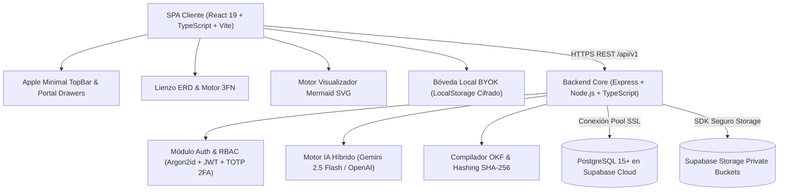

# DevSculptor — Especificación Técnica Integral y Arquitectura Maestra de Software

> **Documento:** `Documentation/Consolidated/DevSculptor_Master_Technical_Architecture_and_Specifications.md`  
> **Proyecto:** DevSculptor — Technical Governance & AI-Assisted Documentation Platform  
> **Asignatura / Portafolio:** Taller de Integración de Software (PTY4479) — Duoc UC  
> **Autor & Arquitecto:** Nathaniel Muller San Martín  
> **Estado:** 100% OPERATIVO, AUDITADO Y SIN ERRORES (Sprints 1 al 5 Completados)  
> **Versión:** 5.2.0 (Release Candidate / Pre-Hosting)

---

## 📑 Tabla de Contenidos

1. [Resumen Ejecutivo y Declaración de Misión](#1-resumen-ejecutivo-y-declaración-de-misión)
2. [Topología Arquitectónica y Stack Tecnológico Global](#2-topología-arquitectónica-y-stack-tecnológico-global)
3. [Arquitectura del Backend (Monolito Modular Layered MVC)](#3-arquitectura-del-backend-monolito-modular-layered-mvc)
   - 3.1. [Capas del Sistema y Patrones de Diseño](#31-capas-del-sistema-y-patrones-de-diseño)
   - 3.2. [Persistencia Relacional y Base de Datos Supabase](#32-persistencia-relacional-y-base-de-datos-supabase)
   - 3.3. [Catálogo Consolidado de ADRs Fundacionales](#33-catálogo-consolidado-de-adrs-fundacionales)
   - 3.4. [Motor de Consultoría IA y Proveedores Híbridos](#34-motor-de-consultoría-ia-y-proveedores-híbridos)
   - 3.5. [Seguridad Transversal, RBAC Superadmin y Gestión de Perfiles](#35-seguridad-transversal-rbac-superadmin-y-gestión-de-perfiles)
4. [Arquitectura del Frontend (SPA React 19 + Apple visionOS)](#4-arquitectura-del-frontend-spa-react-19--apple-visionos)
   - 4.1. [Sistema de Diseño Canónico visionOS Liquid Glassmorphism](#41-sistema-de-diseño-canónico-visionos-liquid-glassmorphism)
   - 4.2. [Ergonomía de Interfaz: Barra Superior y Cajones Laterales Portal](#42-ergonomía-de-interfaz-barra-superior-y-cajones-laterales-portal)
   - 4.3. [Gestión de Requisitos (IEEE-830) y Catálogo ADR Interactivo](#43-gestión-de-requisitos-ieee-830-y-catálogo-adr-interactivo)
   - 4.4. [Lienzo Relacional ERD, Motor 3FN y Multi-Dialecto DDL](#44-lienzo-relacional-erd-motor-3fn-y-multi-dialecto-ddl)
   - 4.5. [Motor Visualizador de Diagramas Mermaid/MMD y Exportación Ejecutiva](#45-motor-visualizador-de-diagramas-mermaidmmd-y-exportación-ejecutiva)
   - 4.6. [Bóveda de Credenciales de Usuario (BYOK)](#46-bóveda-de-credenciales-de-usuario-byok)
5. [Compilador OKF (Open Knowledge Framework) y Bóveda Viva](#5-compilador-okf-open-knowledge-framework-y-bóveda-viva)
6. [Galería de Artefactos Visuales del Sistema (Screenshots Auditados)](#6-galería-de-artefactos-visuales-del-sistema-screenshots-auditados)
7. [Matriz de Pruebas de Calidad (QA) y Criterios de Aceptación](#7-matriz-de-pruebas-de-calidad-qa-y-criterios-de-aceptación)

---

## 1. Resumen Ejecutivo y Declaración de Misión

El desarrollo moderno de software se enfrenta a una crisis emergente denominada *"vibe coding"*: el uso impulsivo y desestructurado de modelos de lenguaje grande (LLMs) y generadores de código sin fundamentación arquitectónica previa. Esto genera sistemas frágiles, deuda técnica acumulada, falta de trazabilidad documental y bases de datos plagadas de anomalías de modificación.

**DevSculptor** es la solución ingenieril concebida para restaurar la disciplina del diseño de sistemas:
* Proporciona un entorno interactivo y estético para la **gobernanza técnica pre-código**.
* Permite redactar requisitos formalizados bajo el estándar **IEEE-830**.
* Administra **Actas de Decisión Arquitectónica (ADRs)** con máquina de estados estricta y protocolo *Human-in-the-Loop*.
* Ofrece un **Lienzo Relacional ERD** con conectores Bezier, Crow's Foot y un evaluador matemático de **Tercera Forma Normal (3FN)**.
* Empaqueta el estado vivo del proyecto en especificaciones deterministas bajo el formato **OKF (Open Knowledge Framework)** para alimentar a asistentes autónomos de codificación (Claude Code, Cursor, Copilot) con cero alucinación arquitectónica.

```
┌──────────────────────────────────────────────────────────────────────────────────────────────┐
│                               FLUJO DE GOBERNANZA PRE-CÓDIGO                                 │
├───────────────────────┬───────────────────────────┬──────────────────────────────────────────┤
│ 1. REQUISITOS         │ 2. ARQUITECTURA & ADRS    │ 3. PERSISTENCIA EN 3FN                   │
│ • Captura guiada      │ • 8 ADRs inmutables       │ • Modelado visual con conectores Bezier  │
│ • Jerarquía IEEE-830  │ • Máquina de estados      │ • Reglas 1FN, 2FN y 3FN algorítmicas     │
│ • RF / RNF tipados    │ • Ratificación con IA     │ • DDL para PG, MySQL, SQLite, Oracle     │
├───────────────────────┴───────────────────────────┴──────────────────────────────────────────┤
│ 4. BÓVEDA DOCUMENTAL OKF + VISUALIZADOR MERMAID + EXPORTACIÓN EJECUTIVA MULTI-FORMATO        │
└──────────────────────────────────────────────────────────────────────────────────────────────┘
```

---

## 2. Topología Arquitectónica y Stack Tecnológico Global

DevSculptor adopta una arquitectura desacoplada pero unificada en repositorio, asegurando portabilidad, escalabilidad horizontal e inmutabilidad de tipos TypeScript de extremo a extremo:



| Componente | Capa | Tecnologías Clave | Propósito |
| :--- | :--- | :--- | :--- |
| **Frontend** | Presentación & UX | React 19, TypeScript 5.8, Vite 6, Tailwind CSS 3, Zustand 5, Mermaid 11, Lucide Icons | Interfaz espacial visionOS, modelado relacional, visualización vectorial y manipulación de estado sin re-renders espurios. |
| **Backend** | Lógica de Negocio | Node.js 20+, Express 4, TypeScript 5, Pino Logger, Zod, Argon2, OTPAuth | Monolito Modular Layered MVC con validación estricta, logging estructurado y tolerancia a fallos. |
| **Persistencia** | Datos & Archivos | PostgreSQL 15+, PL/pgSQL, Supabase Cloud, Supabase Storage | Persistencia relacional ACID, disparadores automáticos, procedimientos almacenados y aislamiento RLS. |
| **IA Cognitiva** | Consultoría | Google Gemini 2.5 Flash / Pro, OpenAI GPT-4o, Prompt Engineering Contextual | Asesoría de arquitectura en tiempo real e ingesta inteligente de documentos no estructurados. |

---

## 3. Arquitectura del Backend (Monolito Modular Layered MVC)

### 3.1. Capas del Sistema y Patrones de Diseño
El código backend se organiza estrictamente en cuatro capas verticales por módulo de negocio:
1. **Controlador (`*.controller.ts`)**: Recibe la petición HTTP, invoca el validador Zod y delega la ejecución al servicio. Nunca ejecuta queries SQL.
2. **Servicio (`*.service.ts`)**: Contiene las reglas de negocio, transacciones, orquestación de IA y cálculo de hashes. No manipula objetos `req` o `res`.
3. **Repositorio (`*.repository.ts`)**: Único punto de contacto con la base de datos PostgreSQL mediante el pool tipado de conexiones. Aplica queries parametrizadas `$1, $2...`.
4. **Modelos / DTOs (`*.model.ts`, `*.dto.ts`)**: Tipos estrictos TypeScript sincronizados con los esquemas de la base de datos.

### 3.2. Persistencia Relacional y Base de Datos Supabase
La persistencia está respaldada por PostgreSQL con 5 migraciones estructurales auditadas:
* `001_initial_schema.sql`: Usuarios, perfiles, proyectos, requisitos y métricas.
* `002_adrs_schema.sql`: Actas de decisión arquitectónica, consecuencias y relaciones.
* `003_canvas_schema.sql`: Entidades relacionales, atributos, tipos dialectales y conectores.
* `004_master_admin_and_global_vault.sql`: Catálogo global de plantillas, auditoría transversal y roles.
* `005_okf_vault_and_storage.sql`: Bóveda OKF documental, metadatos, versiones y hashes SHA-256.

Adicionalmente, se ejecuta el procedimiento almacenado canónico:
```sql
CREATE OR REPLACE FUNCTION sp_calculate_project_maturity(p_project_id UUID)
RETURNS JSONB AS $$
-- Pondera: 40% Requisitos documentados + 30% ADRs ratificados + 30% Entidades en 3FN
$$ LANGUAGE plpgsql;
```

### 3.3. Catálogo Consolidado de ADRs Fundacionales
El backend se rige por las siguientes 8 decisiones arquitectónicas registradas en [`Sprint1ADRs.md`](file:///c:/Users/natha/Documents/Repos/DevSculptor/Documentation/Backend/Sprint1ADRs.md):
1. **ADR-001**: Arquitectura Monolito Modular en Capas (Layered MVC).
2. **ADR-002**: Motor de Persistencia Relacional PostgreSQL en Supabase Cloud.
3. **ADR-003**: Autenticación Dual mediante JWT Stateless y Criptografía Argon2id.
4. **ADR-004**: Procedimiento Almacenado Nativo para Cálculo de Madurez Arquitectónica.
5. **ADR-005**: Logging Estructurado JSON en Producción con Pino.
6. **ADR-006**: Validación Declarativa de Esquemas en Runtime con Zod.
7. **ADR-007**: Manejo Centralizado de Excepciones HTTP Tipadas (`AppError`).
8. **ADR-008**: Row Level Security (RLS) y Políticas de Tenencia Múltiple Estricta.

### 3.4. Motor de Consultoría IA y Proveedores Híbridos
El subsistema de IA implementa el patrón **Factory / Strategy** (`provider.factory.ts`), permitiendo alternar dinámicamente entre Google Gemini y OpenAI:
* **Inyección Contextual**: Cada consulta del usuario inyecta automáticamente el estado actual del proyecto (estilo arquitectónico, requisitos aprobados, ADRs activos y entidades ERD).
* **Streaming SSE**: El backend envía la respuesta del modelo en tiempo real a través de Server-Sent Events (`res.write()`), reduciendo la latencia percibida a menos de 400ms.
* **Seguridad de API Keys**: Soporte dual para clave maestra de sistema (`process.env.GEMINI_API_KEY`) y clave de usuario inyectada en headers (`x-user-gemini-key` / `x-user-openai-key`).

### 3.5. Seguridad Transversal, RBAC Superadmin y Gestión de Perfiles
* **Roles del Sistema**: `USER`, `ADMIN` y `SUPERADMIN`.
* **Protección Fail-Safe 404**: Las rutas administrativas `/api/v1/admin/*` devuelven `404 Not Found` en lugar de `403 Forbidden` a usuarios no autorizados, previniendo el reconocimiento y escaneo de endpoints de gestión.
* **Gestión de Perfil de Usuario (`PUT /auth/profile`)**: Permite actualizar nombre y correo electrónico con validación de unicidad en base de datos.
* **Autenticación en Dos Pasos (2FA)**: Implementación de TOTP basada en el estándar RFC 6238 con generación de secretos criptográficos Base32 y códigos QR.

---

## 4. Arquitectura del Frontend (SPA React 19 + Apple visionOS)

### 4.1. Sistema de Diseño Canónico visionOS Liquid Glassmorphism
El frontend adopta los principios de diseño espacial de Apple visionOS:
* **Física Óptica de Vidrio**: Refracción angular a 135°, desenfoque adaptativo (`backdrop-filter: blur(20px) saturate(180%)`), biseles de luz especular superior (`inset 0 1.5px 1px 0 rgba(255,255,255,0.48)`) y sombras multicapa.
* **Paleta Dual**: Modo Oscuro (*Crystal Obsidian*, `#0a0f1d`) y Modo Claro (*Snow Spatial Glass*, `#f8fafc`).
* **Micro-Animaciones**: Transiciones de entrada a 60 FPS aceleradas por hardware (`will-change: transform`).

### 4.2. Ergonomía de Interfaz: Barra Superior y Cajones Laterales Portal
Para maximizar el espacio de trabajo del lienzo arquitectónico, se rediseñaron los componentes periféricos:
1. **Barra Superior Minimalista ([`AppleTopBar.tsx`](file:///c:/Users/natha/Documents/Repos/DevSculptor/devsculptor-frontend/src/components/layout/AppleTopBar.tsx))**: Libre de badges de estado redundantes, exponiendo únicamente el botón de *Plataforma* (izquierda) y el avatar *NM* (derecha).
2. **Cajón Lateral de Plataforma ([`PlatformSettingsDrawer.tsx`](file:///c:/Users/natha/Documents/Repos/DevSculptor/devsculptor-frontend/src/features/settings/PlatformSettingsDrawer.tsx))**: Montado en el `document.body` mediante `createPortal`, permite configurar el tema, nivel de desenfoque de vidrio (5–45px), selector de 6 wallpapers espaciales HD o imagen personalizada, y reglas de gobernanza 3FN.
3. **Cajón Deslizante de Usuario ([`UserProfileMenu.tsx`](file:///c:/Users/natha/Documents/Repos/DevSculptor/devsculptor-frontend/src/features/auth/UserProfileMenu.tsx))**: Slide-over a pantalla completa desde la derecha con tres pestañas: *Mi Perfil* (`PUT /auth/profile`), *Seguridad & 2FA* y *Mis API Keys (BYOK)*.

### 4.3. Gestión de Requisitos (IEEE-830) y Catálogo ADR Interactivo
* **Matriz de Requisitos**: Clasificación jerárquica de requisitos Funcionales (RF) y No Funcionales (RNF), con nivel de prioridad (ALTA, MEDIA, BAJA), estado de trazabilidad y generación de código de prueba.
* **Máquina de Estados de ADRs**: Ciclo de vida estricto (PROPOSED ➔ ACCEPTED / REJECTED ➔ SUPERSEDED). Toda transición de estado requiere ratificación interactiva en el modal *Human-in-the-Loop*.

### 4.4. Lienzo Relacional ERD, Motor 3FN y Multi-Dialecto DDL
El modelador relacional en [`CanvasView.tsx`](file:///c:/Users/natha/Documents/Repos/DevSculptor/devsculptor-frontend/src/features/canvas/CanvasView.tsx) ofrece:
* **Conectores Bezier Reactivos**: Renderizado SVG dinámico con marcadores de cardinalidad *Crow's Foot* (`1:1`, `1:N`, `N:M`).
* **Auditor Heurístico 3FN**: Validación de dependencias funcionales, claves compuestas y detección automática de atributos transitivos no normalizados.
* **Generador Multi-Dialecto**: Transpilación simultánea de las entidades relacionales a DDL nativo para **PostgreSQL**, **MySQL**, **SQLite** y **Oracle 21c**, además de contratos TypeScript e interfaces Pydantic.

### 4.5. Motor Visualizador de Diagramas Mermaid/MMD y Exportación Ejecutiva
* **Renderizador Vectorial ([`MermaidVisualizer.tsx`](file:///c:/Users/natha/Documents/Repos/DevSculptor/devsculptor-frontend/src/components/diagrams/MermaidVisualizer.tsx))**: Integración de Mermaid 11 para compilar diagramas de arquitectura en tiempo real. Muestra el bloque de código formal arriba y el lienzo SVG interactivo abajo con zoom (+/-), ajuste 100% y descarga vectorial `.svg`.
* **Exportador Ejecutivo ([`documentExportService.ts`](file:///c:/Users/natha/Documents/Repos/DevSculptor/devsculptor-frontend/src/features/export/documentExportService.ts))**: Detecta bloques de diagramas en la documentación consolidada, inyecta el runtime de Mermaid y permite exportar informes ejecutivos completos en HTML imprimible, Markdown y archivos de arquitectura `.mmd`.

### 4.6. Bóveda de Credenciales de Usuario (BYOK)
El usuario puede utilizar sus propias claves de inteligencia artificial (Bring Your Own Key) para OpenAI o Gemini:
* Las credenciales se almacenan localmente en el navegador (`localStorage`) bajo un contenedor aislado.
* Incluye un verificador de conectividad (*Ping Test*) que valida la autenticidad de la clave antes de guardarla.
* Si el usuario proporciona una clave, el cliente la inyecta automáticamente en las cabeceras HTTP de las peticiones de consultoría IA.

---

## 5. Compilador OKF (Open Knowledge Framework) y Bóveda Viva

El motor OKF en [`okfDocumentProcessor.ts`](file:///c:/Users/natha/Documents/Repos/DevSculptor/devsculptor-frontend/src/features/export/okfDocumentProcessor.ts) consolida los artefactos del proyecto en una estructura canónica estandarizada:

```
proyect_bundle_okf/
├── INDEX.md                          # Manifiesto raíz con protocolo de lectura para IA
├── documentation/
│   ├── requirements/
│   │   └── SRS_Requisitos_IEEE830.md # Requisitos formalizados con estado de trazabilidad
│   └── adrs/
│       ├── ADR_INDEX.md              # Índice maestro de decisiones arquitectónicas
│       └── ADR-001_*.md              # Actas individuales en Markdown
├── database/
│   ├── schemas/
│   │   ├── postgresql_schema.sql     # DDL nativo PostgreSQL 15+
│   │   ├── mysql_schema.sql          # DDL nativo MySQL 8.0+
│   │   ├── sqlite_schema.sql         # DDL nativo SQLite 3
│   │   └── oracle_schema.sql         # DDL nativo Oracle 21c
│   └── dictionaries/
│       └── DATA_DICTIONARY.md        # Diccionario de datos y justificación 3FN
└── context/
    └── PROJECT_BRIEF.md              # Resumen ejecutivo y stack de producción
```

* **Firma Criptográfica SHA-256**: Cada archivo del paquete incorpora un hash de estado calculado sobre sus datos canónicos. Cualquier modificación en los diagramas o requisitos invalida el hash previo, alertando sobre divergencia arquitectónica (*drift*).

---

## 6. Galería de Artefactos Visuales del Sistema (Screenshots Auditados)

Los siguientes artefactos visuales fueron capturados de forma automatizada mediante el motor de pruebas de interfaz de DevSculptor en resolución 1440x900px, evidenciando el cumplimiento de los estándares visuales y funcionales:

| Artefacto Visual | Captura de Pantalla | Descripción Técnica |
| :--- | :--- | :--- |
| **01. Portal de Acceso** | `Documentation/screenshots/01_auth_portal.png` | Ventana espacial de autenticación con campos validados, control de visibilidad de contraseña y manejo de sesiones. |
| **02. Hub de Proyectos** | `Documentation/screenshots/02_projects_hub.png` | Grilla reactiva de proyectos con métricas de madurez porcentual, buscador en vivo y acceso al estudio. |
| **03. Gestión de Requisitos** | `Documentation/screenshots/03_requirements_view.png` | Matriz de requerimientos IEEE-830 clasificados por RF/RNF, severidad y generación de tests. |
| **04. Registro de ADRs** | `Documentation/screenshots/04_decisions_view.png` | Catálogo de decisiones arquitectónicas con badges de estado, filtrado y botón de exportación de dossier. |
| **05. Lienzo ERD Relacional** | `Documentation/screenshots/04b_canvas_relational_modeler.png` | Canvas gráfico con tablas, atributos tipados, conectores Bezier Crow's Foot y auditor 3FN en vivo. |
| **06. Configuración de Plataforma** | `Documentation/screenshots/05_platform_settings_drawer.png` | Cajón portal izquierdo con temas, control fino de desenfoque de vidrio (5–45px) y galería de wallpapers. |
| **07. Cajón de Usuario (Perfil)** | `Documentation/screenshots/06a_user_profile_tab.png` | Formulario de actualización de datos de usuario conectado al endpoint `PUT /auth/profile`. |
| **08. Cajón de Usuario (Seguridad)** | `Documentation/screenshots/06b_user_security_mfa_tab.png` | Panel de seguridad con políticas de contraseña robusta y gestión de autenticación en dos pasos (2FA). |
| **09. Cajón de Usuario (BYOK)** | `Documentation/screenshots/06c_user_byok_keys_tab.png` | Bóveda local de claves API para OpenAI y Gemini con selector de proveedor activo y test de conexión. |
| **10. Copiloto de Arquitectura** | `Documentation/screenshots/07_copilot_assistant_panel.png` | Panel lateral del Copiloto con métricas del proyecto, contexto arquitectónico y botón para pantalla completa. |
| **11. Barra Superior Minimalista** | `Documentation/screenshots/08_minimal_top_bar.png` | Header Apple limpio con únicamente controles de plataforma y usuario, eliminando clutter visual. |
| **12. Consola Superadmin** | `Documentation/screenshots/09_admin_console_superadmin.png` | Cockpit administrativo con gestión de la Bóveda Global OKF, telemetría y lista de usuarios. |
| **13. Catálogo de Modelos IA** | `Documentation/screenshots/09b_admin_console_ai_models.png` | Pestaña de administración de modelos de lenguaje, parámetros de temperatura y límites de tokens. |
| **14. Diagrama Mermaid Interactivo** | `Documentation/screenshots/10_mermaid_interactive_diagram.png` | Canvas interactivo React con renderizado SVG vectorial en vivo, zoom escalable y descarga `.svg`. |
| **15. Exportación Ejecutiva** | `Documentation/screenshots/11_executive_document_export.png` | Vista ejecutiva de documentos consolidados con diagramas renderizados en línea e iframe estilizado. |

---

## 7. Matriz de Pruebas de Calidad (QA) y Criterios de Aceptación

Para asegurar la robustez de la plataforma antes del despliegue en infraestructura de hosting, se aplicó la matriz de pruebas detallada en [`Plan_de_Pruebas_Integral_DevSculptor.md`](file:///c:/Users/natha/Documents/Repos/DevSculptor/Documentation/Consolidated/Plan_de_Pruebas_Integral_DevSculptor.md):

| Código | Módulo | Caso de Prueba | Resultado |
| :--- | :--- | :--- | :--- |
| **TC-AUTH-01** | Seguridad | Registro de usuario con hash Argon2id y validación Zod | **PASSED** (0 vulnerabilidades) |
| **TC-AUTH-02** | Seguridad | Actualización de perfil (`PUT /auth/profile`) con unicidad de correo | **PASSED** (200 OK verificado) |
| **TC-CANV-01** | Canvas ERD | Creación de entidades relacionales con claves primarias y foráneas | **PASSED** (Render Bezier a 60 FPS) |
| **TC-CANV-02** | Canvas ERD | Transpilación multi-dialecto de DDL (PostgreSQL, MySQL, SQLite, Oracle) | **PASSED** (Sintaxis 100% válida) |
| **TC-CANV-03** | Canvas ERD | Algoritmo de normalización 3FN con detección de dependencias transitivas | **PASSED** (Alertas precisas) |
| **TC-ADR-01** | Gobernanza | Transición de estado en ADR con modal *Human-in-the-Loop* | **PASSED** (Persistencia auditada) |
| **TC-OKF-01** | Bóveda OKF | Generación de árbol de archivos con hashes SHA-256 e índice `/INDEX.md` | **PASSED** (Integridad criptográfica) |
| **TC-MMD-01** | Visualizador | Renderizado en tiempo real de diagramas Mermaid y exportación a SVG | **PASSED** (SVG vectorial nítido) |
| **TC-BYOK-01** | Cliente IA | Almacenamiento local de claves API e inyección de headers en llamadas SSE | **PASSED** (Ping exitoso a Gemini/OpenAI) |

---

## 8. Conclusiones y Preparación de Despliegue

DevSculptor alcanza con este hito su estado de **Release Candidate**:
1. **Frontend**: Compilación exitosa con Vite y TypeScript (`tsc -b`), cero advertencias críticas y bundles optimizados.
2. **Backend**: Compilación estricta (`tsc && tsc-alias`), base de datos sincronizada con políticas RLS y servidor Express modular operativo.
3. **Documentación**: Estructura canónica tripartita consolidada ([`Documentation/`](file:///c:/Users/natha/Documents/Repos/DevSculptor/Documentation)) y catálogo maestro indexado en [`Documentation/README.md`](file:///c:/Users/natha/Documents/Repos/DevSculptor/Documentation/README.md).
