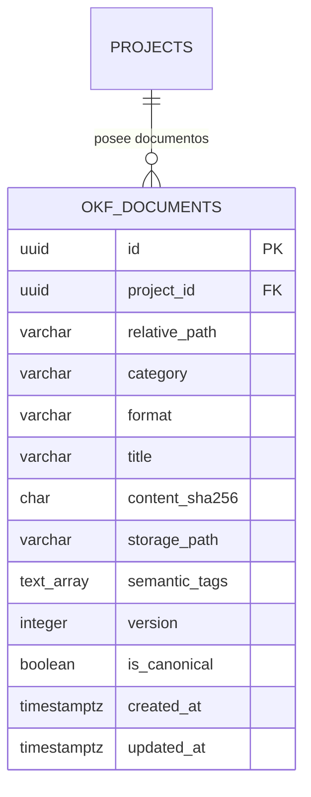
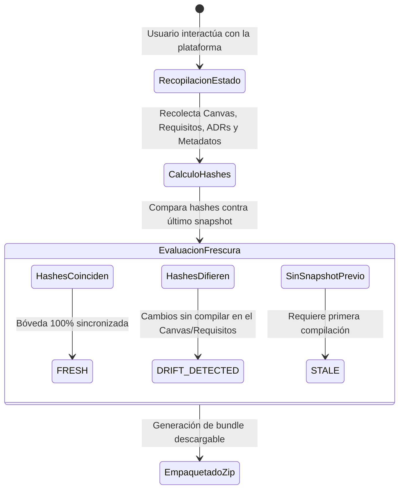

# Sprint 4 — Especificación Técnica de Compilación OKF, Vault Freshness Engine y Exportaciones Granulares

**Proyecto:** DevSculptor Core Engine  
**Versión:** 1.0.0 (Sprint 4 — Etapa A)  
**Autor:** Nathaniel Muller San Martin  
**Estado:** IMPLEMENTADO Y VERIFICADO EN `develop`  
**Patrón Arquitectónico:** Open Knowledge Framework (OKF) Compiler + Reactive Freshness Tracker + Client-Side Dynamic Bundle Assembler  

---

## 1. Resumen Ejecutivo y Alcance

El **Motor de Compilación OKF (Open Knowledge Framework) y Bóveda de Documentación Viva** constituye el puente definitivo entre el diseño arquitectónico conceptual y los artefactos de software listos para producción. Transforma el estado dinámico del proyecto (requisitos IEEE-830, entidades relacionales en 3FN, actas de decisión arquitectónica ADRs y metadatos de gobernanza) en un árbol documental estandarizado, auditable y determinista.

### Principios Rectores:
1. **Determinismo Criptográfico (SHA-256 State Hashing):** Cada documento generado incorpora una firma hash SHA-256 calculada a partir de los datos fuente. Cualquier modificación en los diagramas ERD, requerimientos o ADRs altera el hash, permitiendo una detección inmediata de desincronización arquitectónica (*drift*).
2. **Estructura Estándar OKF:** El árbol generado sigue los lineamientos de la industria para documentación técnica como código (Doc-as-Code), estructurado en carpetas semánticas (`architecture/`, `requirements/`, `database/`, `governance/`).
3. **Multi-Motor DDL Nativo:** Generación determinista de scripts SQL para 4 motores relacionales líderes (PostgreSQL 15+, MySQL 8.0+, SQLite 3 y Oracle 21c), aplicando validaciones de tipos, claves foráneas `1:1` con restricciones `UNIQUE` y prevención de colisiones en columnas de auditoría.
4. **Exportaciones Granulares e Instantáneas:** Capacidad de descargar cualquier artefacto individualmente desde su vista de trabajo o empaquetar la totalidad del proyecto en un bundle `.zip` autocontenido.

---

## 2. Arquitectura de Persistencia: Bóveda OKF y Migración 005

Se diseñó y aplicó la migración `005_okf_vault_and_storage.sql` en PostgreSQL (Supabase Cloud), articulando el almacenamiento de metadatos con el bucket privado de objetos:



### Características Técnicas de la Migración:
1. **Aislamiento Multi-Tenant por RLS:**
   - La tabla `okf_documents` está blindada con Row Level Security. Las políticas de acceso `SELECT`, `INSERT`, `UPDATE` y `DELETE` verifican que `project_id` pertenezca al usuario autenticado (`projects.user_id = auth.uid()`).
2. **Bucket de Almacenamiento Supabase (`okf-vault`):**
   - Configuración de un bucket privado con políticas que condicionan la subida y lectura de archivos a la carpeta raíz del usuario: `(storage.foldername(name))[1] = auth.uid()::text`.
3. **Índices de Búsqueda Rápida:**
   - `idx_okf_documents_project_id`: Acceso directo por proyecto.
   - `idx_okf_documents_lookup`: Búsqueda compuesta por `(project_id, relative_path)`.
   - `idx_okf_documents_category`: Filtrado por categorías documentales.

---

## 3. Procesador Determinista de Documentos (`okfDocumentProcessor.ts`)

El módulo `okfDocumentProcessor` encapsula la lógica de compilación en memoria del árbol OKF completo a partir del estado de la aplicación:

### Árbol de Artefactos Producidos:

| Ruta Relativa | Formato | Estándar / Protocolo | Contenido Técnico |
| :--- | :---: | :---: | :--- |
| `README.md` | Markdown | Doc-as-Code | Resumen ejecutivo, stack tecnológico, arquitecto líder, estadísticas de diseño y guía de lectura. |
| `architecture/system-overview.md` | Markdown | C4 Model / Clean Arch | Visión general del sistema, estilo arquitectónico seleccionado, bounded contexts y diagrama Mermaid. |
| `architecture/adrs/ADR-XXX-[slug].md` | Markdown | Nygard ADR Standard | Registro de Decisiones de Arquitectura con Frontmatter YAML, contexto, decisión, consecuencias y estado. |
| `requirements/srs-specification.md` | Markdown | IEEE 830 | Especificación de Requerimientos de Software completa con categorización RF, RNF y reglas de negocio. |
| `requirements/matrix.md` | Markdown | MoSCoW Traceability | Matriz de trazabilidad cruzada de requisitos, dependencias funcionales y criticidad. |
| `database/schema-[dialect].sql` | SQL | ANSI SQL / Motor Nativo | Esquema DDL completo y normalizado en 3FN con claves primarias, foráneas, índices y triggers. |
| `database/data-dictionary.md` | Markdown | Data Governance | Diccionario de datos exhaustivo: nombres de tablas, columnas, tipos de datos, nulabilidad y descripciones. |
| `database/erd-entities.json` | JSON | Interchange Schema | Estructura JSON determinista de todas las entidades, columnas y relaciones para herramientas externas. |
| `governance/compliance-audit.md` | Markdown | ISO/IEC 25010 / Gartner | Auditoría de gobernanza: matriz de evaluación arquitectónica y validación Human-in-the-Loop. |

### Inyección de Frontmatter YAML y Hash Criptográfico:
Cada archivo generado en Markdown inicia con metadatos estructurados:
```yaml
---
title: "ADR-001: Implementación de Monolito Modular"
category: "architecture"
version: 1
generated_at: "2026-09-18T18:15:00.000Z"
state_hash: "a3b8c9d0e1f2..."
semantic_tags: ["architecture", "adr", "modular-monolith", "accepted"]
---
```

---

## 4. Motor de Frescura en Tiempo Real (`okfVaultService.ts`)

El servicio `okfVaultService` implementa una máquina de estados para supervisar la sincronización entre el modelo visual y los artefactos exportables:



### Estados de Frescura Soportados:
- **`FRESH` (Vigente y Sincronizado):** Los documentos en memoria coinciden exactamente con el estado actual de las entidades y requerimientos.
- **`DRIFT_DETECTED` (Desviación Arquitectónica):** Se detectó que una entidad fue movida, un campo fue renombrado o se añadió un nuevo requisito sin actualizar la compilación formal.
- **`STALE` (Desactualizado / Inicial):** El proyecto aún no cuenta con una compilación previa almacenada.

---

## 5. Experiencia de Usuario: Explorador OKF y Exportaciones Granulares

### 5.1. Modal de Exportación Avanzado (`OkfExportModal.tsx`)
- **Visor Jerárquico en Árbol (`OkfTreeView`):** Agrupa los artefactos por módulos con iconos de estado e indicadores de tamaño en bytes.
- **Previsualizador Monoespaciado en Vivo:** Panel lateral con soporte para Markdown y SQL con numeración de líneas y resaltado sintáctico.
- **Selector Reactivo de Dialectos SQL:** Permite alternar al vuelo entre `PostgreSQL`, `MySQL`, `SQLite` y `Oracle`, actualizando instantáneamente la previsualización del script DDL y el diccionario de datos.
- **Descarga Granular:** Posibilidad de copiar al portapapeles o descargar cualquier archivo individual con 1 clic.
- **Compilador ZIP Integrado:** Generación del archivo `.zip` completo estructurado en memoria y entregado directamente al navegador del usuario.

### 5.2. Botones de Exportación Granular en Vistas Clave
Para acelerar el flujo de trabajo del arquitecto, se dispusieron botones directos sin necesidad de ingresar al modal maestro:
- **Canvas ERD (`CanvasView.tsx`):** Botón *"Descargar DDL (.sql)"* que genera el script para el dialecto activo.
- **Módulo de Requisitos (`RequirementsView.tsx`):** Botón *"Exportar SRS (.md)"* que descarga la especificación de requerimientos en formato IEEE-830.
- **Módulo de Decisiones (`DecisionsView.tsx`):** Botón *"Exportar ADRs (.md)"* que genera el compendio consolidado de decisiones.
- **Modal de Visión Ampliada (`VisionModal.tsx`):** Ajuste de anchos dinámicos (`2xl`, `3xl`, `4xl`) para la lectura confortable de diagramas y documentos extensos.

---

## 6. Blindaje de Red y Conectividad CORS (`app.ts`)

Para permitir el desarrollo y pruebas dinámicas sobre dispositivos externos (tablets, teléfonos móviles y conexiones remotas seguras vía Tailscale), se perfeccionó la política de CORS en `devsculptor-backend/src/app.ts`:

```typescript
(env.NODE_ENV === 'development' &&
  /^http:\/\/(localhost|127\.0\.0\.1|192\.168\.\d+\.\d+|10\.\d+\.\d+\.\d+|100\.\d+\.\d+\.\d+|172\.(1[6-9]|2\d|3[0-1])\.\d+\.\d+)(:\d+)?$/.test(origin))
```

Esta regla habilita de manera segura los siguientes rangos privados exclusivamente en entorno de desarrollo:
- **Loopback Local:** `localhost`, `127.0.0.1`
- **Redes Locales Clase C:** `192.168.0.0/16`
- **Redes Locales Clase A:** `10.0.0.0/8`
- **Redes Locales Clase B:** `172.16.0.0/12`
- **Redes Privadas Seguras Tailscale:** `100.64.0.0/10` (CGNAT)

---

## 7. Verificación Técnica y Calidad de Código

| Componente Evaluado | Comando de Validación | Resultado |
| :--- | :--- | :---: |
| **Backend TypeScript Build** | `npm run build` en `devsculptor-backend` | **0 errores** (compilación limpia con `tsc && tsc-alias`) |
| **Frontend Vite Build** | `npm run build` en `devsculptor-frontend` | **0 errores** (compilación limpia con `tsc -b && vite build`) |
| **Migración Supabase** | `npm run migrate` en `devsculptor-backend` | **Exitosa** (001 a 005 aplicadas sin inconsistencias) |
| **Determinismo Hash** | Generación de SHA-256 en navegador | **Validado** (mismo contenido genera idéntico digest) |
