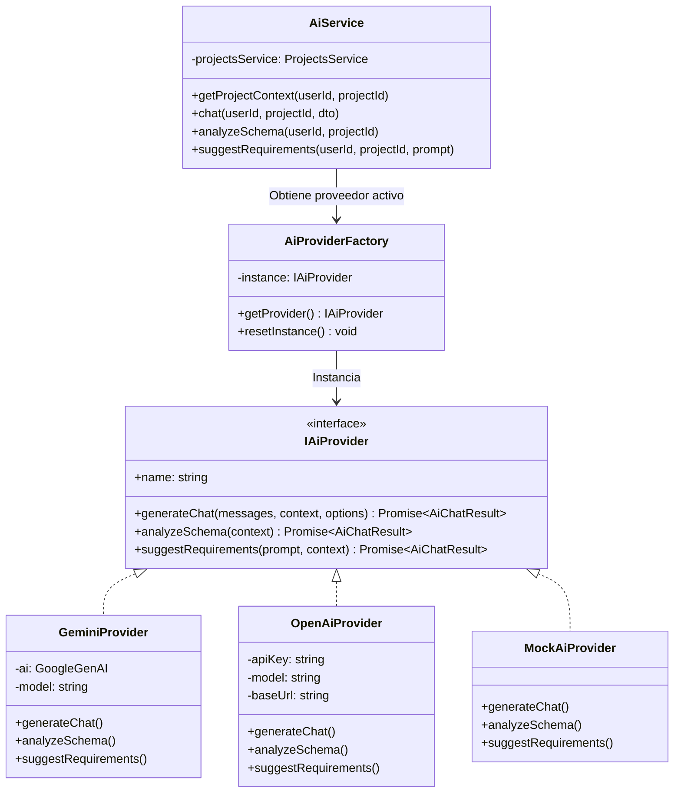

# Sprint 3 — Especificación Técnica del Motor de Consultoría IA y Copiloto de Arquitectura

**Proyecto:** DevSculptor Core Backend  
**Versión:** 1.0.0 (Sprint 3 — Épica B)  
**Autor:** Nathaniel Muller San Martin  
**Estado:** IMPLEMENTADO Y VERIFICADO EN `develop`  
**Patrón Arquitectónico:** Monolito Modular Layered MVC + Strategy/Adapter Pattern para Proveedores de IA  

---

## 1. Resumen Ejecutivo y Alcance

El **Motor de Consultoría IA y Copiloto de Arquitectura en Tiempo Real** dota a DevSculptor de un asistente inteligente de nivel Principal Software Architect. El motor no opera como un chatbot genérico desconectado; en su lugar, inspecciona dinámicamente el estado vivo de la base de datos relacional del proyecto (requisitos IEEE-830, entidades y columnas del canvas relacional, y actas de decisión arquitectónica ADRs) antes de generar cualquier recomendación técnica.

### Principios Rectores:
1. **Aislamiento Estricto de Claves (Zero-Trust):** Ninguna API key (Google Gemini, OpenAI, etc.) se expone jamás al cliente frontend, al navegador o al repositorio Git. Todas las credenciales residen exclusivamente en el entorno backend (`.env`), con validación estricta en tiempo de arranque mediante Zod.
2. **Arquitectura Agnóstica de Proveedor (Strategy / Adapter Pattern):** Desacople total entre la capa de negocio y los SDKs de modelos fundacionales. Soporta `GeminiProvider` (SDK oficial `@google/genai`), `OpenAiProvider` (compatible con OpenAI y DeepSeek), y `MockAiProvider`.
3. **Resiliencia y Modo Offline/Heurístico:** Si no se suministra una `GEMINI_API_KEY` en el entorno de desarrollo, el sistema conmuta automáticamente a un simulador heurístico local (`MockAiProvider`) de alta fidelidad que analiza las tablas y requisitos reales sin lanzar excepciones ni detener el flujo.
4. **Bloques de Acción Estructurados (DevSculptor Action Blocks):** El motor puede sintetizar respuestas en prosa junto con bloques JSON normalizados (````json:devsculptor-actions````) capaces de inyectar entidades, requisitos y ADRs con 1 solo clic en el frontend.

---

## 2. Arquitectura de Proveedores (Strategy / Adapter Pattern)



### 2.1. Interfaz Común (`IAiProvider`)
Ubicación: `src/modules/ai/providers/ai-provider.interface.ts`
Define los contratos universales de entrada y salida:
- `AiProjectContext`: Nombre del proyecto, estilo arquitectónico, lista de requisitos existentes, entidades relacionales del canvas y decisiones ADR vigentes.
- `AiChatResult`: Texto enriquecido (`reply`), nombre del proveedor (`provider`), modelo empleado (`model`) y bloque opcional estructurado (`actions`).

### 2.2. Adaptador Google Gemini Oficial (`GeminiProvider`)
Ubicación: `src/modules/ai/providers/gemini.provider.ts`
- Utiliza la librería oficial unificada `@google/genai` (`GoogleGenAI`).
- Soporta configuración dinámica del modelo vía `GEMINI_MODEL` (por defecto `gemini-2.0-flash`, con compatibilidad para `gemini-1.5-pro` u otros modelos de vanguardia).
- Inyecta el System Instruction especializado (`SYSTEM_INSTRUCTION_ARCHITECT`) y el contexto vivo serializado en JSON.

### 2.3. Simulador Heurístico Local (`MockAiProvider`)
Ubicación: `src/modules/ai/providers/mock.provider.ts`
- Evalúa el contexto real del proyecto: detecta si existen tablas como `users`, `orders`, `payments`, etc.
- Evalúa la normalización relacional (3FN), claves primarias/foráneas y genera bloques de acción reales con códigos autoincrementales (`[RF-xx]`, `[RNF-xx]`, `[ADR-xxx]`).
- Permite desarrollo continuo sin cuotas de red ni consumo de tokens.

---

## 3. Ensamblado del Contexto Vivo y Multi-Tenancy (Pilar 7)

El servicio `AiService` (`src/modules/ai/ai.service.ts`) implementa el protocolo estricto de seguridad transversal:
1. **Verificación de Propiedad:** Valida que el `projectId` pertenezca al `userId` autenticado mediante `ProjectsService.findById(userId, projectId)`. Si el proyecto no existe o es de otro usuario, emite un error `404 Not Found` para evitar enumeración maliciosa.
2. **Consulta Parametrizada a PostgreSQL:**
   ```sql
   SELECT code, title, type, priority, description 
   FROM requirements 
   WHERE project_id = $1 
   ORDER BY created_at ASC;

   SELECT table_name, columns_json 
   FROM canvas_entities 
   WHERE project_id = $1 
   ORDER BY created_at ASC;

   SELECT code, title, status, context, decision 
   FROM architecture_decisions 
   WHERE project_id = $1 
   ORDER BY created_at ASC;
   ```
3. **Inyección en el Prompt:** El contexto resultante se añade al System Instruction o al bloque de contexto del LLM, garantizando que el modelo jamás alucine sobre la estructura del proyecto del usuario.

---

## 4. Catálogo de Endpoints REST

Todas las rutas están montadas en `/api/v1/projects/:projectId/ai` y protegidas por el middleware `authenticate` (JWT Bearer) y validación de schemas Zod.

### 4.1. `POST /api/v1/projects/:projectId/ai/chat`
- **Propósito:** Conversación interactiva con el arquitecto de software sobre el proyecto actual.
- **Payload:**
  ```json
  {
    "messages": [
      { "role": "user", "content": "Necesito diseñar una pasarela de pagos con Stripe" }
    ],
    "temperature": 0.3,
    "actionContext": "canvas-erd"
  }
  ```
- **Respuesta Exitosa (`200 OK`):**
  ```json
  {
    "success": true,
    "data": {
      "reply": "Para integrar Stripe de manera desacoplada bajo arquitectura hexagonal...",
      "provider": "gemini",
      "model": "gemini-2.0-flash",
      "actions": {
        "requirements": [
          { "code": "RF-PAY-01", "title": "Webhooks de Stripe idempotentes", "type": "RF", "priority": "HIGH" }
        ],
        "entities": [
          {
            "tableName": "payment_transactions",
            "columns": [
              { "name": "id", "type": "UUID", "isPrimary": true },
              { "name": "stripe_charge_id", "type": "VARCHAR(255)", "isUnique": true }
            ]
          }
        ],
        "decisions": [
          { "code": "ADR-004", "title": "Idempotencia en Procesamiento de Webhooks", "status": "ACCEPTED" }
        ]
      }
    }
  }
  ```

### 4.2. `POST /api/v1/projects/:projectId/ai/analyze-schema`
- **Propósito:** Auditoría relacional automatizada, detección de dependencias transitivas (violaciones 3FN), normalización y recomendaciones de indexación.
- **Payload:** `{}` (analiza automáticamente el canvas del proyecto).

### 4.3. `POST /api/v1/projects/:projectId/ai/suggest-requirements`
- **Propósito:** Generación guiada de requisitos funcionales (RF) y no funcionales (RNF) bajo estándar IEEE-830 a partir de una necesidad expresada en lenguaje natural.
- **Payload:**
  ```json
  {
    "prompt": "Sistema de reservas hoteleras con control de concurrencia optimista"
  }
  ```

---

## 5. Variables de Entorno y Configuración (`.env`)

```env
# ==============================================================================
# PROVEEDORES DE INTELIGENCIA ARTIFICIAL (IA COPILOT)
# ==============================================================================
# Proveedor activo: 'gemini' | 'openai' | 'deepseek' | 'mock'
AI_PROVIDER=gemini

# Google Gemini API (Oficial @google/genai)
# Obtén tu clave en: https://aistudio.google.com/
GEMINI_API_KEY=tu_api_key_de_gemini_aqui
GEMINI_MODEL=gemini-2.0-flash

# OpenAI API (Opcional - Provider Strategy)
OPENAI_API_KEY=
# DeepSeek API (Opcional - Provider Strategy)
DEEPSEEK_API_KEY=
```

---

## 6. Validación de Compilación y Calidad
- Backend compilado con `tsc && tsc-alias` sin advertencias ni errores (`Exit Code 0`).
- Strict typing en TypeScript con interfaces completas y sin uso de `any` descontrolado.
- Sanitización de logs vía Pino: las API keys y tokens nunca se imprimen en consola ni en registros de auditoría.
