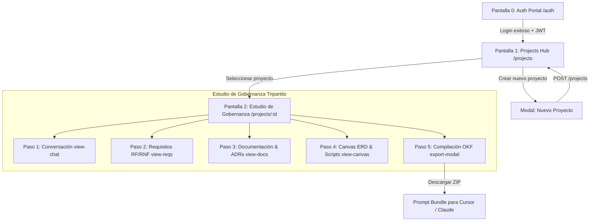

# DevSculptor Frontend — Convenciones de Arquitectura, UX/UI, Sistema de Diseño y Estructura de Pantallas

Este documento constituye el **estándar formal y definitivo** de arquitectura frontend, diseño visual, experiencia de usuario (UX/UI) y estructura canónica de pantallas para **DevSculptor**. 

Sintetiza la visión de producto (gobernanza técnica pre-código y mitigación del *"vibe coding"*), consolida la estética **Apple Glassmorphic & NotebookLM Studio System** validada empíricamente en el sandbox de prototipado, y establece los contratos que regirán la construcción de la aplicación web en producción (**React 18+ con Vite y TypeScript**), consumiendo la API REST construida y blindada en el **Sprint 1 (Backend Core)**.

---

## 📑 Tabla de Contenidos

1. [Estrategia Metodológica: El Prototipado como Gate de Validación](#1-estrategia-metodológica-el-prototipado-como-gate-de-validación)
2. [Stack Tecnológico Canónico del Frontend Real](#2-stack-tecnológico-canónico-del-frontend-real)
3. [Sistema de Diseño (Design System): Apple Glassmorphism & NotebookLM Studio](#3-sistema-de-diseño-design-system-apple-glassmorphism--notebooklm-studio)
   - 3.1. [Filosofía Visual y Lenguaje de Diseño](#31-filosofía-visual-y-lenguaje-de-diseño)
   - 3.2. [Paleta Dual de Tokens: Obsidian Depth & Apple macOS Snow](#32-paleta-dual-de-tokens-obsidian-depth--apple-macos-snow)
   - 3.3. [Capas Glassmórficas, Elevación y Desenfoque](#33-capas-glassmórficas-elevación-y-desenfoque)
   - 3.4. [Tipografía Canónica y Jerarquías](#34-tipografía-canónica-y-jerarquías)
   - 3.5. [Componentes Visuales de Firma (Pills, Apple Buttons, Badges)](#35-componentes-visuales-de-firma-pills-apple-buttons-badges)
4. [Estructura Canónica de Pantallas y Flujos de Navegación](#4-estructura-canónica-de-pantallas-y-flujos-de-navegación)
   - 4.1. [Mapa General de Navegación y Flujo del Usuario](#41-mapa-general-de-navegación-y-flujo-del-usuario)
   - 4.2. [Pantalla 0: Portal de Acceso y Autenticación (`/auth`)](#42-pantalla-0-portal-de-acceso-y-autenticación-auth)
   - 4.3. [Pantalla 1: Hub de Proyectos & Portafolio (`/projects`)](#43-pantalla-1-hub-de-proyectos--portafolio-projects)
   - 4.4. [Pantalla 2: Estudio de Gobernanza Tripartito NotebookLM (`/projects/:projectId`)](#44-pantalla-2-estudio-de-gobernanza-tripartito-notebooklm-projectsprojectid)
     - 4.4.1. [Barra Superior Integrada (Apple Glass TopBar)](#441-barra-superior-integrada-apple-glass-topbar)
     - 4.4.2. [Panel Izquierdo: Flujo Guiado en 5 Pasos (Navigation Pipeline)](#442-panel-izquierdo-flujo-guiado-en-5-pasos-navigation-pipeline)
     - 4.4.3. [Panel Central: Workspace / Studio de 4 Vistas Activas](#443-panel-central-workspace--studio-de-4-vistas-activas)
       - *Vista 1: Conversación Inicial & Entrevista de Alcance (`view-chat`)*
       - *Vista 2: Matriz de Requisitos RF y RNF (`view-reqs`)*
       - *Vista 3: Catálogo de Documentación & ADRs (`view-docs`)*
       - *Vista 4: Canvas ERD & Salidas de Scripts Multi-Lenguaje (`view-canvas`)*
     - 4.4.4. [Panel Derecho: Copiloto & Inspector de Contexto (Metrics & Sources)](#444-panel-derecho-copiloto--inspector-de-contexto-metrics--sources)
     - 4.4.5. [Modal de Compilación & Exportación OKF (`export-modal`)](#445-modal-de-compilación--exportación-okf-export-modal)
5. [Ergonomía y Arquitectura del Canvas Interactivo (ERD) & Salidas Multi-Lenguaje](#5-ergonomía-y-arquitectura-del-canvas-interactivo-erd--salidas-multi-lenguaje)
6. [Principios de UX/UI y Experiencia de Usuario](#6-principios-de-uxui-y-experiencia-de-usuario)
7. [Integración con el Backend Core (Sprint 1) & Mapeo Pantalla-API](#7-integración-con-el-backend-core-sprint-1--mapeo-pantalla-api)
8. [Estructura Canónica de Directorios del Frontend Real](#8-estructura-canónica-de-directorios-del-frontend-real)
9. [Matriz de Buenas Prácticas Frontend (Do's & Don'ts)](#9-matriz-de-buenas-prácticas-frontend-dos--donts)

---

## 1. Estrategia Metodológica: El Prototipado como Gate de Validación

Para proyectos de alta densidad técnica e interactiva como DevSculptor —que combina captura guiada de lenguaje natural, matrices jerárquicas de requerimientos, máquinas de estado para ADRs y un **Canvas Interactivo con generación automática de scripts DDL, TypeScript, JSON Schema y Python**— codificar componentes en React sin validación previa introduce riesgos críticos de acoplamiento y sobreingeniería de estado.

Por ello, el ciclo de vida del frontend se gobierna bajo un flujo estricto de dos fases en la rama `feat/frontend`:

```
┌────────────────────────────────┐       ┌────────────────────────────────┐       ┌────────────────────────────────┐
│   1. SANDBOX DE PROTOTIPADO    │       │     2. GATE DE VALIDACIÓN      │       │     3. CONSTRUCCIÓN REAL       │
│  - HTML5 Semántico             │ ────► │  - Ergonomía y fluidez 60 FPS  │ ────► │  - React 18+ con Vite          │
│  - Vanilla CSS3 (Glass Tokens) │       │  - Contraste WCAG 2.1 AA       │       │  - TypeScript Estricto         │
│  - ES6 Modules nativos         │       │  - Validación de 5 estados UI  │       │  - Zustand + React Flow        │
│  - Carpeta /Prototype          │       │  - Aprobación de Arquitectura  │       │  - devsculptor-frontend        │
└────────────────────────────────┘       └────────────────────────────────┘       └────────────────────────────────┘
```

### Reglas Inmutables de la Carpeta `/Prototype`
1. **Tecnologías Exclusivas**: Únicamente `.html`, `.css` y `.js` nativo.
2. **Cero Dependencias**: Prohibido el uso de `npm`, `package.json`, Vite, Webpack o Node.js dentro de `/Prototype`.
3. **Ejecución Instantánea**: Debe poder abrirse con *Live Server* o doble clic en cualquier navegador web moderno.
4. **Objetivo Exclusivo**: Experimentar layout, micro-interacciones, arrastre de nodos con transformaciones GPU, cálculo de conectores Bezier SVG, alternancia de temas y ergonomía general antes de abstraerlos a componentes de producción.

---

## 2. Stack Tecnológico Canónico del Frontend Real

Al culminar la validación en el prototipo, la aplicación de producción se implementará bajo el siguiente stack:

| Capa | Tecnología | Justificación Técnica |
| :--- | :--- | :--- |
| **Framework Base** | **React 18+** | Concurrencia, suspense para carga progresiva y soporte de nodos gráficos en árbol virtual. |
| **Build Tool** | **Vite** | Arranque ultrarrápido con ESM nativo, HMR sub-segundo y empaquetado optimizado mediante Rollup. |
| **Lenguaje** | **TypeScript (`strict: true`)** | Cero `any`. Tipado simétrico con los DTOs y tipos del backend (`User`, `Project`, `Requirement`, `ApiResponse<T>`). |
| **Sistema de Estilos** | **Vanilla CSS + Design Tokens** | Control nativo de `backdrop-filter`, animaciones GPU (`transform: translate3d`) y cero overhead de CSS-in-JS. |
| **Lienzo ERD** | **React Flow (@xyflow/react)** | Gestión determinista de nodos arrastrables, puertos magnéticos y aristas Bezier interactivas. |
| **Gestión de Estado** | **Zustand + Context API** | Context API para Auth y Tema; Zustand para el grafo del canvas ERD, nodos seleccionados y sincronización. |
| **Cliente HTTP** | **Axios Centralizado** | Interceptores para inyección JWT, propagación de `X-Request-Id` y desempaquetado del envelope estándar. |
| **Iconografía** | **Material Symbols Outlined + Lucide** | Iconos vectoriales limpios con alineación tipográfica perfecta y soporte de ligaduras. |

---

## 3. Sistema de Diseño (Design System): Apple Glassmorphism & NotebookLM Studio

### 3.1. Filosofía Visual y Lenguaje de Diseño
DevSculptor adopta una identidad visual **"Apple Glassmorphic & NotebookLM Studio"**:
- **Inspiración Apple macOS Snow & Glass:** Superficies translúcidas con desenfoque gaussiano profundo (`backdrop-filter: blur(30px)`), bordes sutiles con gradiente de luz (`1px solid rgba(255, 255, 255, 0.08)`), esquinas suavemente redondeadas (`border-radius: 14px` a `20px`), sombras de ventana flotante y botones táctiles.
- **Inspiración Google NotebookLM Studio:** Organización del espacio de trabajo en **3 paneles articulados** (Navegación de flujo a la izquierda, Workspace interactivo al centro e Inspector/Copiloto de fuentes a la derecha). Brinda una sensación de "estudio de arquitectura" donde el usuario nunca pierde el contexto de su proyecto.

### 3.2. Paleta Dual de Tokens: Obsidian Depth & Apple macOS Snow

El sistema cuenta con soporte de **Dual Theme nativo** conmutado mediante el atributo `.dark` o `.light` en `<html>` / `<body>`:

```css
/* ==========================================================================
   Design Tokens: Obsidian Depth (Dark) vs. Apple macOS Snow (Light)
   ========================================================================== */

:root {
  /* --- MODO OSCURO (Obsidian Depth — Por Defecto) --- */
  --bg-desktop: #07090e;                        /* Fondo base de pantalla */
  --bg-glass-base: rgba(13, 18, 30, 0.72);      /* Ventana principal */
  --bg-glass-card: rgba(22, 30, 49, 0.55);      /* Tarjetas internas */
  --bg-glass-elevated: rgba(30, 41, 67, 0.85);  /* Modales y flotantes */
  --bg-glass-hover: rgba(255, 255, 255, 0.06);
  --bg-glass-active: rgba(99, 102, 241, 0.18);
  --bg-code: #0b0f19;                           /* Bloques de código/terminal */

  --glass-blur-sm: blur(16px);
  --glass-blur-md: blur(30px) saturate(180%);
  --glass-blur-lg: blur(40px) saturate(200%);

  --border-glass: 1px solid rgba(255, 255, 255, 0.08);
  --border-glass-light: 1px solid rgba(255, 255, 255, 0.15);
  --border-glass-subtle: 1px solid rgba(255, 255, 255, 0.05);
  --border-glass-focus: 1px solid rgba(99, 102, 241, 0.55);

  --text-primary: #f8fafc;                      /* Títulos y datos críticos */
  --text-secondary: #94a3b8;                    /* Descripciones y subtítulos */
  --text-muted: #64748b;                        /* Metadatos y placeholders */
  --canvas-grid: rgba(255, 255, 255, 0.06);     /* Grilla de puntos del lienzo */

  --accent-indigo: #6366f1;                     /* Acción primaria, Focus */
  --accent-indigo-glow: rgba(99, 102, 241, 0.3);
  --accent-cyan: #38bdf8;                       /* Relaciones DDL, Documentos */
  --accent-emerald: #34d399;                    /* Éxito, RLS, Estado Activo */
  --accent-amber: #fbbf24;                      /* Advertencias, PKs, Requisitos */
  --accent-danger: #f87171;                     /* Destructivo, Rechazos */

  --shadow-window: 0 20px 48px -12px rgba(0, 0, 0, 0.75), 0 0 0 1px rgba(255, 255, 255, 0.08);
  --shadow-card: 0 8px 24px -6px rgba(0, 0, 0, 0.45);
  --shadow-dock: 0 10px 30px -5px rgba(0, 0, 0, 0.8), 0 0 0 1px rgba(255, 255, 255, 0.1);

  --font-ui: 'Inter', -apple-system, BlinkMacSystemFont, 'SF Pro Text', 'Segoe UI', sans-serif;
  --font-mono: 'JetBrains Mono', 'Fira Code', monospace;

  --radius-window: 20px;
  --radius-card: 14px;
  --radius-pill: 9999px;
}

/* --- MODO CLARO (Apple macOS Snow Style) --- */
html.light, body.light {
  --bg-desktop: #f2f2f6;
  --bg-glass-base: rgba(255, 255, 255, 0.82);
  --bg-glass-card: rgba(255, 255, 255, 0.65);
  --bg-glass-elevated: rgba(255, 255, 255, 0.95);
  --bg-glass-hover: rgba(0, 0, 0, 0.04);
  --bg-glass-active: rgba(79, 70, 229, 0.10);
  --bg-code: #f8fafc;

  --border-glass: 1px solid rgba(0, 0, 0, 0.08);
  --border-glass-light: 1px solid rgba(0, 0, 0, 0.14);
  --border-glass-subtle: 1px solid rgba(0, 0, 0, 0.05);
  --border-glass-focus: 1px solid rgba(79, 70, 229, 0.6);

  --text-primary: #1d1d1f;
  --text-secondary: #515154;
  --text-muted: #86868b;
  --canvas-grid: rgba(0, 0, 0, 0.06);

  --accent-indigo: #4f46e5;
  --accent-indigo-glow: rgba(79, 70, 229, 0.2);
  --accent-cyan: #0284c7;
  --accent-emerald: #059669;
  --accent-amber: #d97706;
  --accent-danger: #dc2626;

  --shadow-window: 0 16px 36px -8px rgba(0, 0, 0, 0.1), 0 0 0 1px rgba(0, 0, 0, 0.06);
  --shadow-card: 0 6px 16px -3px rgba(0, 0, 0, 0.06);
  --shadow-dock: 0 8px 24px -4px rgba(0, 0, 0, 0.12), 0 0 0 1px rgba(0, 0, 0, 0.06);
}
```

### 3.3. Capas Glassmórficas, Elevación y Desenfoque
1. **`glass-window`**: Superficie de panel principal (Nav lateral, Workspace, Copiloto). `background: var(--bg-glass-base); backdrop-filter: var(--glass-blur-md); border: var(--border-glass); border-radius: var(--radius-window); box-shadow: var(--shadow-window);`.
2. **`glass-card`**: Bloque interactivo de contenido (requisito, ADR, nodo ERD). `background: var(--bg-glass-card); backdrop-filter: var(--glass-blur-sm); border: var(--border-glass-subtle); border-radius: var(--radius-card); transition: all 0.2s cubic-bezier(0.16, 1, 0.3, 1);`.
3. **`glass-elevated`**: Modales, menús contextuales y docks flotantes de zoom.

### 3.4. Tipografía Canónica y Jerarquías
- **Fuente de Interfaz (`--font-ui`)**: `Inter`, con soporte de pesos 300, 400, 500, 600, 700.
- **Fuente Monoespaciada (`--font-mono`)**: `JetBrains Mono`, con soporte de ligaduras para identificadores de código, tipos SQL, códigos `RF-01`, `RNF-01`, `ADR-01` y salidas de compilación.

### 3.5. Componentes Visuales de Firma
- **Apple Buttons (`.apple-btn`)**: Botones con esquinas `10px` a `pill`, elevación sutil, `:active` con `transform: scale(0.98)` y versión primaria índigo (`.apple-btn-primary`).
- **Pills de Estado (`.pill-tag`)**: Indicadores compactos tipo badge redondeado (`font-size: 8.5px` a `10px`, `font-family: var(--font-mono)`, `font-weight: 600`):
  - `.pill-indigo`: Contexto general y fases (`Gobernanza Pre-Código`).
  - `.pill-cyan`: Documentos, contratos y RNF (`VERIFICADO`).
  - `.pill-emerald`: Éxito, persistencia cloud (`Supabase RLS`, `APROBADA`).
  - `.pill-amber`: Requisitos funcionales y prioridades (`RF-01`, `ALTA`).
  - `.pill-danger`: Decisiones rechazadas o alertas destructivas.
- **Theme Toggle (Luna/Sol)**: Botón circular con icono Material Symbols `dark_mode` / `light_mode` que conmuta instantáneamente las variables CSS sin recargar.

---

## 4. Estructura Canónica de Pantallas y Flujos de Navegación

### 4.1. Mapa General de Navegación y Flujo del Usuario

El flujo de la aplicación se divide en 3 pantallas de nivel superior organizadas jerárquicamente:



---

### 4.2. Pantalla 0: Portal de Acceso y Autenticación (`/auth`)

* **Rutas URL**: `/login`, `/register`.
* **Propósito**: Entrada segura al sistema mediante credenciales validadas con bcrypt y JWT.
* **Layout**: Centrado absoluto (`AuthLayout`), fondo `var(--bg-desktop)` con sutil orbe de gradiente radial índigo en el fondo.
* **Componentes Principales**:
  - `AuthCard` (`glass-window` de 380px de ancho con sombra profunda).
  - Encabezado de marca con isotipo pulsante y título "DevSculptor".
  - Selector de Sol/Luna en la esquina superior derecha del card.
  - Pestañas conmutables "Iniciar Sesión" y "Crear Cuenta".
  - Formulario reactivo con campos validados en tiempo real con Zod:
    - Registro: `full_name` (min 2), `email` (RFC format), `password` (min 8 chars).
    - Login: `email`, `password`.
  - Botón primario con feedback de carga (`.apple-btn-primary`).
  - Mensajes de error tipados mediante el envelope de la API (`401 Credenciales inválidas`, `409 Email ya registrado`).
* **Comportamiento & Persistencia**:
  - Al recibir respuesta 200/201: Almacena `token` en `localStorage.getItem('devsculptor_token')` y perfil en el store global.
  - Redirección automática inmediata hacia `/projects`.

---

### 4.3. Pantalla 1: Hub de Proyectos & Portafolio (`/projects`)

* **Rutas URL**: `/projects`.
* **Propósito**: Gestión del portafolio personal de proyectos del usuario (aislamiento horizontal garantizado por backend).
* **Layout**: `DashboardLayout` con barra superior Apple Glass y contenedor centrado maximizado (`max-w-6xl mx-auto p-6`).
* **Componentes Principales**:
  1. **Barra Superior**:
     - Logo y nombre de la plataforma.
     - Buscador reactivo de proyectos con debounce.
     - Botón flotante `+ Nuevo Proyecto`.
     - Toggle de tema Sol/Luna.
     - Menú de perfil de usuario (`full_name`, `email`, botón *Cerrar Sesión*).
  2. **Banner de Métricas de Portafolio**:
     - Resumen general: Total de Proyectos, Índice de Madurez Promedio (obtenido de los SPs), Total de ADRs aprobados.
  3. **Grid de Proyectos (`ProjectGrid`)**:
     - Tarjetas en grid responsivo (1 a 3 columnas) con clase `glass-card`.
     - Cada tarjeta (`ProjectCard`) exhibe:
       - Nombre del proyecto (`name`).
       - Badge de estilo arquitectónico (`architecture_style`, ej. *Monolito Modular*, *Microservicios*).
       - Descripción truncada.
       - Barra de progreso del **Maturity Index** (0% a 100% calculado por el SP de PostgreSQL).
       - Conteo rápido de requisitos asociados (`RF` y `RNF`) y tablas en Canvas.
       - Fecha de última modificación (`updated_at` formateado).
       - Menú contextual `[⋮]`: Editar metadatos, Eliminar proyecto (con modal destructivo).
  4. **Modal "Crear Nuevo Proyecto" (`CreateProjectModal`)**:
     - Campos: `name` (requerido), `description` (opcional), `architecture_style` (selector).
     - Validación Zod: Unicidad de nombre por usuario antes de enviar.
     - Envío `POST /api/v1/projects` y apertura directa del workspace creado.
  5. **Estados UI**:
     - *Loading*: 6 skeletons de tarjetas con efecto shimmer.
     - *Empty State*: Ilustración sutil de planos de arquitectura, título *"No tienes proyectos activos"*, y CTA *"Comenzar nuevo diseño"*.

---

### 4.4. Pantalla 2: Estudio de Gobernanza Tripartito NotebookLM (`/projects/:projectId`)

Es la pantalla central de DevSculptor. Su disposición replica el layout de **3 paneles fluidos** sin barras de scroll generales en la ventana:

```
┌──────────────────────────────────────────────────────────────────────────────────────────────────┐
│  [●] DevSculptor | Proyecto: Core MVP  ──  Fase Pre-Código  ──  [● Supabase RLS] [☼/☽] [Avatar]  │ ◄─ TopBar
├───────────────────┬──────────────────────────────────────────────────────┬───────────────────────┤
│ 1. INICIO         │                                                      │  COPILOTO & FUENTES   │
│    Conversación   │  [ ESPACIO DE TRABAJO DINÁMICO / WORKSPACE STUDIO ]  │  - Integridad 3FN 100%│
│                   │                                                      │  - Seguridad RLS 6/6  │
│ 2. REQUISITOS     │  Conmuta de forma reactiva entre:                    │  - Maturity Index: 100│
│    RF / RNF (5)   │  1. view-chat   (Entrevista y captura con IA)        │                       │
│                   │  2. view-reqs   (Matriz estructurada de requisitos)  │  Consultas rápidas:   │
│ 3. DOCUMENTACIÓN  │  3. view-docs   (Actas ADRs y especificaciones)      │  - Validar RF con DDL │
│    ADRs (4)       │  4. view-canvas (Lienzo ERD + Scripts SQL/TS/JSON/Py)│  - Auditar Triggers   │
│                   │                                                      │  - Preparar OKF       │
│ 4. MODELADOR      │                                                      │                       │
│    Canvas & DDL   │                                                      │  Fase Pre-Código:     │
│ ───────────────── │                                                      │  Validado sin deuda   │
│ [ Compilar OKF ]  │                                                      │                       │
└───────────────────┴──────────────────────────────────────────────────────┴───────────────────────┘
  PANEL IZQ (260px)                  PANEL CENTRAL (Flex-1)                   PANEL DER (270px)
```

---

#### 4.4.1. Barra Superior Integrada (Apple Glass TopBar)
- Altura fija `h-11`, píldora flotante con `!rounded-full`, margen superior y separación de paneles.
- **Izquierda**: Isotipo índigo pulsante, marca DevSculptor, divisor vertical y nombre del proyecto activo con enlace de retorno al Hub (`/projects`).
- **Centro**: Badge de fase metodológica (`pill-indigo: Gobernanza Pre-Código`) y versión de compilación.
- **Derecha**:
  - Telemetría de base de datos (`pill-emerald: Supabase RLS Conectado`).
  - Botón selector Sol/Luna (`#theme-toggle`).
  - Avatar del usuario autenticado con iniciales.

---

#### 4.4.2. Panel Izquierdo: Flujo Guiado en 5 Pasos (Navigation Pipeline)
- Ancho rígido `260px`, superficie `glass-window`, sin scroll exterior.
- Encabezado con título `FLUJO DE TRABAJO` y badge `5 PASOS`.
- Contenedor de botones de paso (`.nav-step`), cada uno con icono temático, título en negrita, subtítulo explicativo y badge contador:
  - **Paso 1: Inicio (`view-chat`)**: Icono `chat_bubble`, *"Conversación — Captura de idea y alcance"*.
  - **Paso 2: Requisitos (`view-reqs`)**: Icono `checklist`, *"Requisitos RF/RNF"*, badge ámbar con conteo dinámico.
  - **Paso 3: Documentación (`view-docs`)**: Icono `description`, *"Documentos & ADRs"*, badge cyan con total de actas.
  - **Paso 4: Modelador & Código (`view-canvas`)**: Icono `schema`, *"Canvas & Scripts — SQL, TypeScript, JSON, Py"*.
- **Paso 5: Botón Inferior Anclado**: Botón full-width índigo destacado con icono `folder_zip` *"Compilar & Exportar"* que abre el modal OKF.

---

#### 4.4.3. Panel Central: Workspace / Studio de 4 Vistas Activas

##### Vista 1: Conversación Inicial & Entrevista de Alcance (`view-chat`)
- **Propósito**: Dialogar en lenguaje natural con el *Arquitecto DevSculptor (IA)* para vaciar ideas de software, descubrir reglas de negocio implícitas y extraer automáticamente artefactos estructurados.
- **Header**: Título "Conversación Inicial", descripción de alcance y badge de estado `EN CURSO`.
- **Stream de Mensajes**:
  - Mensajes del Asistente (`chat-bubble-assistant`): fondo translúcido, borde suave, con extracción destacada de requisitos detectados y tablas sugeridas.
  - Mensajes del Usuario (`chat-bubble-user`): burbuja índigo alineada a la derecha.
- **Chips de Sugerencia Rápida (Floating Chips)**:
  - Píldoras con prompts rápidos con un solo clic: `+ Añadir tabla audit_logs`, `+ RNF Latencia < 500ms`, `🔍 Validar 3FN`.
- **Input de Entrada Flotante**:
  - Campo estilo Apple Input (`apple-input`) con botón circular de envío y atajo `Enter`.

##### Vista 2: Matriz de Requisitos RF y RNF (`view-reqs`)
- **Propósito**: Gestionar la lista formal de requisitos de ingeniería según el estándar IEEE-830.
- **Header**: Título "Requisitos Recopilados", contador y botón `+ Nuevo Requisito`.
- **Listado de Requisitos**:
  - Tarjetas interactivas con layout horizontal (`glass-card`):
    - Código en tipografía monoespaciada: `RF-01`, `RNF-02` (validado bajo regex `/^(RF|RNF)-\d{2,3}$/`).
    - Pill de tipo: `RF` (Ámbar) o `RNF` (Cyan).
    - Pill de prioridad: `ALTA`, `MEDIA`, `LOW`.
    - Título y descripción detallada del requerimiento.
    - Entidad relacionada del Canvas (ej. tabla `users`, `projects`).
    - Botones de acción rápida: Editar (abre drawer) y Eliminar.
- **Drawer Lateral de Requisito (`RequirementDrawer`)**:
  - Edición con autoguardado (debounce 800ms) y sincronización contra `PUT /api/v1/projects/:projectId/requirements/:id`.

##### Vista 3: Catálogo de Documentación & ADRs (`view-docs`)
- **Propósito**: Formalizar y consultar las actas de decisión arquitectónica (Architecture Decision Records) mitigando la pérdida de contexto histórico.
- **Header**: Título "Documentos Generados", subtítulo explicativo y botón `+ Nueva Acta`.
- **Visualizador de ADRs**:
  - Tarjetas de decisión técnica (`doc-card`) que exhiben:
    - Identificador: `ADR-01`, `ADR-02`.
    - Badge de Máquina de Estados:
      - `PROPOSED`: Ámbar translúcido (decisión en evaluación).
      - `ACCEPTED`: Esmeralda translúcido (decisión ratificada e inmutable).
      - `REJECTED`: Rojo translúcido (decisión descartada con justificación).
    - Título del dilema arquitectónico (ej. *Monolito Modular vs Microservicios*, *pg.Pool nativo vs ORMs*).
    - Resumen del contexto, decisión tomada y consecuencias.
  - Controles de Transición de Estado:
    - Botones para "Aceptar Decisión" o "Rechazar Decisión" que ejecutan `PATCH /api/v1/projects/:projectId/decisions/:id/status`.
    - Cumplimiento estricto de inmutabilidad: si el ADR ya fue aceptado o rechazado, el estado se bloquea en la interfaz.
  - Especificaciones Complementarias: Tarjeta especial `SPEC-01: Contrato API REST OpenAPI 3.1`.

##### Vista 4: Canvas ERD & Salidas de Scripts Multi-Lenguaje (`view-canvas`)
- **Propósito**: Diseñar visualmente la base de datos relacional y generar en tiempo real código estandarizado listo para producción.
- **Barra de Sub-pestañas de Formato**:
  - Selector conmutador:
    - `[schema] Lienzo Gráfico` (Lienzo interactivo ERD).
    - `[database] PostgreSQL DDL` (Script SQL normalizado).
    - `[code] TypeScript DTOs` (Schemas Zod y tipos `z.infer`).
    - `[data_object] JSON Schema` (Especificación JSON Schema v7).
    - `[terminal] Python Pydantic` (Modelos Pydantic v2).
  - Botón de utilidad: `[content_copy] Copiar Código` con toast de confirmación.
- **Área 1: Lienzo Gráfico ERD (`#canvas-visual-area`)**:
  - Fondo infinito con grilla de puntos (`canvas-dot-grid`).
  - Nodos de tabla arrastrables (`.erd-node`):
    - Encabezado con icono de tabla, nombre en negrita monoespaciada y badge (`RLS`, `FK`).
    - Filas de atributos con indicación de Clave Primaria (`🔑 id UUID PK` en dorado), Clave Foránea (`🔗 user_id FK → users` en cyan) y campos regulares (`VARCHAR`, `TIMESTAMPTZ`).
  - Conectores SVG Bezier interactivos trazados automáticamente entre los puertos de las tablas relacionadas.
  - Dock Flotante de Zoom en la base: botones `[-]`, indicador porcentual `100%` y `[+]`.
  - Pestaña de Auditoría de Canvas: Lista desplegable conectada a `GET /api/v1/projects/:projectId/audit-logs` que visualiza las inserciones y mutaciones atómicas registradas por el trigger de PostgreSQL (`INSERT`, `UPDATE`, `DELETE`, `payload_before`, `payload_after`).
- **Área 2: Salida de Scripts Formateados (`#canvas-code-area`)**:
  - Bloque con fondo de terminal (`--bg-code`), resaltado sintáctico y opción de copia directa.

---

#### 4.4.4. Panel Derecho: Copiloto & Inspector de Contexto (Metrics & Sources)
- Ancho rígido `270px`, superficie `glass-window`, sin scroll exterior.
- **Encabezado**: Título "Copiloto" con indicador cyan pulsante y badge `ACTIVO`.
- **Métricas de Motor en Vivo**:
  - Tarjetas de telemetría conectadas al Stored Procedure `sp_calculate_project_metrics`:
    - `INTEGRIDAD: 100%` (3FN Normalizado).
    - `SEGURIDAD: 6/6` (Políticas RLS activas en Supabase).
    - `MATURITY INDEX`: Índice compuesto de madurez técnica (0 a 100 puntos).
- **Consultas Contextuales Sugeridas (`copilot-chip`)**:
  - Botones con acciones heurísticas inmediatas:
    - `🔍 Validar RF-01 con DDL`: Analiza si los requisitos funcionales están soportados por columnas de la base de datos.
    - `🛡️ Auditar triggers RLS`: Verifica la coherencia de seguridad y el parámetro `search_path`.
    - `📦 Preparar paquete LLM`: Sintetiza el estado para exportación.
- **Certificación de Estado Metodológico**:
  - Tarjeta inferior esmeralda: *"Fase Pre-Código — Diseño validado sin deuda técnica. Listo para exportar hacia Cursor o Claude"*.

---

#### 4.4.5. Modal de Compilación & Exportación OKF (`export-modal`)
- **Propósito**: Empaquetar todo el proyecto en un archivo comprimido (.zip) con la estructura documental determinista OKF (*Optimal Knowledge Format*), diseñado específicamente para ser consumido por agentes de IA externos (Cursor, Claude, NotebookLM) sin saturar su ventana de contexto.
- **Disparador**: Botón "Compilar & Exportar" del panel de flujo o chip del copiloto.
- **Layout**: Modal flotante centrado sobre backdrop desenfocado (`bg-black/60 backdrop-blur-sm`).
- **Opciones de Compilación**:
  - Checkboxes seleccionables por carpetas de contexto:
    - `[x] /skills/`: Manual `devsculptor-architect` y reglas metodológicas de conducta.
    - `[x] /database/`: Esquemas PostgreSQL DDL, Triggers, SPs y políticas RLS.
    - `[x] /documentation/`: Requisitos RF/RNF, actas ADRs y contratos de API.
- **Proceso de Compilación**:
  - Barra de estado animada *"Empaquetando artefactos en ZIP..."*.
  - Generación en cliente/servidor del paquete comprimido y descarga automática del archivo `DevSculptor_{projectName}_OKF_Bundle.zip`.

---

## 5. Ergonomía y Arquitectura del Canvas Interactivo (ERD) & Salidas Multi-Lenguaje

### 5.1. Mecánicas de Navegación y Rendimiento
- **Navegación Fluida**:
  - Pan mediante arrastre con botón central del ratón o `Espacio + Clic Izquierdo`.
  - Zoom mediante rueda del ratón (`0.25x` a `2.0x`) con transformaciones CSS basadas en GPU (`transform: translate3d(...) scale(...)`).
- **Conectores Bezier Dinámicos**:
  - Las curvas SVG entre nodos se recalculan en tiempo real dentro del ciclo de renderizado `requestAnimationFrame`, garantizando una tasa de refresco constante de 60 cuadros por segundo sin bloqueo del hilo principal.
- **Sincronización Transaccional de Posición**:
  - Las coordenadas `position_x` y `position_y` de cada nodo de tabla se persisten mediante debouncing (800ms) invocando `PUT /api/v1/projects/:projectId/canvas/:canvasId`.

---

## 6. Principios de UX/UI y Experiencia de Usuario

1. **La Regla Inquebrantable de los 5 Estados de Interfaz**:
   - `Idle`: Controles listos con micro-animación en hover.
   - `Loading`: Skeletons animados que replican la estructura geométrica final.
   - `Success`: Datos ordenados con jerarquía tipográfica estricta.
   - `Empty State`: Gráfica conceptual, texto explicativo del valor y botón de acción (CTA).
   - `Error State`: Explicación amigable en lenguaje natural y botón de reintento.
2. **Autoguardado con Debounce**:
   - Toda entrada de texto (requisitos, actas, tablas) se guarda de manera transparente tras 800ms de inactividad de teclado, mostrando un badge de sincronización (🔄 Guardando... / 🟢 Guardado).
3. **Confirmación de Acciones Destructivas**:
   - Eliminar proyectos, requisitos o tablas de canvas requiere confirmación explícita mediante un modal de advertencia (`accent-danger`).

---

## 7. Integración con el Backend Core (Sprint 1) & Mapeo Pantalla-API

Toda la interfaz web se integra directamente con los servicios construidos en `devsculptor-backend`. A continuación se mapea cada pantalla con su contrato REST correspondiente:

| Pantalla / Vista | Método HTTP | Endpoint del Backend | Descripción de la Operación |
| :--- | :---: | :--- | :--- |
| **Auth / Login** | `POST` | `/api/v1/auth/login` | Autenticación con email/password y retorno de JWT. |
| **Auth / Register**| `POST` | `/api/v1/auth/register`| Creación de usuario y entrega de token inicial. |
| **Projects Hub** | `GET` | `/api/v1/projects` | Listado paginado de proyectos del usuario autenticado. |
| **Projects Hub** | `POST` | `/api/v1/projects` | Creación de nuevo proyecto de software. |
| **Projects Hub** | `PUT` | `/api/v1/projects/:id` | Actualización de nombre o estilo de arquitectura. |
| **Projects Hub** | `DELETE`| `/api/v1/projects/:id` | Eliminación en cascada de un proyecto. |
| **Workspace / Reqs**| `GET` | `/api/v1/projects/:id/requirements` | Obtención de matriz de requisitos filtrable por `?type=`. |
| **Workspace / Reqs**| `POST` | `/api/v1/projects/:id/requirements` | Alta de requisito (código regex `/^(RF\|RNF)-\d{2,3}$/`). |
| **Workspace / Reqs**| `PUT` | `/api/v1/projects/:id/requirements/:reqId` | Edición reactiva de título, prioridad o descripción. |
| **Workspace / Reqs**| `DELETE`| `/api/v1/projects/:id/requirements/:reqId` | Eliminación de un requisito del proyecto. |
| **Workspace / Docs**| `GET` | `/api/v1/projects/:id/decisions` | Consulta de actas ADRs registradas (filtro `?status=`). |
| **Workspace / Docs**| `POST` | `/api/v1/projects/:id/decisions` | Creación de nuevo ADR en estado inicial `PROPOSED`. |
| **Workspace / Docs**| `PATCH` | `/api/v1/projects/:id/decisions/:decId/status` | Transición de estado (`ACCEPTED` / `REJECTED`). |
| **Workspace / Canvas**|`GET` | `/api/v1/projects/:id/canvas` | Carga de tablas, columnas JSON y coordenadas visuales. |
| **Workspace / Canvas**|`POST` | `/api/v1/projects/:id/canvas` | Creación de entidad en canvas (dispara trigger auditoría). |
| **Workspace / Canvas**|`PUT` | `/api/v1/projects/:id/canvas/:canvasId` | Actualización de esquema o posición X/Y del nodo. |
| **Workspace / Canvas**|`DELETE`| `/api/v1/projects/:id/canvas/:canvasId` | Eliminación de tabla del canvas (dispara trigger). |
| **Workspace / Canvas**|`GET` | `/api/v1/projects/:id/audit-logs` | Historial de auditoría generado por `fn_audit_canvas_entities`. |
| **Copiloto / Metrics**|`GET` | `/api/v1/projects/:id/metrics` | Ejecución del SP `sp_calculate_project_metrics` y `maturity_index`. |

---

## 8. Estructura Canónica de Directorios del Frontend Real

```
devsculptor-frontend/
├── public/                         # Favicon, assets estáticos sin procesar
├── src/
│   ├── assets/                     # SVGs, logotipos y recursos vectoriales
│   ├── components/                 # Componentes UI transversales (Átomo / Molécula)
│   │   ├── ui/                     # AppleButton, AppleInput, Modal, Badge, PillTag, ThemeToggle
│   │   ├── feedback/               # Toast, Skeleton, Alert, ConfirmDialog
│   │   └── navigation/             # AppleTopBar, FlowSidebar, CopilotInspector
│   │
│   ├── features/                   # MÓDULOS DE NEGOCIO (Alta cohesión)
│   │   ├── auth/                   # LoginForm, RegisterForm, useAuth
│   │   ├── projects/               # ProjectCard, ProjectGrid, CreateProjectModal
│   │   ├── requirements/           # RequirementsMatrix, RequirementDrawer, QuickAddReq
│   │   ├── decisions/              # DecisionsList, DecisionCard, StatusTransitionModal
│   │   ├── canvas/                 # ErdCanvas, EntityNode, BezierConnector, ZoomDock, ScriptPreview
│   │   └── export/                 # OkfExportModal, BundleProgress, ZipGenerator
│   │
│   ├── layouts/                    # Plantillas estructurales de vista
│   │   ├── AuthLayout.tsx          # Vista centrada minimalista
│   │   ├── DashboardLayout.tsx     # Barra superior + grilla de proyectos
│   │   └── StudioLayout.tsx        # Layout tripartito NotebookLM (Nav + Workspace + Copiloto)
│   │
│   ├── hooks/                      # Custom hooks reutilizables
│   │   ├── useDebounce.ts          # Optimización de inputs y autoguardado
│   │   ├── useCanvasTransform.ts   # Matemáticas de pan, zoom y coordenadas relativas
│   │   ├── useTheme.ts             # Alternancia Sol/Luna y persistencia en localStorage
│   │   └── useKeyboardShortcuts.ts # Atajos de teclado accesibles (Ctrl+S, Delete, Esc)
│   │
│   ├── services/                   # Clientes HTTP hacia devsculptor-backend
│   │   ├── apiClient.ts            # Instancia Axios con interceptores de JWT y Request-Id
│   │   ├── auth.service.ts
│   │   ├── projects.service.ts
│   │   ├── requirements.service.ts
│   │   ├── canvas.service.ts
│   │   ├── decisions.service.ts
│   │   └── metrics.service.ts
│   │
│   ├── stores/                     # Estado global con Zustand
│   │   ├── useCanvasStore.ts       # Grafo ERD, coordenadas, selección y subpestaña activa
│   │   ├── useProjectStore.ts      # Proyecto activo y métricas del SP
│   │   └── useAuthStore.ts         # Token JWT y perfil de usuario activo
│   │
│   ├── styles/                     # Estilos globales y tokens
│   │   ├── tokens.css              # Variables CSS (Obsidian Depth & Snow Style)
│   │   ├── reset.css               # Reset moderno
│   │   └── globals.css             # Clases utilitarias de cristal y grilla
│   │
│   ├── types/                      # Definiciones TypeScript de dominio y API
│   │   ├── api.types.ts
│   │   ├── auth.types.ts
│   │   ├── project.types.ts
│   │   ├── requirement.types.ts
│   │   ├── canvas.types.ts
│   │   └── decision.types.ts
│   │
│   ├── App.tsx                     # Enrutador principal de la aplicación (React Router)
│   └── main.tsx                    # Punto de entrada de Vite
│
├── .env.example                    # VITE_API_URL=http://localhost:3000/api/v1
├── index.html                      # HTML raíz con Inter y JetBrains Mono
├── package.json
├── tsconfig.json                   # Strict mode activado
└── vite.config.ts                  # Configuración de Vite y alias de rutas (@/*)
```

---

## 9. Matriz de Buenas Prácticas Frontend (Do's & Don'ts)

| Área | Lo que un Ingeniero Frontend HACE (Do) | Lo que un Ingeniero Frontend NUNCA hace (Don't) |
| :--- | :--- | :--- |
| **Estilos & Colores** | Usa variables CSS semánticas (`var(--bg-glass-card)`). | Jamás escribe colores hexadecimales fijos dispersos en el código (`#1e293b`). |
| **Dual Theme** | Implementa transiciones suaves y contraste verificado tanto en Sol como en Luna. | No hardcodea modo oscuro permanente rompiendo la experiencia en modo claro. |
| **Tipado TypeScript** | Tipa todas las props, estados y respuestas HTTP con interfaces explícitas. | Prohibido el uso de `any` para salir del paso. |
| **Manejo de Respuestas** | Desempaqueta `response.data` respetando el envelope `{ success: true, data: T }`. | Nunca asume que el backend devuelve arrays planos sin validar `success: true`. |
| **Canvas & Eventos** | Aplica `requestAnimationFrame` y transformaciones GPU (`translate3d`). | Jamás manipula `top` y `left` de forma síncrona en eventos `mousemove` (provoca lag). |
| **Máquina de Estados ADRs** | Bloquea la mutación de estado una vez que un ADR pasa a `ACCEPTED` o `REJECTED`. | Nunca permite revertir una decisión aprobada sin levantar una nueva acta. |
| **Feedback al Usuario** | Muestra Skeletons, Toasts y badges de autoguardado para confirmar operaciones. | Nunca deja la pantalla congelada sin indicador visual de progreso. |
| **Formularios & Validación** | Valida campos en tiempo real antes de enviar, replicando los schemas Zod del backend. | No envía payloads vacíos esperando que el backend descubra los errores. |
| **Seguridad de Tokens** | Limpia el token y redirige a `/login` ante cualquier respuesta `401 Unauthorized`. | Nunca almacena contraseñas en claro ni ignora la expiración del token. |
| **Accesibilidad (a11y)** | Incluye `aria-label`, foco visual navegable y soporte de atajos de teclado (`Ctrl+S`, `Esc`). | Prohibido usar `<div>` con `onClick` sin `role="button"` ni accesibilidad por teclado. |

---

> **Regla de Oro para el Frontend de DevSculptor**:  
> *«La interfaz debe sentirse como un instrumento de precisión arquitectónica. Si el usuario siente fricción, si el canvas se traba o si la gobernanza pre-código parece un trámite burocrático en lugar de una ventaja estratégica, el diseño debe ser refinado.»*
