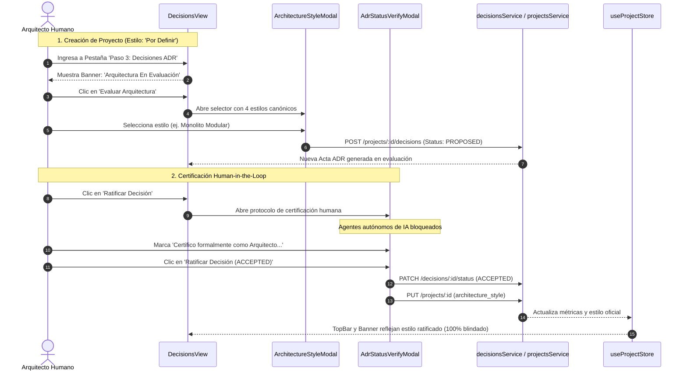

# Sprint 3 — Guía Frontend de Selección Guiada de Arquitectura y Verificación Human-in-the-Loop para ADRs

**Proyecto:** DevSculptor Frontend  
**Versión:** 1.1.0 (Sprint 3 — Épica C: Gobernanza Técnica Pre-Código)  
**Autor:** Nathaniel Muller San Martin  
**Estado:** IMPLEMENTADO Y VERIFICADO EN `develop`  
**Estilo Visual:** Apple visionOS Frosted Glassmorphism (Modo Claro / Modo Oscuro)  

---

## 1. Resumen de la Integración Frontend

Esta evolución transforma radicalmente la experiencia de usuario y el flujo de trabajo de gobernanza en DevSculptor:

1. **Creación de Proyectos sin Presunción Prematura (`CreateProjectModal.tsx`):**
   - Se eliminó el selector canónico rígido obligatorio que forzaba a elegir arquitectura antes de capturar requisitos.
   - Se reemplazó por campos organizacionales: **Organización / Empresa** y **Arquitecto Líder / Responsable**.
   - Se incorporó un banner de bienvenida explicando que la arquitectura se evaluará mediante ADRs en el estudio.
2. **Banner de Estado Arquitectónico en Tiempo Real (`DecisionsView.tsx` & `AppleTopBar.tsx`):**
   - Si el proyecto se encuentra con arquitectura `'Por Definir / En Evaluación'`, se despliega un banner destacado en color ámbar con llamado a la acción para definirla.
   - Una vez ratificada la decisión, se exhibe un chip de certificación con el estilo oficial en el encabezado global y en el panel de decisiones.
3. **Modal de Selección Canónica Guiada (`ArchitectureStyleModal.tsx`):**
   - Presenta los 4 estilos de arquitectura de referencia con ventajas y trade-offs:
     * *Monolito Modular Layered MVC* (Recomendado para DevSculptor).
     * *Microservicios Desacoplados*.
     * *Clean Architecture / Hexagonal*.
     * *Event-Driven Architecture*.
   - Permite generar el acta técnica estructurada en estado `PROPOSED`.
4. **Protocolo Estricto de Verificación *Human-in-the-Loop* (`AdrStatusVerifyModal.tsx`):**
   - Elimina los cambios de estado de un solo clic que permitían ratificaciones o rechazos accidentales.
   - Bloquea explícitamente cualquier automatización o alteración no supervisada por agentes de IA.
   - Requiere la firma/confirmación obligatoria mediante casilla: *"Certifico formalmente como Arquitecto de Software que he evaluado las implicaciones técnicas y apruebo este cambio de estado de gobernanza"*.
   - Permite la sincronización bidireccional automática del estilo arquitectónico del proyecto al ratificar el acta ADR correspondiente.
   - Habilita la reapertura (`PROPOSED`) o revocación (`REJECTED`) de decisiones previas bajo el mismo estándar de verificación.

---

## 2. Diagrama de Flujo de Gobernanza Human-in-the-Loop



---

## 3. Especificación de Componentes

### 3.1. `AdrStatusVerifyModal.tsx`
- **Props:**
  ```typescript
  interface AdrStatusVerifyModalProps {
    isOpen: boolean;
    onClose: () => void;
    decision: Decision | null;
    targetStatus: DecisionStatus | null;
    onConfirm: (decisionId: string, nextStatus: DecisionStatus, syncArchitecture?: string) => Promise<void>;
  }
  ```
- **Validaciones UX:**
  - El botón de confirmación permanece inhabilitado (`disabled`) hasta que el usuario activa el checkbox de verificación humana.
  - Detecta mediante expresiones regulares si el contenido del acta ratifica una arquitectura canónica y ofrece sincronizarla automáticamente con el proyecto.

### 3.2. `ArchitectureStyleModal.tsx`
- **Props:**
  ```typescript
  interface ArchitectureStyleModalProps {
    isOpen: boolean;
    onClose: () => void;
    projectId: string;
    onCreated: (decision: Decision) => void;
  }
  ```
- **Contenido:**
  - Tarjetas comparativas interactivas con conteo de ventajas (`+3 Ventajas`) y compromisos (`-2 Trade-offs`).
  - Generador dinámico de código de acta (`ADR-001`).

---

## 4. Pruebas de Verificación y Compilación

- Compilación limpia con Vite y TypeScript (`tsc -b && vite build`): **0 errores**.
- Validación funcional e interactiva en navegador (`http://localhost:5173/`):
  - Creación de proyecto con Organización y Arquitecto Líder.
  - Apertura del selector de arquitectura y generación de propuesta ADR.
  - Bloqueo y desbloqueo del modal Human-in-the-Loop.
  - Ratificación formal, actualización del TopBar y recalculo de métricas.
