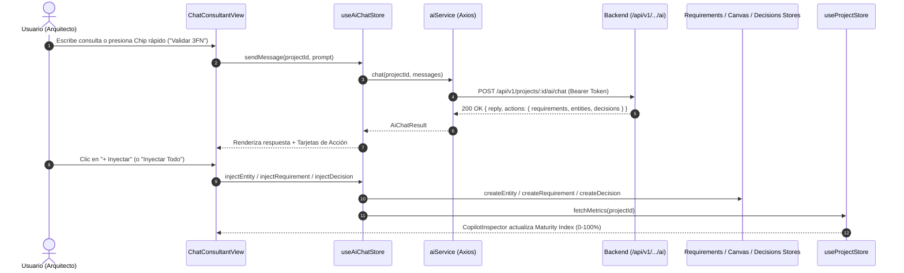

# Sprint 3 — Guía de Integración Frontend del Copiloto IA y Acciones 1-Click

**Proyecto:** DevSculptor Frontend  
**Versión:** 1.0.0 (Sprint 3 — Épica B)  
**Autor:** Nathaniel Muller San Martin  
**Estado:** IMPLEMENTADO Y VERIFICADO EN `develop`  
**Estilo Visual:** Apple visionOS Frosted Glassmorphism (Modo Claro / Modo Oscuro)  

---

## 1. Resumen de la Integración Frontend

La integración del Copiloto IA en el cliente web de DevSculptor conecta el diálogo interactivo con el estado reactivo del espacio de trabajo. Los arquitectos de software no solo reciben análisis y respuestas explicativas, sino también **artefactos técnicos accionables** que pueden incorporarse al proyecto con **un solo clic** sin abandonar la conversación ni recurrir a copiar y pegar manualmente.

### Características Clave:
1. **Consumo Seguro sin API Keys:** El frontend no posee ni requiere ninguna clave de Google Gemini o de terceros. Todas las peticiones se realizan hacia los endpoints protegidos del backend con el JWT Bearer del usuario activo en `Authorization`.
2. **Estructura Reactiva con Zustand (`useAiChatStore`):** Gestión centralizada del historial conversacional, estados de carga, respuestas del modelo, y seguimiento de artefactos inyectados para evitar duplicación.
3. **Inyección Inmediata 1-Click:**
   - **Requisitos:** Se insertan directamente en `requirementsService` bajo nomenclatura `[RF-xx]` o `[RNF-xx]`.
   - **Entidades de Base de Datos:** Se dibujan en el Canvas Relacional mediante `useCanvasStore.createEntity`.
   - **Actas de Decisión (ADRs):** Se registran en `decisionsService` con estado, contexto y consecuencias.
   - **Botón "Inyectar Todo":** Procesa todos los artefactos de la recomendación en batch.
4. **Sincronización de Métricas en Tiempo Real:** Cada inyección dispara automáticamente `useProjectStore.fetchMetrics(projectId)`, actualizando el Índice de Madurez (Maturity Score) y los contadores en el panel del Copiloto.

---

## 2. Arquitectura de Componentes y Flujo de Datos



---

## 3. Tipos TypeScript (`src/types/ai.types.ts`)

```typescript
export interface AiSuggestedRequirement {
  code: string;
  title: string;
  type: 'RF' | 'RNF';
  priority: 'HIGH' | 'MEDIUM' | 'LOW';
  description?: string;
}

export interface AiSuggestedColumn {
  name: string;
  type: string;
  isPrimary?: boolean;
  isNullable?: boolean;
  isUnique?: boolean;
  references?: string;
  defaultValue?: string;
  description?: string;
}

export interface AiSuggestedEntity {
  tableName: string;
  columns: AiSuggestedColumn[];
  description?: string;
}

export interface AiSuggestedDecision {
  code: string;
  title: string;
  status: 'ACCEPTED' | 'PROPOSED' | 'REJECTED';
  context?: string;
  decision?: string;
  consequences?: string;
}

export interface DevSculptorActions {
  requirements?: AiSuggestedRequirement[];
  entities?: AiSuggestedEntity[];
  decisions?: AiSuggestedDecision[];
}
```

---

## 4. Diseño Visual y Experiencia de Usuario (visionOS)

### 4.1. Tarjeta de Asistente con Badge de Proveedor
- Badge dinámico en la cabecera del mensaje que exhibe el motor activo (ejemplo: `Gemini (gemini-2.0-flash)` o `Mock (local-heuristic)`).
- Tipografía limpia con espaciado optimizado (`text-[12px] leading-relaxed`).

### 4.2. Bloque de Acciones Técnicas Detectadas
- Marco contenedor traslúcido con borde sutil `border-indigo-500/25`.
- Items individuales con estado de inyección:
  - Antes de inyectar: Botón `+ Inyectar` interactivo con hover glow.
  - Tras la inyección: Cambia a badge inmutable `Inyectado ✓` con fondo esmeralda sutil, previniendo duplicaciones accidentales.

### 4.3. Chips de Prompt Rápido
- **Validar 3FN:** Dispara análisis relacional con detección de dependencias transitivas.
- **Sugerir Requisitos Pagos & Auth:** Genera instantáneamente requisitos IEEE-830 completos.
- **Auditar ADRs:** Solicita una revisión de decisiones no formalizadas en el proyecto.
- **Diseñar Tabla Auditoría:** Genera la especificación DDL para trazabilidad de mutaciones.

### 4.4. Vinculación en el Inspector Lateral (`CopilotInspector.tsx`)
- Se incluyó la acción rápida **"Auditoría IA (3FN & ADRs)"** con icono `auto_awesome`, la cual conmuta automáticamente a la pestaña de chat y dispara la validación del esquema.

---

## 5. Verificación de Compilación y Calidad
- Frontend validado con `tsc -b && vite build` (`Exit Code 0`).
- Generación de assets minificados limpios sin errores de dependencias cíclicas ni tipado estricto.
