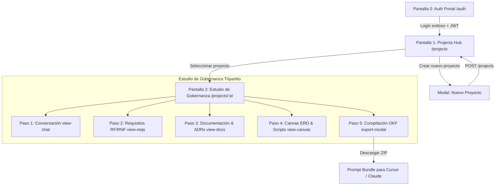

# DevSculptor Frontend — Convenciones de Arquitectura, UX/UI, Sistema de Diseño y Estructura de Pantallas

Este documento constituye el **estándar formal y definitivo** de arquitectura frontend, diseño visual, experiencia de usuario (UX/UI) y estructura canónica de pantallas para **DevSculptor**. 

Sintetiza la visión de producto (gobernanza técnica pre-código y mitigación del *"vibe coding"*), consolida la estética **Apple Glassmorphic & NotebookLM Studio System** validada empíricamente en el sandbox de prototipado, y establece los contratos que regirán la construcción de la aplicación web en producción (**React 18+ con Vite y TypeScript**), consumiendo la API REST construida y blindada en el **Sprint 1 (Backend Core)**.

---

## 📑 Tabla de Contenidos

1. [Estrategia Metodológica: El Prototipado como Gate de Validación](#1-estrategia-metodológica-el-prototipado-como-gate-de-validación)
2. [Stack Tecnológico Canónico del Frontend Real](#2-stack-tecnológico-canónico-del-frontend-real)
3. [Sistema de Diseño (Design System): Apple visionOS Liquid Glassmorphism (v2) & NotebookLM Studio](#3-sistema-de-diseño-design-system-apple-visionos-liquid-glassmorphism-v2--notebooklm-studio)
   - 3.1. [Filosofía Visual, Geometría Arquitectónica y Física del Cristal](#31-filosofía-visual-geometría-arquitectónica-y-física-del-cristal)
   - 3.2. [Arquitectura de Fondo Multicapa: Wallpaper Canvas, Ondas y Orbes](#32-arquitectura-de-fondo-multicapa-wallpaper-canvas-ondas-y-orbes)
   - 3.3. [Paleta Dual Canónica de Tokens: visionOS Crystal Obsidian vs. Snow Spatial Glass](#33-paleta-dual-canónica-de-tokens-visionos-crystal-obsidian-vs-snow-spatial-glass)
   - 3.4. [Sistema de Elevación, Desenfoque Óptico Saturado y Reflejos Especulares Biselados](#34-sistema-de-elevación-desenfoque-óptico-saturado-y-reflejos-especulares-biselados)
   - 3.5. [Tipografía Canónica y Jerarquías de Contraste](#35-tipografía-canónica-y-jerarquías-de-contraste)
   - 3.6. [Catálogo Canónico de Primitivas y Componentes Glassmórficos](#36-catálogo-canónico-de-primitivas-y-componentes-glassmórficos)
   - 3.7. [Ergonomía Visual de Nodos ERD y Conectores Bezier SVG Neón](#37-ergonomía-visual-de-nodos-erd-y-conectores-bezier-svg-neón)
   - 3.8. [Reglas de Implementación en Producción (React 18, Tailwind y GPU)](#38-reglas-de-implementación-en-producción-react-18-tailwind-y-gpu)
   - 3.9. [Arquitectura de Responsividad y Adaptabilidad Multi-Pantalla (Mobile, Tablet, Desktop, Ultra-Wide)](#39-arquitectura-de-responsividad-y-adaptabilidad-multi-pantalla-mobile-tablet-desktop-ultra-wide)
     - 3.9.1. [Matriz Canónica de Breakpoints](#391-matriz-canónica-de-breakpoints)
     - 3.9.2. [Patrón de Transición: Del Layout Tripartito a Drawers Deslizantes de Cristal](#392-patrón-de-transición-del-layout-tripartito-a-drawers-deslizantes-de-cristal)
     - 3.9.3. [Ergonomía Táctil y Solución a Restricciones de Viewport Móvil](#393-ergonomía-táctil-y-solución-a-restricciones-de-viewport-móvil)
     - 3.9.4. [Patrón de Colapso Selectivo en Toolbars Complejas (Canvas Subtabs & Multi-Motor Combobox)](#394-patrón-de-colapso-selectivo-en-toolbars-complejas-canvas-subtabs--multi-motor-combobox)
4. [Estructura Canónica de Pantallas y Flujos de Navegación](#4-estructura-canónica-de-pantallas-y-flujos-de-navegación)
   - 4.1. [Mapa General de Navegación y Flujo del Usuario](#41-mapa-general-de-navegación-y-flujo-del-usuario)
   - 4.2. [Pantalla 0: Portal de Acceso y Autenticación (`/auth`)](#42-pantalla-0-portal-de-acceso-y-autenticación-auth)
   - 4.3. [Pantalla 1: Hub de Proyectos & Portafolio (`/projects`)](#43-pantalla-1-hub-de-proyectos--portafolio-projects)
   - 4.4. [Pantalla 2: Estudio de Gobernanza Tripartito NotebookLM (`/projects/:projectId`)](#44-pantalla-2-estudio-de-gobernanza-tripartito-notebooklm-projectsprojectid)
     - 4.4.1. [Barra Superior Integrada (Apple Glass TopBar)](#441-barra-superior-integrada-apple-glass-topbar)
     - 4.4.2. [Panel Izquierdo: Flujo Guiado en 6 Pasos (Navigation Pipeline) & Dock Colapsable](#442-panel-izquierdo-flujo-guiado-en-6-pasos-navigation-pipeline--dock-colapsable)
     - 4.4.3. [Panel Central: Workspace / Studio de 5 Vistas Activas](#443-panel-central-workspace--studio-de-5-vistas-activas)
       - *Vista 1: Conversación Inicial & Copiloto Asertivo (`view-chat`)*
       - *Vista 2: Matriz de Requisitos RF y RNF (`view-reqs`)*
       - *Vista 3: Catálogo de Documentación & ADRs (`view-docs`)*
       - *Vista 4: Estudio de Diagramas Arquitectónicos (`view-diagrams`)*
       - *Vista 5: Canvas ERD & Salidas de Scripts Multi-Lenguaje (`view-canvas`)*
     - 4.4.4. [Panel Derecho: Copiloto & Inspector de Contexto (Metrics & Sources)](#444-panel-derecho-copiloto--inspector-de-contexto-metrics--sources)
     - 4.4.5. [Modal de Compilación & Exportación OKF (`export-modal`)](#445-modal-de-compilación--exportación-okf-export-modal)
5. [Ergonomía y Arquitectura del Canvas Interactivo (ERD) & Salidas Multi-Lenguaje](#5-ergonomía-y-arquitectura-del-canvas-interactivo-erd--salidas-multi-lenguaje)
6. [Principios de UX/UI y Experiencia de Usuario](#6-principios-de-uxui-y-experiencia-de-usuario)
7. [Integración con el Backend Core (Sprint 1) & Mapeo Pantalla-API](#7-integración-con-el-backend-core-sprint-1--mapeo-pantalla-api)
8. [Estructura Canónica de Directorios del Frontend Real](#8-estructura-canónica-de-directorios-del-frontend-real)
9. [Matriz de Buenas Prácticas Frontend (Do's & Don'ts)](#9-matriz-de-buenas-prácticas-frontend-dos--donts)

---

## 1. Estrategia Metodológica: El Prototipado como Gate de Validación

Para proyectos de alta densidad técnica e interactiva como DevSculptor —que combina captura guiada de lenguaje natural, matrices jerárquicas de requerimientos, máquinas de estado para ADRs y un **Canvas Interactivo con generación automática de scripts DDL, TypeScript, JSON Schema y Python**— codificar componentes en React sin validación previa introduce riesgos críticos de acoplamiento y sobreingeniería de estado.

Por ello, el ciclo de vida del frontend se gobierna bajo un flujo estricto de dos fases en la rama `feat/frontend`:

```
┌────────────────────────────────┐       ┌────────────────────────────────┐       ┌────────────────────────────────┐
│   1. SANDBOX DE PROTOTIPADO    │       │     2. GATE DE VALIDACIÓN      │       │     3. CONSTRUCCIÓN REAL       │
│  - HTML5 Semántico             │ ────► │  - Ergonomía y fluidez 60 FPS  │ ────► │  - React 18+ con Vite          │
│  - Vanilla CSS3 (Glass Tokens) │       │  - Contraste WCAG 2.1 AA       │       │  - TypeScript Estricto         │
│  - ES6 Modules nativos         │       │  - Validación de 5 estados UI  │       │  - Zustand + React Flow        │
│  - Carpeta /Prototype          │       │  - Aprobación de Arquitectura  │       │  - devsculptor-frontend        │
└────────────────────────────────┘       └────────────────────────────────┘       └────────────────────────────────┘
```

### Estado del Ciclo de Vida: Prototipado Superado y Retirado
1. **Fase Superada**: La validación inicial en HTML/CSS/JS nativo cumplió su propósito en la fase de concepción de Sprint 2, verificando contraste, fluidez a 60 FPS y física óptica de vidrio.
2. **Código de Producción Canónico**: El código vivo y único del frontend reside en [`devsculptor-frontend/`](file:///c:/Users/natha/Documents/Repos/DevSculptor/devsculptor-frontend) (React 19 + TypeScript + Vite + Tailwind CSS + Zustand).
3. **Ergonomía de Producción**: Toda iteración de diseño se gobierna directamente sobre los tokens del sistema de diseño, componentes reutilizables y stores reactivos de la aplicación principal.

---

## 2. Stack Tecnológico Canónico del Frontend Real

Al culminar la validación en el prototipo, la aplicación de producción se implementará bajo el siguiente stack:

| Capa | Tecnología | Justificación Técnica |
| :--- | :--- | :--- |
| **Framework Base** | **React 18+** | Concurrencia, suspense para carga progresiva y soporte de nodos gráficos en árbol virtual. |
| **Build Tool** | **Vite** | Arranque ultrarrápido con ESM nativo, HMR sub-segundo y empaquetado optimizado mediante Rollup. |
| **Lenguaje** | **TypeScript (`strict: true`)** | Cero `any`. Tipado simétrico con los DTOs y tipos del backend (`User`, `Project`, `Requirement`, `ApiResponse<T>`). |
| **Sistema de Estilos** | **Vanilla CSS + Design Tokens** | Control nativo de `backdrop-filter`, animaciones GPU (`transform: translate3d`) y cero overhead de CSS-in-JS. |
| **Lienzo ERD** | **React Flow (@xyflow/react)** | Gestión determinista de nodos arrastrables, puertos magnéticos y aristas Bezier interactivas. |
| **Gestión de Estado** | **Zustand + Context API** | Context API para Auth y Tema; Zustand para el grafo del canvas ERD, nodos seleccionados y sincronización. |
| **Cliente HTTP** | **Axios Centralizado** | Interceptores para inyección JWT, propagación de `X-Request-Id` y desempaquetado del envelope estándar. |
| **Iconografía** | **Material Symbols Outlined + Lucide** | Iconos vectoriales limpios con alineación tipográfica perfecta y soporte de ligaduras. |

---

## 3. Sistema de Diseño (Design System): Apple visionOS Liquid Glassmorphism (v2) & NotebookLM Studio

### 3.1. Filosofía Visual, Geometría Arquitectónica y Física del Cristal

DevSculptor abandona el "glassmorphism genérico de cartón translúcido" (fondos planos semiopacos que lavan el contraste) y evoluciona hacia una implementación de grado de ingeniería: **Apple visionOS Liquid Glassmorphism (v2)** articulada con el **Workspace Tripartito de Google NotebookLM Studio**.

```
┌────────────────────────────────────────────────────────────────────────────────────────┐
│                        ANATOMÍA ÓPTICA DE UNA SUPERFICIE DE VIDRIO                      │
│                                                                                        │
│  Luz Cenital                                                                           │
│      │                                                                                 │
│      ▼   ┌──────────────────────────────────────────────────────────────────────────┐  │
│  [ SHEEN ]   Bisel Superior Especular: inset 0 1.5px 1px 0 rgba(255, 255, 255, 0.48) │  │
│          ├──────────────────────────────────────────────────────────────────────────┤  │
│          │ Gradiente Angular 135°: Refracción de luz (12% -> 2% -> 4%)              │  │
│  [ CUERPO│ Transparencia Neta: 20% a 35% (var(--glass-window) / var(--glass-card))   │  │
│   VIDRIO]│ Desenfoque Gaussiano Óptico Saturado: blur(18px) + saturate(190%)        │  │
│          ├──────────────────────────────────────────────────────────────────────────┤  │
│  [ OCULTA]   Sombra de Oclusión Inferior: inset 0 -1px 1px 0 rgba(255, 255, 255, 0.08)│  │
│          └──────────────────────────────────────────────────────────────────────────┘  │
│                  Sombra Profunda Proyectada: 0 16px 40px -8px rgba(0, 0, 0, 0.5)      │
└────────────────────────────────────────────────────────────────────────────────────────┘
```

#### 1. Principios de Física Óptica del Cristal
* **Reflejo Especular Superior (*Specular Sheen*):** Toda ventana y tarjeta de cristal posee un fino resplandor blanco puro en su arista superior (`inset 0 1.5px 1px 0 rgba(255, 255, 255, 0.48)` en Dark Mode; `0.98` en Light Mode). Esto emula la luz cenital rebotando en el bisel pulido del vidrio.
* **Gradiente de Refracción Angular:** La superficie no es un color plano, sino un gradiente a 135 grados (`linear-gradient(135deg, rgba(255, 255, 255, 0.12) 0%, rgba(255, 255, 255, 0.02) 40%, rgba(255, 255, 255, 0.04) 100%)`) superpuesto al color translúcido base.
* **Saturación Cromática Obligatoria (`saturate`):** Un desenfoque común (`blur(...)`) deslava los colores de fondo, tornándolos lechosos o grisáceos. En DevSculptor, todo `backdrop-filter` acompaña el blur con saturación potenciada (`saturate(170% a 210%)`), manteniendo la vitalidad de las formas que transitan por detrás.
* **Translucidez Dinámica Alta:** Los fondos de cristal mantienen una opacidad real entre el **20% y 35%**. Esto permite que el wallpaper y los orbes de luz ambiental respiren y se filtren sutilmente a través de la UI sin comprometer la legibilidad de los textos.

#### 2. Geometría Refinada y Radios Arquitectónicos (Menor Border-Radius)
A diferencia de los estilos de consumo masivo con bordes exageradamente redondos (20px - 28px) que desperdician espacio y transmiten informalidad ("look de juguete"), DevSculptor adopta una **geometría arquitectónica de precisión**:
* **`--radius-window: 10px`**: Marcos perimetrales de ventanas y paneles estructurales (TopBar, Nav, Workspace, Copiloto).
* **`--radius-card: 7px`**: Tarjetas de contenido técnico (ítems de requisitos, actas ADRs, métricas del copiloto).
* **`--radius-node: 8px`**: Nodos de entidad y tablas de base de datos en el lienzo ERD.
* **`--radius-btn: 6px`**: Botones táctiles, inputs y selectores.
* **`--radius-pill: 9999px`**: Exclusivo para píldoras conmutadoras (Sol/Luna, telemetría de estado) y badges de clasificación.

---

### 3.2. Arquitectura de Fondo Multicapa: Wallpaper Canvas, Ondas y Orbes

Para que el efecto de refracción del cristal cobre vida, la interfaz descansa sobre un canvas de fondo compuesto por **4 capas orquestadas** bajo el contenedor `.wallpaper-canvas`:

```html
<!-- Arquitectura Canónica del Fondo de Vidrio (Wallpaper Canvas) -->
<div class="wallpaper-canvas">
  <!-- Capa 1: Fotografía de Paisaje Apple Retina HD -->
  <div id="wallpaper-bg" class="wallpaper-img"></div>
  
  <!-- Capa 2: Malla Gradiente de Ondas Dinámicas -->
  <div class="wallpaper-wave-overlay"></div>
  
  <!-- Capa 3: Micro-Retícula Topográfica de Precisión -->
  <div class="wallpaper-topo-pattern"></div>
  
  <!-- Capa 4: Orbes de Luz Ambiental con Deriva Cinemática GPU -->
  <div class="ambient-orb orb-indigo"></div>
  <div class="ambient-orb orb-cyan"></div>
  <div class="ambient-orb orb-purple"></div>
</div>
```

```css
/* ==========================================================================
   Capas de Fondo: Naturaleza Apple & Patrón de Ondas Orgánicas
   ========================================================================== */
.wallpaper-canvas {
  position: fixed;
  inset: 0;
  z-index: 0;
  pointer-events: none;
  overflow: hidden;
}

/* Capa 1: Fotografía de Paisaje Natural con Contraste y Calibración Óptica */
.wallpaper-img {
  position: absolute;
  inset: -20px;
  background-image: url('https://images.unsplash.com/photo-1506744038136-46273834b3fb?q=80&w=2560&auto=format&fit=crop');
  background-size: cover;
  background-position: center 35%;
  background-repeat: no-repeat;
  filter: brightness(0.84) contrast(1.18) saturate(1.3);
  transition: opacity 0.6s ease, filter 0.6s ease, background-image 0.6s ease;
}

html.light .wallpaper-img {
  filter: brightness(0.98) contrast(1.08) saturate(1.15);
}

/* Capa 2: Malla de Ondas Gradiente Dinámica (Modo Fusión) */
.wallpaper-wave-overlay {
  position: absolute;
  inset: 0;
  background: radial-gradient(circle at 18% 22%, rgba(99, 102, 241, 0.32) 0%, transparent 45%),
              radial-gradient(circle at 82% 78%, rgba(56, 189, 248, 0.28) 0%, transparent 50%),
              radial-gradient(circle at 50% 105%, rgba(168, 85, 247, 0.22) 0%, transparent 55%);
  mix-blend-mode: screen;
  pointer-events: none;
}

html.light .wallpaper-wave-overlay {
  mix-blend-mode: multiply;
  opacity: 0.55;
}

/* Capa 3: Patrón de Puntos / Retícula Topográfica de Arquitecto */
.wallpaper-topo-pattern {
  position: absolute;
  inset: 0;
  opacity: 0.15;
  background-image: radial-gradient(rgba(255, 255, 255, 0.8) 1.2px, transparent 1.2px);
  background-size: 28px 28px;
  pointer-events: none;
}

/* Capa 4: Orbes Ambientales con Animación Acelerada por GPU */
.ambient-orb {
  position: absolute;
  border-radius: 50%;
  filter: blur(90px);
  opacity: 0.50;
  animation: orbFloat 24s ease-in-out infinite alternate;
}

.orb-indigo {
  top: -5%;
  left: 25%;
  width: 650px;
  height: 650px;
  background: rgba(99, 102, 241, 0.38);
}

.orb-cyan {
  bottom: -5%;
  right: 15%;
  width: 600px;
  height: 600px;
  background: rgba(56, 189, 248, 0.32);
  animation-delay: -9s;
}

.orb-purple {
  top: 45%;
  left: -8%;
  width: 500px;
  height: 500px;
  background: rgba(168, 85, 247, 0.26);
  animation-delay: -16s;
}

@keyframes orbFloat {
  0% { transform: translate3d(0, 0, 0) scale(1); }
  50% { transform: translate3d(45px, 35px, 0) scale(1.08); }
  100% { transform: translate3d(-35px, -25px, 0) scale(0.94); }
}
```

---

### 3.3. Paleta Dual Canónica de Tokens: visionOS Crystal Obsidian vs. Snow Spatial Glass

El sistema implementa alternancia instantánea mediante clases `.dark` o `.light` aplicadas a la raíz `<html>` o al `<body>`:

```css
/* ==========================================================================
   Design Tokens Canónicos: visionOS Crystal Obsidian vs. Snow Spatial Glass
   ========================================================================== */

:root {
  /* --- MODO OSCURO (visionOS Crystal Obsidian — Por Defecto) --- */
  --bg-space: #06080d;
  
  /* Superficies de Cristal Ultra-Translúcidas (Transparencia: 20% - 35%) */
  --glass-nav: rgba(10, 14, 25, 0.35);
  --glass-window: rgba(8, 12, 22, 0.26);
  --glass-card: rgba(255, 255, 255, 0.04);
  --glass-card-hover: rgba(255, 255, 255, 0.08);
  --glass-card-selected: rgba(99, 102, 241, 0.20);
  --glass-elevated: rgba(12, 16, 28, 0.65);
  --glass-input: rgba(255, 255, 255, 0.05);
  --glass-code: rgba(6, 9, 16, 0.72);

  /* Desenfoque Óptico con Saturación de Color */
  --blur-window: blur(18px) saturate(190%);
  --blur-card: blur(14px) saturate(170%);
  --blur-modal: blur(35px) saturate(210%);

  /* Reflejos Especulares Biselados (Bordes de Vidrio de Alta Nitidez) */
  --border-glass: 1px solid rgba(255, 255, 255, 0.24);
  --border-glass-subtle: 1px solid rgba(255, 255, 255, 0.14);
  --border-glass-light: 1px solid rgba(255, 255, 255, 0.38);
  --border-focus: 1px solid rgba(129, 140, 248, 0.85);

  /* Sombras Multinivel con Inset Sheen Blanco Puro */
  --shadow-window: 0 16px 40px -8px rgba(0, 0, 0, 0.5), 
                   inset 0 1.5px 1px 0 rgba(255, 255, 255, 0.48), 
                   inset 0 -1px 1px 0 rgba(255, 255, 255, 0.08),
                   inset 0 0 20px 0 rgba(255, 255, 255, 0.02);
                   
  --shadow-card: 0 4px 16px -2px rgba(0, 0, 0, 0.25), 
                 inset 0 1px 0 0 rgba(255, 255, 255, 0.28);
                 
  --shadow-dock: 0 12px 30px -4px rgba(0, 0, 0, 0.65), 
                 inset 0 1.5px 1px 0 rgba(255, 255, 255, 0.55);
                 
  --shadow-node: 0 12px 28px -4px rgba(0, 0, 0, 0.45), 
                 inset 0 1px 1px 0 rgba(255, 255, 255, 0.4),
                 0 0 0 1px rgba(255, 255, 255, 0.18);

  /* Tipografía de Alto Contraste */
  --text-primary: #ffffff;
  --text-secondary: #e2e8f0;
  --text-muted: #94a3b8;
  --text-dim: #64748b;

  /* Acentos de Cristal Luminoso */
  --accent-indigo: #818cf8;
  --accent-indigo-glow: rgba(99, 102, 241, 0.5);
  --accent-cyan: #38bdf8;
  --accent-cyan-glow: rgba(56, 189, 248, 0.4);
  --accent-emerald: #34d399;
  --accent-amber: #fbbf24;
  --accent-rose: #f87171;

  --canvas-grid-dot: rgba(255, 255, 255, 0.18);

  --font-sans: 'Inter', -apple-system, BlinkMacSystemFont, 'SF Pro Display', sans-serif;
  --font-mono: 'JetBrains Mono', monospace;

  /* Geometría Arquitectónica Refinada */
  --radius-pill: 9999px;
  --radius-window: 10px;
  --radius-card: 7px;
  --radius-node: 8px;
  --radius-btn: 6px;
}

/* --- MODO CLARO (visionOS Snow Spatial Glass) --- */
html.light, body.light {
  --bg-space: #dbe3ed;

  --glass-nav: rgba(255, 255, 255, 0.55);
  --glass-window: rgba(255, 255, 255, 0.42);
  --glass-card: rgba(255, 255, 255, 0.40);
  --glass-card-hover: rgba(255, 255, 255, 0.65);
  --glass-card-selected: rgba(99, 102, 241, 0.16);
  --glass-elevated: rgba(255, 255, 255, 0.82);
  --glass-input: rgba(255, 255, 255, 0.55);
  --glass-code: rgba(248, 250, 252, 0.80);

  --border-glass: 1px solid rgba(255, 255, 255, 0.85);
  --border-glass-subtle: 1px solid rgba(255, 255, 255, 0.55);
  --border-glass-light: 1px solid rgba(255, 255, 255, 0.95);
  --border-focus: 1px solid rgba(79, 70, 229, 0.7);

  --shadow-window: 0 16px 40px -8px rgba(15, 23, 42, 0.15), 
                   inset 0 1.5px 1px 0 rgba(255, 255, 255, 0.98);
                   
  --shadow-card: 0 4px 14px -2px rgba(15, 23, 42, 0.08), 
                 inset 0 1px 0 0 rgba(255, 255, 255, 0.9);
                 
  --shadow-dock: 0 10px 24px -4px rgba(15, 23, 42, 0.16), 
                 inset 0 1.5px 1px 0 rgba(255, 255, 255, 1);
                 
  --shadow-node: 0 8px 20px -3px rgba(15, 23, 42, 0.12), 
                 inset 0 1px 1px 0 rgba(255, 255, 255, 0.95), 
                 0 0 0 1px rgba(255, 255, 255, 0.85);

  --text-primary: #090d16;
  --text-secondary: #1e293b;
  --text-muted: #334155;
  --text-dim: #64748b;

  --accent-indigo: #4f46e5;
  --accent-indigo-glow: rgba(79, 70, 229, 0.3);
  --accent-cyan: #0284c7;
  --accent-emerald: #059669;
  --accent-amber: #d97706;
  --accent-rose: #dc2626;

  --canvas-grid-dot: rgba(15, 23, 42, 0.15);
}

/* ==========================================================================
   Utilidades Tipográficas y Píldoras de Alto Contraste en Modo Claro
   ========================================================================== */
html.light .pill-indigo  { background: rgba(99, 102, 241, 0.16); color: #312e81; border: 1px solid rgba(99, 102, 241, 0.4); }
html.light .pill-cyan    { background: rgba(14, 165, 233, 0.16); color: #0c4a6e; border: 1px solid rgba(14, 165, 233, 0.4); }
html.light .pill-emerald { background: rgba(16, 185, 129, 0.16); color: #064e3b; border: 1px solid rgba(16, 185, 129, 0.4); }
html.light .pill-amber   { background: rgba(245, 158, 11, 0.16); color: #78350f; border: 1px solid rgba(245, 158, 11, 0.4); }
html.light .pill-rose    { background: rgba(244, 63, 94, 0.16);  color: #881337; border: 1px solid rgba(244, 63, 94, 0.4); }

.text-primary   { color: var(--text-primary) !important; }
.text-secondary { color: var(--text-secondary) !important; }
.text-muted     { color: var(--text-muted) !important; }
.text-dim       { color: var(--text-dim) !important; }

/* Drawer Lateral de Modelado Adaptativo */
.vision-drawer {
  background: var(--glass-elevated);
  backdrop-filter: var(--blur-modal);
  -webkit-backdrop-filter: var(--blur-modal);
  border-right: var(--border-glass);
  color: var(--text-primary);
  box-shadow: var(--shadow-window);
}

.vision-drawer-subtle {
  background: var(--glass-card);
  border: var(--border-glass-subtle);
}
```

---

### 3.4. Sistema de Elevación, Desenfoque Óptico Saturado y Reflejos Especulares Biselados

La jerarquía de elevación en DevSculptor no se define únicamente por el eje Z de desplazamiento (`box-shadow`), sino por la **densidad óptica del cristal**:

| Nivel de Capa | Clase Primitiva | Translucidez Base | Desenfoque + Saturación | Reflejo Especular Inset | Propósito en el Estudio |
| :--- | :--- | :--- | :--- | :--- | :--- |
| **N0 — Base** | `.wallpaper-canvas` | 100% visible | Sin desenfoque | N/A | Fondo escénico con ondas y orbes cinéticos. |
| **N1 — Ventana** | `.vision-window` | 26% a 42% | `blur(18px) saturate(190%)` | `inset 0 1.5px 1px rgba(255,255,255,0.48)` | Paneles estructurales (TopBar, Nav, Studio, Copiloto). |
| **N2 — Tarjeta** | `.vision-card` | 4% a 8% | `blur(14px) saturate(170%)` | `inset 0 1px 0 rgba(255,255,255,0.28)` | Ítems de Requisitos, Actas ADRs, Contenedores internos. |
| **N2.5 — Nodo ERD** | `.erd-node` | 65% a 82% | `blur(18px) saturate(190%)` | `inset 0 1px 1px rgba(255,255,255,0.4)` + Perímetro 1px | Tablas arrastrables en el lienzo interactivo de modelado. |
| **N3 — Flotante** | `.vision-dock` | 65% a 82% | `blur(18px) saturate(190%)` | `inset 0 1.5px 1px rgba(255,255,255,0.55)` | Dock de controles de zoom del canvas e indicadores. |
| **N4 — Modal** | `#export-modal`, etc. | 65% a 85% | `blur(35px) saturate(210%)` | `backdrop-blur-md` + Sombra profunda 24px | Ventanas modales de compilación OKF, creación y confirmación. |

---

### 3.5. Tipografía Canónica y Jerarquías de Contraste

La legibilidad bajo fondos translúcidos requiere tipografías con alta altura de la "x" (x-height) y renderizado sub-pixel nítido:
* **Tipografía de Interfaz (`--font-sans`):** **`Inter`** (pesos `300`, `400`, `500`, `600`, `700`). Se acompaña de `-webkit-font-smoothing: antialiased` en `<body>`.
* **Tipografía de Código y Fórmulas (`--font-mono`):** **`JetBrains Mono`** (pesos `400`, `500`, `600`). Empleada obligatoriamente para:
  - Identificadores de requisitos (`RF-01`, `RNF-02`).
  - Actas de arquitectura (`ADR-01`, `ADR-02`).
  - Tipos y nombres de columna en el canvas (`UUID PK`, `VARCHAR UNIQUE`).
  - Salidas DDL, DTOs TypeScript, JSON Schema y modelos Pydantic.
  - Indicadores numéricos de telemetría y puntuaciones de madurez (`100%`).

---

### 3.6. Catálogo Canónico de Primitivas y Componentes Glassmórficos

Las siguientes clases CSS son los bloques fundamentales de construcción visual en toda la aplicación:

#### 1. Ventana Estructural (`.vision-window`)
```css
.vision-window {
  /* Gradiente angular que simula la refracción de luz sobre vidrio pulido */
  background: linear-gradient(135deg, rgba(255, 255, 255, 0.12) 0%, rgba(255, 255, 255, 0.02) 40%, rgba(255, 255, 255, 0.04) 100%), var(--glass-window);
  backdrop-filter: var(--blur-window);
  -webkit-backdrop-filter: var(--blur-window);
  border: var(--border-glass);
  box-shadow: var(--shadow-window);
  border-radius: var(--radius-window);
  transition: all 0.22s cubic-bezier(0.16, 1, 0.3, 1);
  position: relative;
}
```

#### 2. Tarjeta Interactiva (`.vision-card`)
```css
.vision-card {
  background: linear-gradient(135deg, rgba(255, 255, 255, 0.08) 0%, rgba(255, 255, 255, 0.015) 100%), var(--glass-card);
  backdrop-filter: var(--blur-card);
  -webkit-backdrop-filter: var(--blur-card);
  border: var(--border-glass-subtle);
  border-radius: var(--radius-card);
  box-shadow: var(--shadow-card);
  transition: all 0.2s cubic-bezier(0.16, 1, 0.3, 1);
}

.vision-card:hover {
  background: linear-gradient(135deg, rgba(255, 255, 255, 0.14) 0%, rgba(255, 255, 255, 0.03) 100%), var(--glass-card-hover);
  border-color: var(--border-glass-light);
  transform: translateY(-1px);
  box-shadow: 0 8px 24px -2px rgba(0, 0, 0, 0.35), inset 0 1px 1px 0 rgba(255, 255, 255, 0.35);
}

.vision-card.selected {
  background: linear-gradient(135deg, rgba(99, 102, 241, 0.22) 0%, rgba(99, 102, 241, 0.08) 100%), var(--glass-card-selected);
  border-color: var(--border-focus);
  box-shadow: 0 0 0 2px var(--accent-indigo-glow), var(--shadow-card);
}
```

#### 3. Botones Táctiles Hápticos (`.vision-btn`)
```css
.vision-btn {
  display: inline-flex;
  align-items: center;
  justify-content: center;
  gap: 6px;
  padding: 6px 12px;
  font-family: var(--font-sans);
  font-size: 11.5px;
  font-weight: 500;
  color: var(--text-primary);
  background: rgba(255, 255, 255, 0.09);
  backdrop-filter: blur(12px);
  -webkit-backdrop-filter: blur(12px);
  border: var(--border-glass-subtle);
  border-radius: var(--radius-btn);
  cursor: pointer;
  outline: none;
  box-shadow: inset 0 1px 1px 0 rgba(255, 255, 255, 0.2), 0 2px 5px rgba(0, 0, 0, 0.2);
  transition: all 0.18s cubic-bezier(0.16, 1, 0.3, 1);
  white-space: nowrap;
}

.vision-btn:hover {
  background: rgba(255, 255, 255, 0.18);
  border-color: var(--border-glass-light);
  transform: translateY(-0.5px);
  box-shadow: inset 0 1px 1px 0 rgba(255, 255, 255, 0.35), 0 4px 10px rgba(0, 0, 0, 0.25);
}

.vision-btn:active {
  transform: scale(0.97);
  background: rgba(255, 255, 255, 0.06);
}

.vision-btn-primary {
  background: linear-gradient(135deg, rgba(99, 102, 241, 0.95), rgba(79, 70, 229, 0.95));
  color: #ffffff !important;
  border: 1px solid rgba(255, 255, 255, 0.4);
  box-shadow: 0 4px 14px var(--accent-indigo-glow), inset 0 1px 1px 0 rgba(255, 255, 255, 0.5);
}

.vision-btn-primary:hover {
  background: linear-gradient(135deg, #6366f1, #4f46e5);
  box-shadow: 0 6px 20px var(--accent-indigo-glow), inset 0 1px 1px 0 rgba(255, 255, 255, 0.6);
}

.vision-btn-pill {
  border-radius: var(--radius-pill);
  padding: 4px 12px;
}

.vision-btn-icon {
  width: 28px;
  height: 28px;
  padding: 0;
  border-radius: var(--radius-btn);
}
```

#### 4. Campos de Entrada de Cristal (`.vision-input`)
```css
.vision-input {
  width: 100%;
  padding: 7.5px 12px;
  font-family: var(--font-sans);
  font-size: 12px;
  color: var(--text-primary);
  background: var(--glass-input);
  backdrop-filter: blur(12px);
  -webkit-backdrop-filter: blur(12px);
  border: var(--border-glass);
  border-radius: var(--radius-btn);
  box-shadow: inset 0 1px 2px 0 rgba(0, 0, 0, 0.2);
  outline: none;
  transition: all 0.2s ease;
}

.vision-input:focus {
  border-color: var(--border-focus);
  background: rgba(255, 255, 255, 0.12);
  box-shadow: 0 0 0 2.5px var(--accent-indigo-glow), inset 0 1px 1px 0 rgba(255, 255, 255, 0.25);
}
```

#### 5. Pills de Estado y Badges Semánticos (`.vision-pill`)
```css
.vision-pill {
  display: inline-flex;
  align-items: center;
  gap: 4px;
  padding: 2px 7px;
  font-family: var(--font-mono);
  font-size: 9.5px;
  font-weight: 600;
  border-radius: 5px;
  letter-spacing: 0.03em;
  text-transform: uppercase;
  backdrop-filter: blur(8px);
  -webkit-backdrop-filter: blur(8px);
}

.pill-indigo {
  background: rgba(99, 102, 241, 0.25);
  color: #c7d2fe;
  border: 1px solid rgba(99, 102, 241, 0.5);
}

.pill-cyan {
  background: rgba(56, 189, 248, 0.25);
  color: #bae6fd;
  border: 1px solid rgba(56, 189, 248, 0.5);
}

.pill-emerald {
  background: rgba(52, 211, 153, 0.25);
  color: #a7f3d0;
  border: 1px solid rgba(52, 211, 153, 0.5);
}

.pill-amber {
  background: rgba(251, 191, 36, 0.25);
  color: #fef08a;
  border: 1px solid rgba(251, 191, 36, 0.5);
}

.pill-rose {
  background: rgba(248, 113, 113, 0.25);
  color: #fecaca;
  border: 1px solid rgba(248, 113, 113, 0.5);
}
```

#### 6. Dock Flotante de Controles (`.vision-dock`)
```css
.vision-dock {
  background: linear-gradient(135deg, rgba(255, 255, 255, 0.14) 0%, rgba(255, 255, 255, 0.03) 100%), var(--glass-elevated);
  backdrop-filter: var(--blur-window);
  -webkit-backdrop-filter: var(--blur-window);
  border: var(--border-glass-light);
  border-radius: var(--radius-btn);
  box-shadow: var(--shadow-dock);
  padding: 4px 10px;
  display: flex;
  align-items: center;
  gap: 6px;
}
```

#### 7. Bloques de Terminal y Código de Cristal (`.code-block`)
```css
.code-block {
  font-family: var(--font-mono);
  font-size: 11px;
  line-height: 1.6;
  background: var(--glass-code);
  backdrop-filter: blur(16px);
  -webkit-backdrop-filter: blur(16px);
  border-radius: var(--radius-card);
  padding: 14px;
  overflow: auto;
  border: var(--border-glass-subtle);
  box-shadow: inset 0 1px 2px 0 rgba(0, 0, 0, 0.35);
}
```

#### 8. Barra de Desplazamiento Translúcida (Minimalist Scrollbar)
```css
::-webkit-scrollbar {
  width: 5px;
  height: 5px;
}
::-webkit-scrollbar-track {
  background: transparent;
}
::-webkit-scrollbar-thumb {
  background: rgba(255, 255, 255, 0.22);
  border-radius: 4px;
}
::-webkit-scrollbar-thumb:hover {
  background: rgba(255, 255, 255, 0.35);
}
html.light ::-webkit-scrollbar-thumb {
  background: rgba(0, 0, 0, 0.22);
}
```

---

### 3.7. Ergonomía Visual de Nodos ERD y Conectores Bezier SVG Neón

El lienzo interactivo de modelado de base de datos se rige por las siguientes especificaciones visuales de cristal y conectividad:

```css
/* Grilla Infinita de Puntos Radiales */
.canvas-grid-bg {
  background-color: transparent;
  background-image: radial-gradient(var(--canvas-grid-dot) 1.2px, transparent 1.2px);
  background-size: 20px 20px;
}

/* Nodo de Entidad Relacional (Tabla ERD) */
.erd-node {
  position: absolute;
  width: 220px;
  background: linear-gradient(135deg, rgba(255, 255, 255, 0.12) 0%, rgba(255, 255, 255, 0.02) 100%), var(--glass-elevated);
  backdrop-filter: var(--blur-window);
  -webkit-backdrop-filter: var(--blur-window);
  border: var(--border-glass-light);
  border-radius: var(--radius-node);
  box-shadow: var(--shadow-node);
  cursor: grab;
  z-index: 10;
  transition: box-shadow 0.15s ease, border-color 0.15s ease;
}

.erd-node:active {
  cursor: grabbing;
}

.erd-node.is-selected {
  border-color: var(--accent-indigo);
  box-shadow: 0 0 0 2.5px var(--accent-indigo-glow), var(--shadow-node);
  z-index: 20;
}

.erd-node-header {
  padding: 7px 11px;
  display: flex;
  align-items: center;
  justify-content: space-between;
  border-bottom: var(--border-glass-subtle);
  background: rgba(255, 255, 255, 0.06);
  border-radius: var(--radius-node) var(--radius-node) 0 0;
}

.erd-node-body {
  padding: 3px 0;
}

.erd-row {
  display: flex;
  align-items: center;
  justify-content: space-between;
  padding: 4px 11px;
  font-family: var(--font-mono);
  font-size: 10.5px;
  position: relative;
}

.erd-row:hover {
  background: rgba(255, 255, 255, 0.08);
}

/* Conectores SVG Bezier Neón (Relaciones Relacionales) */
.bezier-connector {
  fill: none;
  stroke: #38bdf8;
  stroke-width: 2px;
  stroke-dasharray: 5 3;
  opacity: 0.95;
  filter: drop-shadow(0 0 6px rgba(56, 189, 248, 0.7));
}
```

---

### 3.8. Reglas de Implementación en Producción (React 18, Tailwind y GPU)

Para trasladar este sistema desde el sandbox de prototipado hacia `devsculptor-frontend`:
1. **SSOT de Estilos:** Crear `src/styles/tokens.css` y `src/styles/glassmorphism.css` conteniendo exactamente estas reglas nativas.
2. **Compatibilidad con Tailwind CSS:** No intentar recrear las sombras compuestas multinivel y gradientes de refracción mediante clases ad-hoc (`shadow-[...]`). En su lugar, registrar las clases semánticas `.vision-window`, `.vision-card`, `.vision-btn` y sus variantes en el plugin de componentes de Tailwind o consumirlas directamente vía `@apply` o imports globales.
3. **Aceleración por Hardware (GPU):**
   - El arrastre de nodos y el zoom en React Flow deben ejecutarse usando transformaciones GPU (`transform: translate3d(x, y, 0) scale(z)`).
   - Aplicar `will-change: transform` durante interacciones dinámicas y retirarlo al entrar en reposo para evitar fugas de memoria gráfica.
4. **Respeto a Preferencias del Sistema:** Consultar `window.matchMedia('(prefers-color-scheme: light)')` en la inicialización si no existe clave previa en `localStorage`.

---

### 3.9. Arquitectura de Responsividad y Adaptabilidad Multi-Pantalla (Mobile, Tablet, Desktop, Ultra-Wide)

Para satisfacer los requerimientos de usabilidad transversal y permitir la gobernanza de software tanto en estaciones de trabajo de alta resolución como en dispositivos portátiles y táctiles, DevSculptor implementa un modelo **Líquido y Adaptativo** guiado por las siguientes convenciones de ingeniería:

#### 3.9.1. Matriz Canónica de Breakpoints
El sistema opera sobre cuatro rangos de viewport normalizados:

| Breakpoint | Ancho de Pantalla (Viewport) | Dispositivos Típicos | Comportamiento del Layout |
| :--- | :--- | :--- | :--- |
| **Móvil (Compact)** | `< 768px` (`xs`, `sm`) | Smartphones (iPhone, Pixel, Galaxy) | Workspace a ancho completo (100%). Paneles laterales (`FlowSidebar` y `CopilotInspector`) transformados en *Slide-Over Glass Drawers* activables vía TopBar o Bottom Dock. |
| **Tablet Portrait** | `768px - 1023px` (`md`) | iPad, Galaxy Tab vertical | Workspace central expandido. Drawers laterales deslizables con animación GPU a 60 FPS y fondo desenfocado (`backdrop-blur-sm`). Grid de proyectos en 2 columnas. |
| **Laptop / Tablet Horiz.** | `1024px - 1279px` (`lg`) | iPad Pro horizontal, Laptops 13" | Transición fluida: barra de navegación rápida visible, visualización de métricas y acceso ágil a copiloto sin saturar el lienzo ERD. Grid de proyectos en 3 columnas. |
| **Desktop / Ultra-Wide** | `≥ 1280px` (`xl`, `2xl`) | Monitores QHD, 4K, Dual Screen | **Layout Tripartito NotebookLM simultáneo**: Flujo Izquierdo (240px) + Workspace Central (`flex-1`) + Copiloto Inspector Derecho (260px) activos en paralelo. |

#### 3.9.2. Patrón de Transición: Del Layout Tripartito a Drawers Deslizantes de Cristal
En lugar de forzar tres columnas fijas en pantallas estrechas —lo cual colapsaba el espacio útil a menos de 200px—, el sistema implementa una arquitectura híbrida gobernada por el store desacoplado [`useLayoutStore`](file:///src/stores/useLayoutStore.ts):

```
                       ARQUITECTURA DE RESPONSIVIDAD DEVSCULPTOR
                       
   [ ESCRITORIO ≥ 1280px ]                    [ MÓVIL Y TABLET < 1280px ]
┌───────┬───────────────────┬───────┐      ┌─────────────────────────────────────┐
│ Flow  │                   │ Copil.│      │ TopBar: Toggles [Flujo] & [Copiloto]│
│ 240px │  Workspace Studio │ 260px │      ├─────────────────────────────────────┤
│       │      flex-1       │       │      │                                     │
│       │  (Chat/Reqs/ERD)  │       │      │       Workspace Studio (100%)       │
│       │                   │       │      │         Área Máxima Táctil          │
│       │                   │       │      │                                     │
└───────┴───────────────────┴───────┘      ├─────────────────────────────────────┤
                                           │ Floating Vision Dock (Pasos & Copil)│
                                           └─────────────────────────────────────┘
                                                    │                │
                                           [Slide-Over Left]  [Slide-Over Right]
                                           Drawer de Flujo    Drawer de Copiloto
```

1. **Desacoplamiento mediante `useLayoutStore`:**
   - Controla `isFlowDrawerOpen` e `isCopilotDrawerOpen`.
   - Permite que la barra superior (`AppleTopBar`) y el dock flotante disparen los drawers sin prop-drilling.
2. **Animaciones Nativas Aceleradas por GPU:**
   - `.animate-slide-right`: Transición `translateX(-100%)` a `translateX(0)` en `0.24s cubic-bezier(0.16, 1, 0.3, 1)`.
   - `.animate-slide-left`: Transición `translateX(100%)` a `translateX(0)`.
   - Descarte táctil al pulsar sobre el backdrop overlay oscurecido con `backdrop-blur-sm`.
3. **Cierre Automático por Contexto:**
   - Al seleccionar un paso en `FlowSidebar` o disparar una acción de calidad en `CopilotInspector` desde un dispositivo móvil, el drawer se cierra automáticamente devolviendo al usuario al área de trabajo.

#### 3.9.3. Ergonomía Táctil y Solución a Restricciones de Viewport Móvil
* **Mitigación del Bug de `100vh` en Navegadores Móviles:**
  - Se sustituye el clásico `h-screen` (que causa solapamientos con la barra de navegación de iOS Safari y Chrome Android) por `h-screen h-dvh`, garantizando que la superficie de la aplicación se ajuste dinámicamente al viewport real visible (*Dynamic Viewport Height*).
* **Dimensionamiento Táctil de Botones (Touch Targets):**
  - Todo elemento interactivo en móvil cumple con el estándar mínimo de **44x44px** de área de toque, evitando toques accidentales en formularios y selectores.
* **Scroll Inercial y Ocultación de Barras:**
  - En chips de acción rápida de IA y elementos de navegación secundaria, se aplica la clase `.no-scrollbar` con `overflow-x-auto`, permitiendo deslizamiento táctil horizontal sin barras de desplazamiento intrusivas.
* **Modales Adaptativos con Altura Controlada:**
  - Todos los modales basados en `VisionModal` incorporan `max-h-[calc(100dvh-1.5rem)]` y `overflow-y-auto custom-scrollbar`, asegurando que formularios densos (como selección de estilo arquitectónico o edición de entidades) siempre expongan los botones de acción inferior incluso con teclados virtuales desplegados.

#### 3.9.4. Patrón de Colapso Selectivo en Toolbars Complejas (Canvas Subtabs & Multi-Motor Combobox)
En vistas densas con múltiples controles de navegación transversal —como el lienzo técnico `CanvasView` que combina 6 subpestañas de generación (`Lienzo ERD`, `DDL Multi-Motor`, `TypeScript DTOs`, `JSON Schema`, `Python Pydantic`, `Auditoría Triggers`) y selectores de dialecto SQL (`postgres`, `mysql`, `sqlite`, `oracle`)—, el ancho agregado de botones supera los 1000px.

En laptops estándar (`xl: 1280px - 1535px`), el layout tripartito de `StudioWorkspace` despliega simultáneamente `FlowSidebar` (240px) y `CopilotInspector` (260px), dejando únicamente entre **780px y 950px libres para el espacio central**. Si los botones se mantuvieran desplegados en pantallas laptop, colisionarían y se solaparían inevitablemente contra el botón de copiado y los selectores de motor.

Para neutralizar este conflicto de espacio preservando una estética intachable, se aplica el **Patrón de Combobox Dinámico visionOS con Breakpoint en `2xl` (1536px)**:
1. **Punto de Quiebre Canónico (`2xl: 1536px`)**:
   - **En pantallas ultra-amplias y monitores de escritorio (`≥ 2xl`)**: La columna central dispone de más de 1050px de ancho neto, por lo que ambos grupos de controles se despliegan en su totalidad como botones estilizados con `vision-btn` y `vision-btn-primary`, permitiendo acceso de un clic con sus respectivos iconos Material Symbols.
   - **En móviles, tablets y laptops estándar (`< 2xl`)**:
     - **Subpestañas de Canvas**: Se colapsan en un `<select>` interactivo encapsulado en una pastilla de cristal (`bg-[var(--glass-card)]` con borde `border-glass-subtle` y ancho flexible `max-w-[220px] sm:max-w-[240px]`), precedido por el icono dinámico reactivo correspondiente a la vista seleccionada.
     - **Selector de Dialecto Multi-Motor**: Cuando la subpestaña activa es DDL Multi-Motor (`'sql'`), los 4 botones de motor se compactan en un combobox secundario tipo pastilla con etiqueta monocromática `Motor:`, permitiendo alternar instantáneamente entre PostgreSQL, MySQL, SQLite y Oracle sin quebrar el layout horizontal ni solaparse con el botón de "Copiar Código".
2. **Preservación de Accesibilidad y Estado**:
   - Ambos comboboxes implementan atributos `aria-label` descriptivos y sincronización de dos vías directa con los estados `activeSubTab` y `sqlDialect`, asegurando paridad funcional 100% idéntica en cualquier resolución.


---

## 4. Estructura Canónica de Pantallas y Flujos de Navegación

### 4.1. Mapa General de Navegación y Flujo del Usuario

El flujo de la aplicación se divide en 3 pantallas de nivel superior organizadas jerárquicamente:



---

### 4.2. Pantalla 0: Portal de Acceso y Autenticación (`/auth`)

* **Rutas URL**: `/login`, `/register`.
* **Propósito**: Entrada segura al sistema mediante credenciales validadas con bcrypt y JWT.
* **Layout**: Centrado absoluto (`AuthLayout`), fondo `var(--bg-desktop)` con sutil orbe de gradiente radial índigo en el fondo.
* **Componentes Principales**:
  - `AuthCard` (`glass-window` de 380px de ancho con sombra profunda).
  - Encabezado de marca con isotipo pulsante y título "DevSculptor".
  - Selector de Sol/Luna en la esquina superior derecha del card.
  - Pestañas conmutables "Iniciar Sesión" y "Crear Cuenta".
  - Formulario reactivo con campos validados en tiempo real con Zod:
    - Registro: `full_name` (min 2), `email` (RFC format), `password` (min 8 chars).
    - Login: `email`, `password`.
  - Botón primario con feedback de carga (`.apple-btn-primary`).
  - Mensajes de error tipados mediante el envelope de la API (`401 Credenciales inválidas`, `409 Email ya registrado`).
* **Comportamiento & Persistencia**:
  - Al recibir respuesta 200/201: Almacena `token` en `localStorage.getItem('devsculptor_token')` y perfil en el store global.
  - Redirección automática inmediata hacia `/projects`.

---

### 4.3. Pantalla 1: Hub de Proyectos & Portafolio (`/projects`)

* **Rutas URL**: `/projects`.
* **Propósito**: Gestión del portafolio personal de proyectos del usuario (aislamiento horizontal garantizado por backend).
* **Layout**: `DashboardLayout` con barra superior Apple Glass y contenedor centrado maximizado (`max-w-6xl mx-auto p-6`).
* **Componentes Principales**:
  1. **Barra Superior**:
     - Logo y nombre de la plataforma.
     - Buscador reactivo de proyectos con debounce.
     - Botón flotante `+ Nuevo Proyecto`.
     - Toggle de tema Sol/Luna.
     - Menú de perfil de usuario (`full_name`, `email`, botón *Cerrar Sesión*).
  2. **Banner de Métricas de Portafolio**:
     - Resumen general: Total de Proyectos, Índice de Madurez Promedio (obtenido de los SPs), Total de ADRs aprobados.
  3. **Grid de Proyectos (`ProjectGrid`)**:
     - Tarjetas en grid responsivo (1 a 3 columnas) con clase `glass-card`.
     - Cada tarjeta (`ProjectCard`) exhibe:
       - Nombre del proyecto (`name`).
       - Badge de estilo arquitectónico (`architecture_style`, ej. *Monolito Modular*, *Microservicios*).
       - Descripción truncada.
       - Barra de progreso del **Maturity Index** (0% a 100% calculado por el SP de PostgreSQL).
       - Conteo rápido de requisitos asociados (`RF` y `RNF`) y tablas en Canvas.
       - Fecha de última modificación (`updated_at` formateado).
       - Menú contextual `[⋮]`: Editar metadatos, Eliminar proyecto (con modal destructivo).
  4. **Modal "Crear Nuevo Proyecto" (`CreateProjectModal`)**:
     - Campos: `name` (requerido), `description` (opcional), `architecture_style` (selector).
     - Validación Zod: Unicidad de nombre por usuario antes de enviar.
     - Envío `POST /api/v1/projects` y apertura directa del workspace creado.
  5. **Estados UI**:
     - *Loading*: 6 skeletons de tarjetas con efecto shimmer.
     - *Empty State*: Ilustración sutil de planos de arquitectura, título *"No tienes proyectos activos"*, y CTA *"Comenzar nuevo diseño"*.

---

### 4.4. Pantalla 2: Estudio de Gobernanza Tripartito NotebookLM (`/projects/:projectId`)

Es la pantalla central de DevSculptor. Su disposición replica el layout de **3 paneles fluidos** sin barras de scroll generales en la ventana:

```
┌──────────────────────────────────────────────────────────────────────────────────────────────────┐
│  [●] DevSculptor | Proyecto: Core MVP  ──  Fase Pre-Código  ──  [● Supabase RLS] [☼/☽] [Avatar]  │ ◄─ TopBar
├───────────────────┬──────────────────────────────────────────────────────┬───────────────────────┤
│ 1. INICIO         │                                                      │  COPILOTO & FUENTES   │
│    Conversación   │  [ ESPACIO DE TRABAJO DINÁMICO / WORKSPACE STUDIO ]  │  - Integridad 3FN 100%│
│                   │                                                      │  - Seguridad RLS 6/6  │
│ 2. REQUISITOS     │  Conmuta de forma reactiva entre:                    │  - Maturity Index: 100│
│    RF / RNF (5)   │  1. view-chat   (Entrevista y captura con IA)        │                       │
│                   │  2. view-reqs   (Matriz estructurada de requisitos)  │  Consultas rápidas:   │
│ 3. DOCUMENTACIÓN  │  3. view-docs   (Actas ADRs y especificaciones)      │  - Validar RF con DDL │
│    ADRs (4)       │  4. view-canvas (Lienzo ERD + Scripts SQL/TS/JSON/Py)│  - Auditar Triggers   │
│                   │                                                      │  - Preparar OKF       │
│ 4. MODELADOR      │                                                      │                       │
│    Canvas & DDL   │                                                      │  Fase Pre-Código:     │
│ ───────────────── │                                                      │  Validado sin deuda   │
│ [ Compilar OKF ]  │                                                      │                       │
└───────────────────┴──────────────────────────────────────────────────────┴───────────────────────┘
  PANEL IZQ (260px)                  PANEL CENTRAL (Flex-1)                   PANEL DER (270px)
```

---

#### 4.4.1. Barra Superior Integrada (Apple Glass TopBar)
- Altura fija `h-11`, píldora flotante con `!rounded-full`, margen superior y separación de paneles.
- **Izquierda**: Isotipo índigo pulsante, marca DevSculptor, divisor vertical y nombre del proyecto activo con enlace de retorno al Hub (`/projects`).
- **Centro**: Badge de fase metodológica (`pill-indigo: Gobernanza Pre-Código`) y versión de compilación.
- **Derecha**:
  - Telemetría de base de datos (`pill-emerald: Supabase RLS Conectado`).
  - Botón selector Sol/Luna (`#theme-toggle`).
  - Avatar del usuario autenticado con iniciales.

---

#### 4.4.2. Panel Izquierdo: Flujo Guiado en 6 Pasos (Navigation Pipeline) & Dock Colapsable
- **Dimensiones y Anatomía:**
  - Ancho estándar desplegado: `240px` (o `260px` según breakpoint), superficie `glass-window`, sin scroll exterior.
  - Estado inicial: **Abierto por defecto** al montar `StudioWorkspace`.
- **Mecanismo de Colapso Lateral Dinámico:**
  - **Botón de Colapso en Cabecera:** Icono `first_page` en la barra superior junto al título que pliega el panel hacia la izquierda mediante `transition-all duration-300 ease-in-out`.
  - **Dock de Reapertura Vertical Ultra-Delgado:** Al estar colapsado, el panel se reduce a una lengüeta de `24px` (`w-8`) con icono `last_page` y tipografía vertical `[writing-mode:vertical-lr]` con el texto *"Flujo"*. Esto otorga de forma inmediata más de 240px de espacio libre continuo al área de trabajo central (`main`).
  - **Atajo Global de Teclado:** Alternancia rápida mediante `Ctrl + B` (Windows/Linux) o `Cmd + B` (macOS), con guardia contextual para evitar intercepciones mientras el usuario escribe en inputs o textareas.
- **Encabezado:** Título `FLUJO DE TRABAJO` con badge indicador del paso activo.
- **Contenedor de Botones de Paso (`.nav-step`), cada uno con icono temático, título en negrita y subtítulo explicativo:**
  - **Paso 1: Inicio (`view-chat`)**: Icono `chat_bubble`, *"Conversación — Captura de idea y alcance"*.
  - **Paso 2: Requisitos (`view-reqs`)**: Icono `checklist`, *"Requisitos RF/RNF"*, badge con conteo dinámico.
  - **Paso 3: Documentación (`view-docs`)**: Icono `description`, *"Documentos & ADRs"*, badge con total de actas.
  - **Paso 4: Diagramas & Arquitectura (`view-diagrams`)**: Icono `hub`, *"Diagramas OKF — UML, Secuencia, Estados, BPMN"*, badge con modelos disponibles. Ubicado estratégicamente antes del modelador físico.
  - **Paso 5: Modelador & Código (`view-canvas`)**: Icono `schema`, *"Canvas & Scripts — SQL 3FN, TypeScript, JSON, Py"*.
- **Paso 6: Botón Inferior Anclado**: Botón full-width índigo destacado con icono `folder_zip` *"Compilar & Exportar"* que abre el modal OKF.

---

#### 4.4.3. Panel Central: Workspace / Studio de 5 Vistas Activas

##### Vista 1: Conversación Inicial & Copiloto Asertivo (`view-chat`)
- **Propósito**: Dialogar en lenguaje natural con el *Arquitecto DevSculptor (IA)* con discernimiento granular para extraer exclusivamente los artefactos requeridos o formular la suite completa.
- **Header**:
  - Título "Conversación Inicial" y badge de estado `EN CURSO`.
  - **ComboBox de Modos Preset en Cabecera:** Selector contextual desplegable integrado con 5 perfiles de inferencia:
    1. 🏛️ `General (Integral)`: Suite completa (Requisitos, Canvas ERD, Diagramas y ADRs).
    2. 💬 `Conversación (Asesoría)`: Diálogo y asesoría técnica pura sin generación obligatoria de artefactos.
    3. 📐 `Diagramado (UML / BPMN)`: Generación exclusiva de diagramas arquitectónicos y de procesos en Mermaid.
    4. 🗄️ `Canvas ERD (Tablas 3FN)`: Modelado selectivo de entidades relacionales para el lienzo.
    5. 📋 `Requisitos (IEEE-830)`: Requisitos funcionales y no funcionales estructurados.
- **Stream de Mensajes e Inyección Asertiva:**
  - Mensajes del Asistente (`chat-bubble-assistant`): fondo translúcido, borde suave, con renderizado condicional de tarjetas de acción según la categoría formulada.
  - **Tarjetas de Diagramas Arquitectónicos (`AiSuggestedDiagram`):**
    - Despliegue de título, tipo de diagrama y descripción técnica.
    - **Botón `+ Inyectar` / `Inyectado ✓`:** Inyecta reactivamente el diagrama en la sesión activa (`useAiChatStore`) y emite notificación *toast* sin expulsar al usuario del chat ni forzar redirecciones.
    - **Botón `Previsualizar / Ocultar`:** Renderiza interactivamente el diagrama embebido mediante `<MermaidVisualizer />` con controles de zoom y paneo.
    - **Botón `Código`:** Copia el fuente Mermaid al portapapeles.
    - **Botón `Estudio ↗`:** Enlace voluntario directo hacia el Estudio de Diagramas (`view-diagrams`).
- **Barra de Estado y Accesos Rápidos:**
  - Reemplazo de botones ejecutores redundantes por una barra informativa que indica el preset activo, atajo de envío (`Ctrl + Enter`) y enlaces de navegación directa hacia `Diagramas ↗`, `Canvas ↗` y `Requisitos ↗`.
- **Input de Entrada Flotante:**
  - Campo estilo Apple Input (`apple-input`) cuyo placeholder se adapta contextualmente al preset activo.

##### Vista 2: Matriz de Requisitos RF y RNF (`view-reqs`)
- **Propósito**: Gestionar la lista formal de requisitos de ingeniería según el estándar IEEE-830.
- **Header**: Título "Requisitos Recopilados", contador y botón `+ Nuevo Requisito`.
- **Listado de Requisitos**:
  - Tarjetas interactivas con layout horizontal (`glass-card`):
    - Código en tipografía monoespaciada: `RF-01`, `RNF-02` (validado bajo regex `/^(RF|RNF)-\d{2,3}$/`).
    - Pill de tipo: `RF` (Ámbar) o `RNF` (Cyan).
    - Pill de prioridad: `ALTA`, `MEDIA`, `LOW`.
    - Título y descripción detallada del requerimiento.
    - Entidad relacionada del Canvas (ej. tabla `users`, `projects`).
    - Botones de acción rápida: Editar (abre drawer) y Eliminar.
- **Drawer Lateral de Requisito (`RequirementDrawer`)**:
  - Edición con autoguardado (debounce 800ms) y sincronización contra `PUT /api/v1/projects/:projectId/requirements/:id`.

##### Vista 3: Catálogo de Documentación & ADRs (`view-docs`)
- **Propósito**: Formalizar y consultar las actas de decisión arquitectónica (Architecture Decision Records) y la bóveda de documentos OKF con máxima ligereza visual.
- **Refinamiento Visual y Ergonomía Documental:**
  - **Eliminación de Ruido Visual:** Retiro de badges y etiquetas multicolores adyacentes al título que sobrecargaban la lectura.
  - **Co-localización de Controles:** El selector de vista (`[Vista Ejecutiva | Diagrama | YAML & MD]`) se ubica inmediatamente a la derecha del título en una sola fila compacta y armónica.
  - **Micro-botones de Acción:** Botones compactos con iconografía sutil para `Copiar`, `.md`, `.mmd`, `.html` e `Imprimir / PDF`.
  - **Modo Pantalla Completa:** Despliegue de un Dock Flotante Glassmorphic (`top-4 right-4 z-50`) con elevación sutil para preservar el 100% del área de lectura sin barras fijas intrusivas.
- **Visualizador de ADRs**:
  - Tarjetas de decisión técnica (`doc-card`) que exhiben:
    - Identificador: `ADR-01`, `ADR-02`.
    - Badge de Máquina de Estados:
      - `PROPOSED`: Ámbar translúcido (decisión en evaluación).
      - `ACCEPTED`: Esmeralda translúcido (decisión ratificada e inmutable).
      - `REJECTED`: Rojo translúcido (decisión descartada con justificación).
    - Título del dilema arquitectónico (ej. *Monolito Modular vs Microservicios*, *pg.Pool nativo vs ORMs*).
    - Resumen del contexto, decisión tomada y consecuencias.
  - Controles de Transición de Estado:
    - Botones para "Aceptar Decisión" o "Rechazar Decisión" que ejecutan `PATCH /api/v1/projects/:projectId/decisions/:id/status`.
    - Cumplimiento estricto de inmutabilidad: si el ADR ya fue aceptado o rechazado, el estado se bloquea en la interfaz.
  - Especificaciones Complementarias: Tarjeta especial `SPEC-01: Contrato API REST OpenAPI 3.1`.

##### Vista 4: Estudio de Diagramas Arquitectónicos (`view-diagrams`)
- **Propósito**: Modelar, explorar y exportar la arquitectura visual formalizada del proyecto antes de descender al diseño de tablas físicas.
- **Ubicación Estratégica:** Precede inmediatamente al *Modelador de Código & Canvas ERD*, garantizando la coherencia metodológica (Concepto $\to$ Arquitectura $\to$ Datos).
- **Catálogo de 8 Modelos Normativos OKF del Proyecto:**
  - Conexión 1:1 con las plantillas OKF: Modelo de Clases (`OKF-004`), Módulos (`OKF-006`), Secuencia E2E (`OKF-005`), Máquina de Estados ADR (`OKF-007`), C4 Contenedores (`OKF-008`), Topología Cloud (`OKF-009`), ERD Canvas (`OKF-010`) y Trazabilidad (`OKF-002`).
  - Purga total de especificaciones internas de la plataforma: 100% contextualizado en el proyecto del usuario.
- **Pestaña de Inyecciones IA (`OKF IA`):**
  - Sincronización reactiva con `useAiChatStore.injectedDiagrams`. Despliega los diagramas sugeridos desde el chat con badge `OKF IA`, renderizado interactivo y soporte de exportación.
- **Soporte Dual Theme (Claro / Oscuro):**
  - Motores vectoriales `GraphCanvas.tsx` y `SequenceCanvas.tsx` leen reactivamente `useThemeStore.theme`, adaptando colores de fondo, grillas, nodos, agrupadores, conectores y partículas.
  - `MermaidVisualizer.tsx` re-inicializa dinámicamente Mermaid con paletas específicas para modo claro y oscuro (`dark` vs `default`).
- **Motor de Exportación Multi-Formato:** Dock de descarga directa en SVG vectorial, PNG en alta resolución, documento HTML autocontenido y PDF ejecutivo.

##### Vista 5: Canvas ERD & Salidas de Scripts Multi-Lenguaje (`view-canvas`)
- **Propósito**: Diseñar visualmente la base de datos relacional y generar en tiempo real código estandarizado listo para producción.
- **Barra de Sub-pestañas de Formato**:
  - Selector conmutador:
    - `[schema] Lienzo Gráfico` (Lienzo interactivo ERD).
    - `[database] PostgreSQL DDL` (Script SQL normalizado).
    - `[code] TypeScript DTOs` (Schemas Zod y tipos `z.infer`).
    - `[data_object] JSON Schema` (Especificación JSON Schema v7).
    - `[terminal] Python Pydantic` (Modelos Pydantic v2).
  - Botón de utilidad: `[content_copy] Copiar Código` con toast de confirmación.
- **Área 1: Lienzo Gráfico ERD (`#canvas-visual-area`)**:
  - Fondo infinito con grilla de puntos (`canvas-dot-grid`).
  - Nodos de tabla arrastrables (`.erd-node`):
    - Encabezado con icono de tabla, nombre en negrita monoespaciada y badge (`RLS`, `FK`).
    - Filas de atributos con indicación de Clave Primaria (`🔑 id UUID PK` en dorado), Clave Foránea (`🔗 user_id FK → users` en cyan) y campos regulares (`VARCHAR`, `TIMESTAMPTZ`).
  - Conectores SVG Bezier interactivos trazados automáticamente entre los puertos de las tablas relacionadas.
  - Dock Flotante de Zoom en la base: botones `[-]`, indicador porcentual `100%` y `[+]`.
  - Pestaña de Auditoría de Canvas: Lista desplegable conectada a `GET /api/v1/projects/:projectId/audit-logs` que visualiza las inserciones y mutaciones atómicas registradas por el trigger de PostgreSQL (`INSERT`, `UPDATE`, `DELETE`, `payload_before`, `payload_after`).
- **Área 2: Salida de Scripts Formateados (`#canvas-code-area`)**:
  - Bloque con fondo de terminal (`--bg-code`), resaltado sintáctico y opción de copia directa.

---

#### 4.4.4. Panel Derecho: Copiloto & Inspector de Contexto (Metrics & Sources)
- Ancho rígido `270px`, superficie `glass-window`, sin scroll exterior.
- **Encabezado**: Título "Copiloto" con indicador cyan pulsante y badge `ACTIVO`.
- **Métricas de Motor en Vivo**:
  - Tarjetas de telemetría conectadas al Stored Procedure `sp_calculate_project_metrics`:
    - `INTEGRIDAD: 100%` (3FN Normalizado).
    - `SEGURIDAD: 6/6` (Políticas RLS activas en Supabase).
    - `MATURITY INDEX`: Índice compuesto de madurez técnica (0 a 100 puntos).
- **Consultas Contextuales Sugeridas (`copilot-chip`)**:
  - Botones con acciones heurísticas inmediatas:
    - `🔍 Validar RF-01 con DDL`: Analiza si los requisitos funcionales están soportados por columnas de la base de datos.
    - `🛡️ Auditar triggers RLS`: Verifica la coherencia de seguridad y el parámetro `search_path`.
    - `📦 Preparar paquete LLM`: Sintetiza el estado para exportación.
- **Certificación de Estado Metodológico**:
  - Tarjeta inferior esmeralda: *"Fase Pre-Código — Diseño validado sin deuda técnica. Listo para exportar hacia Cursor o Claude"*.

---

#### 4.4.5. Modal de Compilación & Exportación OKF (`export-modal`)
- **Propósito**: Empaquetar todo el proyecto en un archivo comprimido (.zip) con la estructura documental determinista OKF (*Optimal Knowledge Format*), diseñado específicamente para ser consumido por agentes de IA externos (Cursor, Claude, NotebookLM) sin saturar su ventana de contexto.
- **Disparador**: Botón "Compilar & Exportar" del panel de flujo o chip del copiloto.
- **Layout**: Modal flotante centrado sobre backdrop desenfocado (`bg-black/60 backdrop-blur-sm`).
- **Opciones de Compilación**:
  - Checkboxes seleccionables por carpetas de contexto:
    - `[x] /skills/`: Manual `devsculptor-architect` y reglas metodológicas de conducta.
    - `[x] /database/`: Esquemas PostgreSQL DDL, Triggers, SPs y políticas RLS.
    - `[x] /documentation/`: Requisitos RF/RNF, actas ADRs y contratos de API.
- **Proceso de Compilación**:
  - Barra de estado animada *"Empaquetando artefactos en ZIP..."*.
  - Generación en cliente/servidor del paquete comprimido y descarga automática del archivo `DevSculptor_{projectName}_OKF_Bundle.zip`.

---

## 5. Ergonomía y Arquitectura del Canvas Interactivo (ERD) & Salidas Multi-Lenguaje

El Canvas Relacional de DevSculptor es el núcleo visual del modelado de datos pre-código. En el **Sprint 3 (Épica A)** se consolidó como un entorno de ingeniería formal, equiparable a herramientas profesionales de modelado de datos pero integrado de forma nativa con el stack de gobernanza técnica.

### 5.1. Mecánicas de Navegación y Rendimiento a 60 FPS
- **Arrastre en Tiempo Real sin Lag (Zero Stale Closures)**:
  - Para evitar la degradación de rendimiento provocada por renders masivos de React durante el arrastre, se implementó un sistema desacoplado:
    - Las coordenadas instantáneas se rastrean en un ref mutable (`currentPos = useRef(...)`) en [`EntityNode.tsx`](file:///c:/Users/natha/Documents/Repos/DevSculptor/devsculptor-frontend/src/features/canvas/EntityNode.tsx).
    - La memoria reactiva del store Zustand se actualiza en cada frame vía `setTransientPosition(id, x, y)` sin disparar mutaciones a la base de datos.
    - Al soltar el cursor (`onMouseUp`), se dispara la persistencia asíncrona hacia el backend (`updateEntityPosition`) protegida con debouncing.
- **Conectores Bezier Reactivos**:
  - Los conectores SVG curvilíneos en [`BezierConnectors.tsx`](file:///c:/Users/natha/Documents/Repos/DevSculptor/devsculptor-frontend/src/features/canvas/BezierConnectors.tsx) se recalculan automáticamente con las coordenadas transitorias, manteniendo los cables magnéticos unidos a los nodos a 60 FPS.
- **Dock de Zoom y Navegación Espacial**:
  - Controles flotantes en la base del canvas: botones de decremento `[-]`, botón de reseteo rápido al 100% y botón de aumento `[+]` (`0.25x` a `2.0x`), ejecutados con aceleración de hardware GPU (`transform: scale(...)`).

---

### 5.2. Notación Relacional Formal Crow's Foot (Information Engineering)
DevSculptor abandona los conectores genéricos de flecha simple y adopta la notación estándar de la industria **Crow's Foot (Pata de Gallo)**:

```
[ Tabla Padre (PK) ] ────||───────────────❯|──── [ Tabla Hija (FK) ]
                         (Uno)                  (Muchos)
```

1. **Marcadores SVG Parametrizados**:
   - **Lado Padre (PK / 1:N)**: Doble barra vertical `||` (Uno y sólo uno) renderizada mediante `<marker id="crows-foot-one">`.
   - **Lado Hijo (FK / N:1)**: Pata de gallo `❯|` (Muchos) con línea transversal delimitadora mediante `<marker id="crows-foot-many">`.
2. **Badges Centrales de Cardinalidad**:
   - En el punto medio de cada curva Bezier se monta una etiqueta interactiva con soporte visual de tres cardinalidades:
     - `1:N` (Uno a Muchos - Relación canónica por defecto).
     - `1:1` (Uno a Uno - Clave foránea con restricción de unicidad `UNIQUE`).
     - `N:M` (Muchos a Muchos - Asociación conceptual para tablas intermedias).

---

### 5.3. Panel de Modelado Desplegable en Acordeones (`CanvasDrawer.tsx`)
El panel lateral retráctil (*Sliding Drawer*) organiza las herramientas de modelado de forma compacta y accesible:
- **Barra de Acciones Principales**:
  - Botón principal de alto contraste: `+ Añadir Tabla al Lienzo`.
  - Acciones secundarias: `Importar SQL` y `Auditoría 3FN`.
- **Acordeón 1 — Tablas del Modelo**:
  - Buscador reactivo en tiempo real (`filterQuery`) que filtra entidades instantáneamente.
  - Visualización del conteo de columnas por tabla.
  - **Acción inline de vista previa**: Despliegue de columnas y claves (🔑 PK, 🔗 FK) directamente en la tarjeta sin abrir modales.
  - **Acción de Edición**: Icono `tune` que abre el modal visual ALTER TABLE.
  - **Acción de Eliminación Protegida**: Icono `delete` (papelera con hover carmesí) que abre el [`ConfirmModal.tsx`](file:///c:/Users/natha/Documents/Repos/DevSculptor/devsculptor-frontend/src/components/ui/ConfirmModal.tsx) previniendo pérdida de datos y asegurando confirmación antes de la llamada a la API.
- **Acordeón 2 — Conectores y Relaciones Activas**:
  - Resumen didáctico de la simbología *Crow's Foot* (`||` y `❯|`).
  - Listado dinámico de todas las relaciones foráneas activas con sintaxis `origen.col ➔ destino.col` y badge de cardinalidad.
- **Adaptabilidad Nativa a Temas**:
  - Basado en `.vision-drawer` y `.vision-drawer-subtle` con variables CSS dinámicas que conmutan fluidamente entre blanco translúcido en modo claro y obsidiana en modo oscuro.

---

### 5.4. Operación Visual ALTER TABLE (`EditEntityModal.tsx`)
Permite refactorizar tablas existentes sin escribir sentencias DDL manuales:
- Modificación del identificador de tabla (`table_name`).
- Agregar, renombrar o eliminar columnas de forma dinámica.
- Selector de tipos de datos comunes (`UUID`, `VARCHAR(255)`, `TEXT`, `INTEGER`, `BIGINT`, `BOOLEAN`, `TIMESTAMP`, `JSONB`, `NUMERIC(10,2)`).
- Switches booleanos para `PK (Primary Key)`, `FK (Foreign Key)`, `Nullable` y `Unique`.
- Cuando se activa `FK`, se despliegan automáticamente los selectores de tabla de destino (`referencesTable`) y cardinalidad (`1:1`, `1:N`, `N:M`).

---

### 5.5. Motor de Ingeniería Inversa SQL (`SqlImportModal.tsx`)
Permite a desarrolladores y arquitectos importar bases de datos legadas mediante sentencias SQL estándar:
- **Parser Determinista de DDL**:
  - Analiza bloques `CREATE TABLE [IF NOT EXISTS] <nombre> (...)`.
  - Extrae columnas, tipos de datos, constraints `PRIMARY KEY`, `NOT NULL`, `UNIQUE` y referencias `FOREIGN KEY (...) REFERENCES ...`.
- **Ubicación Automática en Grilla**:
  - Asigna coordenadas iniciales en cuadrícula para evitar el solapamiento visual en el lienzo.
- **Persistencia en Cascada**:
  - Inserta secuencialmente las tablas en el backend asegurando que los triggers de auditoría registren las nuevas entidades.

---

### 5.6. Motor de Auditoría y Verificación Heurística 3FN (`NormalizationCheckerModal.tsx`)
Auditoría matemática y metodológica en tiempo real basada en la teoría relacional de Edgar F. Codd:
- **Diagnóstico 1FN (Primera Forma Normal)**:
  - Verifica atomicidad de atributos, detección de tipos estructurados y existencia obligatoria de clave primaria (PK).
- **Diagnóstico 2FN (Segunda Forma Normal)**:
  - Evalúa la ausencia de dependencias funcionales parciales en tablas con claves compuestas.
- **Diagnóstico 3FN (Tercera Forma Normal)**:
  - Detección heurística de dependencias transitivas (campos derivados o redundantes como `total_with_tax`, `user_full_name` coexistiendo con `first_name` y `last_name`).
- **Score Global de Integridad Relacional**:
  - Cálculo porcentual ponderado (0% a 100%) visible tanto en el modal como en el widget de métricas del Copiloto.

---

### 5.7. Generadores Multi-Motor DDL Puros (`scriptGenerators.ts`)
Generación de código DDL sintácticamente estricto para 4 motores de bases de datos líderes:

| Dialecto | Soporte de Tipos | Manejo de Claves Primarias & Foráneas | Comentarios & Sintaxis Específica |
| :--- | :--- | :--- | :--- |
| **PostgreSQL** | `UUID`, `TIMESTAMPTZ`, `JSONB`, `VARCHAR`, `BOOLEAN` | `id UUID PRIMARY KEY DEFAULT gen_random_uuid()` | `CREATE TABLE IF NOT EXISTS`, compatibilidad con Supabase RLS. |
| **MySQL** | `CHAR(36)`, `DATETIME`, `JSON`, `TINYINT(1)` | Claves foráneas con cláusula explícita `CONSTRAINT fk_...` | Motor `ENGINE=InnoDB DEFAULT CHARSET=utf8mb4`. |
| **SQLite** | `TEXT`, `INTEGER`, `REAL`, `BLOB` | Tipado dinámico afinado y FKs integradas | Sintaxis portable para prototipado rápido y testing local. |
| **Oracle Database** | `RAW(16)`, `VARCHAR2(255)`, `TIMESTAMP`, `NUMBER(1)` | Constraints nombradas de tabla y cláusulas `ENABLE` | Bloques PL/SQL deterministas para ejecución corporativa. |

---

### 5.8. Visor de Auditoría de Canvas (`CanvasAuditView.tsx`)
Subpestaña integrada en el espacio del modelador que consulta en tiempo real los registros producidos por la función PL/pgSQL `fn_audit_canvas_entities` y el trigger `tg_audit_canvas_entities`:
- Registro cronológico inmutable de eventos (`INSERT`, `UPDATE`, `DELETE`).
- Visualización de la diferencia de estado antes (`payload_before`) y después (`payload_after`).
- Correlación del `user_id` responsable de la mutación.

---

## 6. Principios de UX/UI y Experiencia de Usuario

1. **La Regla Inquebrantable de los 5 Estados de Interfaz**:
   - `Idle`: Controles listos con micro-animación en hover.
   - `Loading`: Skeletons animados que replican la estructura geométrica final.
   - `Success`: Datos ordenados con jerarquía tipográfica estricta.
   - `Empty State`: Gráfica conceptual, texto explicativo del valor y botón de acción (CTA).
   - `Error State`: Explicación amigable en lenguaje natural y botón de reintento.
2. **Autoguardado con Debounce**:
   - Toda entrada de texto (requisitos, actas, tablas) se guarda de manera transparente tras 800ms de inactividad de teclado, mostrando un badge de sincronización (🔄 Guardando... / 🟢 Guardado).
3. **Confirmación de Acciones Destructivas**:
   - Eliminar proyectos, requisitos o tablas de canvas requiere confirmación explícita mediante un modal de advertencia (`accent-danger`).

---

## 7. Integración con el Backend Core (Sprint 1) & Mapeo Pantalla-API

Toda la interfaz web se integra directamente con los servicios construidos en `devsculptor-backend`. A continuación se mapea cada pantalla con su contrato REST correspondiente:

| Pantalla / Vista | Método HTTP | Endpoint del Backend | Descripción de la Operación |
| :--- | :---: | :--- | :--- |
| **Auth / Login** | `POST` | `/api/v1/auth/login` | Autenticación con email/password y retorno de JWT. |
| **Auth / Register**| `POST` | `/api/v1/auth/register`| Creación de usuario y entrega de token inicial. |
| **Projects Hub** | `GET` | `/api/v1/projects` | Listado paginado de proyectos del usuario autenticado. |
| **Projects Hub** | `POST` | `/api/v1/projects` | Creación de nuevo proyecto de software. |
| **Projects Hub** | `PUT` | `/api/v1/projects/:id` | Actualización de nombre o estilo de arquitectura. |
| **Projects Hub** | `DELETE`| `/api/v1/projects/:id` | Eliminación en cascada de un proyecto. |
| **Workspace / Reqs**| `GET` | `/api/v1/projects/:id/requirements` | Obtención de matriz de requisitos filtrable por `?type=`. |
| **Workspace / Reqs**| `POST` | `/api/v1/projects/:id/requirements` | Alta de requisito (código regex `/^(RF\|RNF)-\d{2,3}$/`). |
| **Workspace / Reqs**| `PUT` | `/api/v1/projects/:id/requirements/:reqId` | Edición reactiva de título, prioridad o descripción. |
| **Workspace / Reqs**| `DELETE`| `/api/v1/projects/:id/requirements/:reqId` | Eliminación de un requisito del proyecto. |
| **Workspace / Docs**| `GET` | `/api/v1/projects/:id/decisions` | Consulta de actas ADRs registradas (filtro `?status=`). |
| **Workspace / Docs**| `POST` | `/api/v1/projects/:id/decisions` | Creación de nuevo ADR en estado inicial `PROPOSED`. |
| **Workspace / Docs**| `PATCH` | `/api/v1/projects/:id/decisions/:decId/status` | Transición de estado (`ACCEPTED` / `REJECTED`). |
| **Workspace / Canvas**|`GET` | `/api/v1/projects/:id/canvas` | Carga de tablas, columnas JSON y coordenadas visuales. |
| **Workspace / Canvas**|`POST` | `/api/v1/projects/:id/canvas` | Creación de entidad en canvas (dispara trigger auditoría). |
| **Workspace / Canvas**|`PUT` | `/api/v1/projects/:id/canvas/:canvasId` | Actualización de esquema o posición X/Y del nodo. |
| **Workspace / Canvas**|`DELETE`| `/api/v1/projects/:id/canvas/:canvasId` | Eliminación de tabla del canvas (dispara trigger). |
| **Workspace / Canvas**|`GET` | `/api/v1/projects/:id/audit-logs` | Historial de auditoría generado por `fn_audit_canvas_entities`. |
| **Copiloto / Metrics**|`GET` | `/api/v1/projects/:id/metrics` | Ejecución del SP `sp_calculate_project_metrics` y `maturity_index`. |

---

## 8. Estructura Canónica de Directorios del Frontend Real

```
devsculptor-frontend/
├── public/                         # Favicon, assets estáticos sin procesar
├── src/
│   ├── assets/                     # SVGs, logotipos y recursos vectoriales
│   ├── components/                 # Componentes UI transversales (Átomo / Molécula)
│   │   ├── ui/                     # AppleButton, AppleInput, Modal, Badge, PillTag, ThemeToggle
│   │   ├── feedback/               # Toast, Skeleton, Alert, ConfirmDialog
│   │   └── navigation/             # AppleTopBar, FlowSidebar, CopilotInspector
│   │
│   ├── features/                   # MÓDULOS DE NEGOCIO (Alta cohesión)
│   │   ├── auth/                   # LoginForm, RegisterForm, useAuth
│   │   ├── projects/               # ProjectCard, ProjectGrid, CreateProjectModal
│   │   ├── requirements/           # RequirementsMatrix, RequirementDrawer, QuickAddReq
│   │   ├── decisions/              # DecisionsList, DecisionCard, StatusTransitionModal
│   │   ├── canvas/                 # ErdCanvas, EntityNode, BezierConnector, ZoomDock, ScriptPreview
│   │   └── export/                 # OkfExportModal, BundleProgress, ZipGenerator
│   │
│   ├── layouts/                    # Plantillas estructurales de vista
│   │   ├── AuthLayout.tsx          # Vista centrada minimalista
│   │   ├── DashboardLayout.tsx     # Barra superior + grilla de proyectos
│   │   └── StudioLayout.tsx        # Layout tripartito NotebookLM (Nav + Workspace + Copiloto)
│   │
│   ├── hooks/                      # Custom hooks reutilizables
│   │   ├── useDebounce.ts          # Optimización de inputs y autoguardado
│   │   ├── useCanvasTransform.ts   # Matemáticas de pan, zoom y coordenadas relativas
│   │   ├── useTheme.ts             # Alternancia Sol/Luna y persistencia en localStorage
│   │   └── useKeyboardShortcuts.ts # Atajos de teclado accesibles (Ctrl+S, Delete, Esc)
│   │
│   ├── services/                   # Clientes HTTP hacia devsculptor-backend
│   │   ├── apiClient.ts            # Instancia Axios con interceptores de JWT y Request-Id
│   │   ├── auth.service.ts
│   │   ├── projects.service.ts
│   │   ├── requirements.service.ts
│   │   ├── canvas.service.ts
│   │   ├── decisions.service.ts
│   │   └── metrics.service.ts
│   │
│   ├── stores/                     # Estado global con Zustand
│   │   ├── useCanvasStore.ts       # Grafo ERD, coordenadas, selección y subpestaña activa
│   │   ├── useProjectStore.ts      # Proyecto activo y métricas del SP
│   │   └── useAuthStore.ts         # Token JWT y perfil de usuario activo
│   │
│   ├── styles/                     # Estilos globales y tokens
│   │   ├── tokens.css              # Variables CSS (Obsidian Depth & Snow Style)
│   │   ├── reset.css               # Reset moderno
│   │   └── globals.css             # Clases utilitarias de cristal y grilla
│   │
│   ├── types/                      # Definiciones TypeScript de dominio y API
│   │   ├── api.types.ts
│   │   ├── auth.types.ts
│   │   ├── project.types.ts
│   │   ├── requirement.types.ts
│   │   ├── canvas.types.ts
│   │   └── decision.types.ts
│   │
│   ├── App.tsx                     # Enrutador principal de la aplicación (React Router)
│   └── main.tsx                    # Punto de entrada de Vite
│
├── .env.example                    # VITE_API_URL=http://localhost:3000/api/v1
├── index.html                      # HTML raíz con Inter y JetBrains Mono
├── package.json
├── tsconfig.json                   # Strict mode activado
└── vite.config.ts                  # Configuración de Vite y alias de rutas (@/*)
```

---

## 9. Matriz de Buenas Prácticas Frontend (Do's & Don'ts)

| Área | Lo que un Ingeniero Frontend HACE (Do) | Lo que un Ingeniero Frontend NUNCA hace (Don't) |
| :--- | :--- | :--- |
| **Glassmorphism & Física Óptica** | Aplica la fórmula completa: refracción angular 135°, `backdrop-filter: blur(...) saturate(...)` y reflejo especular blanco en bisel (`inset 0 1.5px 1px 0 rgba(255,255,255,0.48)`). | Jamás usa fondos translúcidos planos (`background: rgba(0,0,0,0.5)`) sin desenfoque ni bisel (lucen como plástico sucio y destruyen el contraste). |
| **Geometría Arquitectónica** | Emplea radios compactos de ingeniería (`10px` ventanas, `7px` tarjetas, `8px` nodos, `6px` botones) reservando píldora (`9999px`) solo a badges. | Prohibido usar border-radius gigantes "burbuja" (`20px - 30px`) en tarjetas y nodos técnicos que devoran el espacio útil y restan rigor visual. |
| **Rendimiento de GPU** | Delega el arrastre de tablas ERD y zoom a transformaciones GPU (`translate3d(x,y,0)` y `requestAnimationFrame`). | Jamás manipula propiedades de reflujo (`top`, `left`, `margin`) de forma síncrona en eventos `mousemove` del canvas. |
| **Estilos & Tokens** | Usa variables CSS semánticas de cristal (`var(--glass-window)`, `var(--glass-card)`, `var(--border-glass)`). | Jamás escribe colores hexadecimales fijos dispersos en el código (`#1e293b`). |
| **Dual Theme** | Implementa transiciones suaves y contraste verificado tanto en Sol como en Luna. | No hardcodea modo oscuro permanente rompiendo la experiencia en modo claro. |
| **Tipado TypeScript** | Tipa todas las props, estados y respuestas HTTP con interfaces explícitas. | Prohibido el uso de `any` para salir del paso. |
| **Manejo de Respuestas** | Desempaqueta `response.data` respetando el envelope `{ success: true, data: T }`. | Nunca asume que el backend devuelve arrays planos sin validar `success: true`. |
| **Máquina de Estados ADRs** | Bloquea la mutación de estado una vez que un ADR pasa a `ACCEPTED` o `REJECTED`. | Nunca permite revertir una decisión aprobada sin levantar una nueva acta. |
| **Feedback al Usuario** | Muestra Skeletons, Toasts y badges de autoguardado para confirmar operaciones. | Nunca deja la pantalla congelada sin indicador visual de progreso. |
| **Formularios & Validación** | Valida campos en tiempo real antes de enviar, replicando los schemas Zod del backend. | No envía payloads vacíos esperando que el backend descubra los errores. |
| **Seguridad de Tokens** | Limpia el token y redirige a `/login` ante cualquier respuesta `401 Unauthorized`. | Nunca almacena contraseñas en claro ni ignora la expiración del token. |
| **Accesibilidad (a11y)** | Incluye `aria-label`, foco visual navegable y soporte de atajos de teclado (`Ctrl+S`, `Esc`). | Prohibido usar `<div>` con `onClick` sin `role="button"` ni accesibilidad por teclado. |

---

## 10. Lineamientos de Ligereza Visual y Diagramas Reactivos (Sprint 6)

### 10.1 Principio de Ligereza Visual en Visores Documentales
1. **Cabeceras Despejadas**: Los visores de documentos ejecutivos o plantillas normativas deben priorizar el contenido textual y diagramático. Se prohíbe el uso de etiquetas de colores llamativas o badges redundantes junto al título del documento si no aportan funcionalidad crítica.
2. **Co-localización de Controles**: El selector de modo de visualización (`[Vista Ejecutiva | YAML & MD]`) debe situarse en la misma línea inmediatamente al lado derecho del título, evitando barras secundarias de herramientas que consuman altura vertical de pantalla.
3. **Micro-Botones de Acción**: Las acciones auxiliares (Copiar, Descargar `.md`, `.html`, Imprimir PDF) deben implementarse como micro-botones (`p-1.5`, texto `10px` o iconos vectoriales), con tooltips semánticos enriquecidos.
4. **Dock Flotante Glassmorphic en Pantalla Completa**: Al ingresar en modo inmersivo a pantalla completa, la cabecera fija desaparece. Los controles se concentran en un **HUD Dock Flotante** (`position: fixed; top: 1rem; right: 1rem; z-index: 50`) con cristal translúcido y desenfoque, maximizando el área útil de lectura al 100%.

### 10.2 Lineamientos de Adaptabilidad Dual Theme en Diagramas Vectoriales
1. **Reactividad al Tema Global**: Los motores SVG (`GraphCanvas`, `SequenceCanvas`) y renderizadores (`MermaidVisualizer`) deben suscribirse reactivamente al almacén de temas (`useThemeStore.theme`).
2. **Contraste en Modo Claro**:
   - Fondo de lienzo: `#f8fafc` o `#f1f5f9`.
   - Nodos estructurales: Superficie `#ffffff` con sutil borde coloreado por tipo de grupo (`rgba(..., 0.45)`).
   - Títulos y tipografía: Mínimo `#0f172a` (contraste > 7:1) con subtítulos en `#475569`.
   - Grilla de coordenadas: Puntos radiales con opacidad suave en tono índigo (`rgba(99, 102, 241, 0.20)`).
3. **Contraste en Modo Oscuro**:
   - Fondo de lienzo: `#070b16` o `#020617`.
   - Nodos estructurales: Superficie `#0d1527` con reflejo de cristal (`border: 1px solid rgba(255,255,255,0.08)`).
   - Títulos y tipografía: `#f8fafc` con subtítulos en `#94a3b8`.
   - Partículas animadas: Flujos con resplandor `drop-shadow` adaptado.
4. **Puntualidad en Mermaid**: Re-inicializar `mermaid.initialize({ theme: isDark ? 'dark' : 'default' })` antes de invocar `mermaid.render` para evitar colisiones de contraste en textos o nodos generados por SVG.

---

> **Regla de Oro para el Frontend de DevSculptor**:  
> *«La interfaz debe sentirse como un instrumento de precisión arquitectónica. Si el usuario siente fricción, si el canvas se traba o si la gobernanza pre-código parece un trámite burocrático en lugar de una ventaja estratégica, el diseño debe ser refinado.»*

