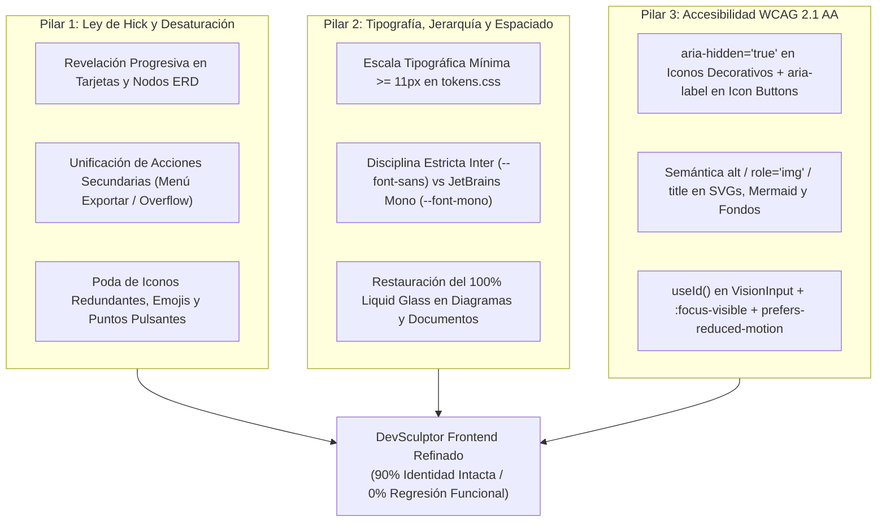

# Plan de Trabajo: Refinamiento Visual, Ley de Hick y Accesibilidad (WCAG 2.1 AA)

| Metadato | Detalle |
| :--- | :--- |
| **Proyecto** | DevSculptor — Plataforma de Gobernanza Arquitectónica Asistida por IA |
| **Módulo Objetivo** | `devsculptor-frontend` (Capa de Presentación y Experiencia de Usuario) |
| **Documentos Base** | `Frontend_Conventions_and_UX_UI_Guidelines.md`, `Frontend_Features_and_Sprints_Specification.md`, `Frontend_Security_and_Quality_Audit_Report.md` |
| **Alcance de Cambio** | **10% Refinamiento Quirúrgico** (Tipografía, Espaciado, Ley de Hick y Accesibilidad) / **90% Conservación Estricta de Identidad Visual** (*Apple visionOS Liquid Glassmorphism v2* & *NotebookLM Studio*) |
| **Riesgo Funcional** | **Nulo (0%)** — Cero alteraciones a lógica de negocio, contratos de API, stores de Zustand o flujos de datos. |

---

## 1. Resumen Ejecutivo y Principios Rectores

El frontend actual de **DevSculptor** posee una identidad visual sólida y altamente diferenciada basada en **Apple visionOS Liquid Glassmorphism (v2)** y la disposición tripartita de **Google NotebookLM**. Sin embargo, tras auditar los componentes implementados en `devsculptor-frontend/src/`, se identificaron tres áreas críticas donde el acabado visual y técnico debe elevarse sin alterar la arquitectura ni romper funcionalidades:

1. **Saturación Visual e Incumplimiento de la Ley de Hick ($T = b \log_2(n + 1)$):** Existen vistas con exceso de micro-iconos, insignias (*badges*) redundantes, múltiples indicadores pulsantes simultáneos (`animate-pulse`), emojis mezclados con iconos vectoriales y barras de herramientas con hasta 6–8 botones compitiendo al mismo nivel jerárquico.
2. **Desajuste Tipográfico y de Espaciado (Micro-textos y Abuso de Monospace):** Se abusa de tamaños inferiores a `10px` (`text-[7.5px]` a `text-[9.5px]`) que dificultan la lectura sobre superficies translúcidas, y se aplica la fuente `--font-mono` (`JetBrains Mono`) a textos descriptivos, subtítulos y etiquetas generales que, según las convenciones del proyecto, deberían utilizar `--font-sans` (`Inter`).
3. **Brechas de Accesibilidad (WCAG 2.1 Nivel AA / WAI-ARIA):** Faltan textos alternativos (`alt`, `role="img"`, `aria-label`) en diagramas SVG/Mermaid, nodos del lienzo ERD y miniaturas; los iconos decorativos de Material Symbols carecen de `aria-hidden="true"` (provocando que los lectores de pantalla lean nombres técnicos como *"grid underscore view"*); los inputs no vinculan programáticamente `<label htmlFor>` con `id`; y los botones `.vision-btn` eliminan el `outline` sin definir un estado `:focus-visible` para navegación por teclado.

### Regla de Oro de la Intervención (Invariante del 90%)
> **Lo que NO se toca:** Se mantienen intactos el motor de fondos escénicos (`WallpaperCanvas`), las variables de cristal líquido (`--bg-glass-*`, `--blur-*`), los bordes especulares (`.glass-border-specular`), la paleta semántica de acentos, la estructura tripartita (`FlowSidebar` + Área Central + `CopilotInspector`) y el 100% de los *handlers* (`onClick`, `onChange`, `onSubmit`), estados y llamadas al backend.

---

## 2. Diagnóstico Detallado del Estado Actual

### 2.1. Violaciones a la Ley de Hick y Saturación de Elementos

La **Ley de Hick-Hyman** establece que el tiempo que tarda un usuario en tomar una decisión aumenta logarítmicamente con el número y la complejidad de las opciones visibles ($T = b \log_2(n + 1)$).

| Componente / Archivo | Hallazgo de Saturación Visual | Impacto en Carga Cognitiva |
| :--- | :--- | :--- |
| `src/components/studio/ChatConsultantView.tsx` | **1.** La cabecera muestra simultáneamente: punto pulsante, subtítulo, selector `<select>` de modo, botón `Limpiar` con icono y un `VisionPill` (`MODO X`) que **duplica exactamente** el valor ya visible en el `<select>`.<br>**2.** En las tarjetas de respuesta IA (`Acciones Técnicas Detectadas`), cada diagrama sugerido despliega **4 botones independientes en fila** (`Previsualizar`, `Código`, `+ Inyectar`, `Estudio`) más 2 badges (`DIAG-EXT`, `FLOWCHART`), sumando entre 15 y 25 objetivos clicables por mensaje. | El usuario se enfrenta a controles repetidos en la cabecera y a una pared de micro-botones en cada burbuja del chat. |
| `src/components/studio/ConsolidatedDocumentsView.tsx` | **1.** Doble barra superior con **6 botones individuales de acción en fila** (`Copiar`, `.md`, `.mmd`, `.html`, `PDF`, `Pantalla completa`) junto al conmutador de 3 vistas.<br>**2.** Fuga de identidad visual en la línea 302: usa `bg-slate-950` / `bg-slate-100` opacos en lugar de la superficie translúcida del estudio. | A diferencia de `DiagramsView.tsx` (que agrupa las descargas en un menú `Exportar`), aquí se exponen todos los formatos a la vez, saturando la barra de herramientas. |
| `src/components/studio/DiagramsView.tsx` | **1.** Fuga de identidad en la línea 411 (`bg-slate-950` / `bg-slate-100` opacos).<br>**2.** Exceso de micro-etiquetas e iconos en la barra lateral de catálogo y en la barra de herramientas del visor. | Rompe la continuidad del *Liquid Glass* al cambiar desde otras pestañas del estudio y recarga el encabezado. |
| `src/components/canvas/EntityNode.tsx` & `CanvasDrawer.tsx` | **1.** Uso de **emojis literales** (`🔑` para PK, `🔗` para FK) mezclados con iconos vectoriales `material-symbols-outlined` (`table_chart`, `tune`, `close`).<br>**2.** Cada nodo muestra permanentemente el badge `RLS`, botones de editar/eliminar y badges `PK`/`FK`/`UQ` en cada fila. | En un modelo con 10–15 tablas, el lienzo muestra cientos de micro-insignias, emojis coloridos y botones de acción estáticos que compiten con los nombres de las entidades y columnas. |
| `src/components/projects/ProjectsHub.tsx` | Cada tarjeta de proyecto es completamente clicable (`onClick`), pero además incluye en su interior: pill `ACTIVO` con punto luminoso, fecha, icono de organización, icono de arquitecto, badge de estado con icono, y un pie de tarjeta con **3 botones** (`Abrir Estudio` a ancho completo + icono flecha, botón `tune` y botón `delete`). | Redundancia entre el clic de la tarjeta completa y el botón primario `Abrir Estudio`, además de saturación de iconos en los metadatos secundarios. |
| **Global (Múltiples Vistas)** | **Abuso de puntos pulsantes (`animate-pulse`):** Presentes al mismo tiempo en `AppleTopBar`, `CopilotInspector`, `ChatConsultantView`, `CanvasDrawer`, `ConsolidatedDocumentsView` y `UserProfileMenu`. | Cuando 4 o 5 indicadores parpadean simultáneamente en pantalla, pierden su función de alerta de estado y generan fatiga visual periférica. |

---

### 2.2. Diagnóstico de Tipografía, Jerarquía y Espaciado

1. **Micro-tipografía ilegible sobre cristal (`< 10.5px`):**
   - Existen más de 80 instancias de clases arbitrarias de Tailwind como `text-[7.5px]`, `text-[8px]`, `text-[8.5px]`, `text-[9px]` y `text-[9.5px]` en `EntityNode.tsx`, `FlowSidebar.tsx`, `CopilotInspector.tsx`, `RequirementsView.tsx`, `DecisionsView.tsx` y `ConsolidatedDocumentsView.tsx`.
   - Sobre fondos con `backdrop-filter: blur(...)` y gradientes dinámicos, cualquier texto por debajo de `10.5px` (`0.656rem`) pierde definición subpíxel en monitores estándar (1080p/1440p).
2. **Invasión de `--font-mono` (`JetBrains Mono`) en textos de interfaz:**
   - La convención en `Frontend_Conventions_and_UX_UI_Guidelines.md` (§3.5) establece que `JetBrains Mono` es exclusiva para identificadores técnicos (`RF-01`, `ADR-01`), tipos de datos SQL (`UUID`, `VARCHAR`) y bloques de código.
   - Actualmente se aplica `font-mono` a subtítulos de vistas (`RequirementsView.tsx`, `DecisionsView.tsx`), mensajes de estado vacío (`StudioWorkspace.tsx`), etiquetas de navegación (`AppleTopBar.tsx`) y descripciones operativas (`CopilotInspector.tsx`), haciendo que la interfaz parezca una terminal cruda en lugar de un entorno *Apple visionOS*.
3. **Separaciones y Respiración Espacial (*Breathing Room*):**
   - Listas densas en `RequirementsView.tsx`, `DecisionsView.tsx` y `CopilotInspector.tsx` usan rellenos comprimidos (`p-2`, `gap-1.5`) combinados con bordes dobles, generando sensación de apiñamiento.

---

### 2.3. Diagnóstico de Accesibilidad (WCAG 2.1 Nivel AA)

1. **Contaminación de Lectores de Pantalla por Iconos Decorativos:**
   - En `VisionButton.tsx` (línea 42) y en todas las vistas, la fuente ligadura `<span className="material-symbols-outlined">nombre_icono</span>` se renderiza **sin `aria-hidden="true"`**. Un lector de pantalla (NVDA, VoiceOver) lee literalmente el texto del ligature antes del botón (ej. *"auto awesome Auditar Estudio"* o *"delete Eliminar"*).
2. **Ausencia de Textos Alternativos (`alt` / `role="img"` / `aria-label`) en Elementos Visuales:**
   - **Diagramas Mermaid y Grafos SVG** (`MermaidVisualizer.tsx`, `GraphCanvas.tsx`, `SequenceCanvas.tsx`): Los contenedores y elementos `<svg>` generados dinámicamente no poseen `role="img"`, `aria-label` descriptivo ni etiqueta interna `<title>`, siendo cajas mudas para tecnologías de asistencia.
   - **Conectores Bezier del Lienzo ERD** (`BezierConnectors.tsx`): El `<svg>` que dibuja las relaciones entre tablas carece de descripción accesible de las relaciones clave foránea ($1:N$, $1:1$) o de ocultación semántica si la relación ya se describe en las tablas.
   - **Nodos del Lienzo ERD** (`EntityNode.tsx`): Son `<div>` interactivos solo mediante ratón (`onMouseDown`, `onDoubleClick`) sin `role="group"`, `tabIndex={0}` ni `aria-label` que resuma la entidad (ej. *"Tabla usuarios, 6 columnas, 1 llave primaria"*).
   - **Miniaturas de Fondos Escénicos** (`PlatformSettingsDrawer.tsx`, `SettingsModal.tsx`): Tienen un `alt={wp.name}` básico que debe enriquecerse a `alt={`Vista previa del fondo escénico ${wp.name}`}`, asegurando además que los botones contenedores tengan `aria-pressed={isSelected}`.
3. **Formularios y Controles sin Etiquetado Programático:**
   - `VisionInput.tsx` renderiza `<label>` e `<input>` como hermanos visuales, pero **no genera ni enlaza un `id` con `htmlFor`**, ni declara `aria-invalid={!!error}` o `aria-describedby` hacia el mensaje de error.
   - Los campos de búsqueda (`<input type="text">`) y selectores de filtro (`<select>`) en `ProjectsHub.tsx`, `RequirementsView.tsx`, `DecisionsView.tsx`, `CanvasDrawer.tsx`, `DiagramsView.tsx` y `ConsolidatedDocumentsView.tsx` dependen únicamente de `placeholder` sin atributo `aria-label`.
4. **Botones de Solo Icono sin `aria-label`:**
   - Múltiples botones que solo contienen un icono tienen `title` pero carecen de `aria-label` (controles de zoom en `CanvasView.tsx`, editar/eliminar en `ProjectsHub.tsx`, `EntityNode.tsx`, `DecisionsView.tsx`, y acciones de barra en `ConsolidatedDocumentsView.tsx`).
5. **Pérdida de Foco de Teclado (`:focus-visible`) y Movimiento Reducido:**
   - En `glassmorphism.css` (línea 60), `.vision-btn` define `outline: none;` sin una regla `.vision-btn:focus-visible`, haciendo imposible saber qué botón tiene el foco al navegar con `Tab`.
   - En `index.css` no existe soporte para `@media (prefers-reduced-motion: reduce)` para desactivar el movimiento continuo de `.ambient-orb` y las animaciones de pulso en usuarios con sensibilidad vestibular.

---

## 3. Arquitectura de la Solución (Los 3 Pilares de Mejora)



---

### Pilar 1: Aplicación Práctica de la Ley de Hick (Desaturación y Limpieza Visual)

#### 1.1. Reglas de Desaturación Global
* **Presupuesto de Indicadores Pulsantes (`animate-pulse`):** Máximo **1 indicador activo** simultáneo en el marco global (exclusivamente en `AppleTopBar` o en el `CopilotInspector` cuando la IA está ejecutando una tarea en tiempo real). Los puntos de estado estáticos usarán color sólido con resplandor sutil sin animación infinita.
* **Presupuesto de Iconos en Botones:**
  * En grupos de 3 o más botones contiguos, solo la **acción primaria** lleva icono + texto; las acciones secundarias llevan **solo texto limpio** o se agrupan en un menú desplegable (`Exportar ▾` / `Más acciones`).
* **Cero Emojis Nativos del Sistema:** Reemplazar `🔑` y `🔗` en `EntityNode.tsx` y `CanvasDrawer.tsx` por indicadores vectoriales minimalistas (`key`, `link` a `12px` con `aria-hidden="true"`) o etiquetas tipográficas monocromáticas limpias (`PK`, `FK`), garantizando coherencia total con el lenguaje *visionOS*.

#### 1.2. Intervenciones Específicas por Vista (Ley de Hick)
1. **`ChatConsultantView.tsx`:**
   * **Cabecera:** Eliminar el `VisionPill` redundante que repite el modo seleccionado en el `<select>` contiguo. Mantener únicamente el selector de modo estilizado y el botón de limpiar conversación.
   * **Tarjetas de Diagramas Detectados:** Reducir los 4 botones en fila (`Previsualizar`, `Código`, `+ Inyectar`, `Estudio`) a **2 acciones claras**:
     1. Acción Primaria: `+ Inyectar al Estudio` (o `Abrir en Estudio` si ya fue inyectado).
     2. Acción Secundaria única: `Previsualizar` (y dentro del panel de previsualización desplegado colocar un conmutador simple `Vista | Código`). Esto reduce a la mitad los botones por tarjeta sin perder ninguna función.
2. **`ConsolidatedDocumentsView.tsx`:**
   * **Unificación de Exportación:** Agrupar los 4 botones sueltos de descarga (`.md`, `.mmd`, `.html`, `PDF`) en un único botón desplegable `Exportar ▾` (idéntico al patrón que ya existe y funciona con éxito en `DiagramsView.tsx`). La barra secundaria pasará de 6 botones a solo 3 (`Copiar`, `Exportar ▾`, `Pantalla completa`).
3. **`EntityNode.tsx` (Lienzo ERD):**
   * **Revelación Progresiva (*Progressive Disclosure*):** Los botones de acción del encabezado de cada tabla (`Editar` / `Eliminar`) tendrán opacidad `0` por defecto y aparecerán suavemente (`opacity-100`) solo cuando el nodo esté en `:hover`, `:focus-within` o seleccionado (`.is-selected`).
   * **Limpieza de Filas de Columnas:** Eliminar los emojis `🔑`/`🔗` del lado izquierdo del nombre de columna, ya que la fila **ya muestra** los badges `PK` y `FK` en el extremo derecho. Esto elimina la duplicación visual en cada columna y alinea todos los nombres de atributos sobre un eje vertical limpio.
4. **`ProjectsHub.tsx`:**
   * **Acciones de Tarjeta:** Hacer que los botones secundarios (`Editar` y `Eliminar`) tengan un estilo discreto y se revelen con énfasis al pasar el cursor o enfocar la tarjeta (`group-hover:opacity-100 focus-within:opacity-100`), y simplificar los iconos de metadatos (`Organización` y `Arquitecto`) a una línea tipográfica limpia separada por un punto medio (`·`), eliminando 2 iconos por tarjeta.

---

### Pilar 2: Refinamiento Tipográfico, Jerarquía y Coherencia Glassmorphism

#### 2.1. Nueva Escala Tipográfica Canónica (`src/styles/tokens.css`)
Se definirán variables tipográficas explícitas en `tokens.css` para erradicar los tamaños arbitrarios menores a `10.5px`:

| Token Propuesto | Tamaño (`rem` / `px`) | Line Height | Fuente Asignada | Uso Canónico en DevSculptor |
| :--- | :--- | :--- | :--- | :--- |
| `--text-2xs` | `0.6875rem` (`11px`) | `1.35` | `--font-sans` o `--font-mono` | **Mínimo absoluto permitido.** Badges (`PK`, `FK`, `RF-01`), atajos (`⌘K`) y contadores. |
| `--text-xs` | `0.75rem` (`12px`) | `1.45` | `--font-sans` | Metadatos secundarios, etiquetas de formulario (`VisionInput`), botones compactos y navegación secundaria. |
| `--text-sm` | `0.8125rem` (`13px`) | `1.55` | `--font-sans` | Texto base de controles, listas de requerimientos, columnas de tablas ERD y descripciones de tarjetas. |
| `--text-base` | `0.875rem` (`14px`) | `1.65` | `--font-sans` | Cuerpo de lectura en `ChatConsultantView`, `ConsolidatedDocumentsView` y modales. |
| `--text-md` | `1rem` (`16px`) | `1.4` | `--font-sans` (`font-semibold`) | Títulos de tarjetas, encabezados de nodos ERD y secciones de paneles laterales. |
| `--text-lg` | `1.25rem` (`20px`) | `1.25` | `--font-display` (`font-bold`) | Títulos principales de vistas de estudio (`Requerimientos`, `Decisiones ADR`, `Lienzo ERD`). |

#### 2.2. Disciplina de Fuentes (`Inter` vs `JetBrains Mono`)
* **Revertir a `--font-sans` (`Inter`):**
  * Subtítulos descriptivos de encabezados en `RequirementsView.tsx`, `DecisionsView.tsx`, `ChatConsultantView.tsx` y `ProjectsHub.tsx`.
  * Etiquetas (`<label>`) de formularios y *placeholders* de búsqueda.
  * Textos de estados vacíos (*empty states*) en `StudioWorkspace.tsx`, `RequirementsView.tsx` y `DiagramsView.tsx`.
  * Textos de botones de navegación en `AppleTopBar.tsx` y `FlowSidebar.tsx`.
* **Mantener en `--font-mono` (`JetBrains Mono`):**
  * Códigos de trazabilidad (`RF-001`, `RNF-002`, `ADR-01`, `DOC-04`).
  * Tipos de datos SQL en `EntityNode.tsx` y `CanvasDrawer.tsx` (`UUID`, `VARCHAR(255)`, `TIMESTAMPTZ`).
  * Bloques de código Mermaid, YAML, Markdown y JSON.
  * Porcentajes y métricas numéricas del índice de madurez arquitectónica.

#### 2.3. Restauración del 100% de Coherencia Glassmorphism
* En `ConsolidatedDocumentsView.tsx` (línea 302) y `DiagramsView.tsx` (línea 411), reemplazar las clases opacas `bg-slate-950` / `bg-slate-100` por superficies translúcidas coherentes con el sistema (`vision-panel` / `bg-[var(--bg-glass-panel)]`) para que el lienzo de fondo (`WallpaperCanvas`) siga percibiéndose sutilmente a través del estudio, respetando el 100% de las convenciones de *Liquid Glass*.

---

### Pilar 3: Estándar de Accesibilidad Integral (WCAG 2.1 Nivel AA)

#### 3.1. Textos Alternativos (`alt`) y Semántica para Imágenes, SVGs y Diagramas
1. **Componente `MermaidVisualizer.tsx`:**
   * Añadir nueva prop opcional `accessibleTitle?: string` y `accessibleDescription?: string`.
   * En el contenedor del SVG inyectado, establecer `role="img"` y `aria-label={accessibleTitle || 'Diagrama de arquitectura generado en formato Mermaid'}`.
   * Posprocesar el nodo `<svg>` renderizado por Mermaid para insertar un elemento `<title>` interno si no existe, permitiendo que los lectores de pantalla anuncien el propósito del diagrama.
2. **Lienzos Interactivos (`GraphCanvas.tsx`, `SequenceCanvas.tsx`, `CanvasView.tsx`):**
   * En `GraphCanvas.tsx` y `SequenceCanvas.tsx`, agregar al elemento `<svg>` principal `role="img"` y `aria-label` dinámico (ej. `aria-label={`Diagrama de secuencia con ${participants.length} participantes y ${messages.length} interacciones`}`).
   * En `BezierConnectors.tsx`, marcar el SVG de líneas conectoras con `aria-hidden="true"` y trasladar la información semántica de relación (`FK -> tabla_destino`) al `aria-label` de la columna correspondiente dentro de `EntityNode.tsx`, evitando que el lector de pantalla intente leer trazos vectoriales sueltos.
3. **Nodos de Entidad (`EntityNode.tsx`):**
   * Añadir al contenedor `.erd-node`: `role="region"`, `tabIndex={0}`, `aria-label={`Entidad ${entity.table_name}, ${entity.columns?.length || 0} columnas`}`, y soporte de teclado (`onKeyDown`: `Enter` para abrir el inspector de edición de la entidad).
4. **Imágenes de Fondos Escénicos (`PlatformSettingsDrawer.tsx`, `SettingsModal.tsx`):**
   * Actualizar ``.
   * En el `<button>` contenedor de cada miniatura, añadir `aria-pressed={currentWallpaperId === wp.id}` y `aria-label={`Seleccionar fondo ${wp.name}`}`.

#### 3.2. Higiene de Iconos Decorativos y Botones de Solo Icono
1. **Primitiva `VisionButton.tsx`:**
   * Actualizar el renderizado del icono para incluir siempre `aria-hidden="true"`:
     ```tsx
     {icon && (
       <span className="material-symbols-outlined text-[16px] leading-none" aria-hidden="true">
         {icon}
       </span>
     )}
     ```
2. **Barrido de `<span className="material-symbols-outlined">` en Vistas:**
   * Añadir `aria-hidden="true"` a todos los iconos decorativos acompañados de texto o dentro de botones con `aria-label`.
3. **Obligatoriedad de `aria-label` en Botones de Solo Icono:**
   * En todo `<button>` que solo contenga un icono (cerrar modal, zoom `+`/`-`/`fit`, editar/eliminar fila, colapsar sidebar, copiar código), añadir explícitamente `aria-label="..."` en español descriptivo (no depender únicamente del atributo `title`, ya que `title` no siempre es anunciado de forma consistente por todos los lectores de pantalla móviles y de escritorio).

#### 3.3. Accesibilidad en Formularios, Foco de Teclado y Movimiento
1. **Vinculación Programática en `VisionInput.tsx`:**
   * Utilizar el hook nativo `React.useId()` para generar un identificador único cuando no se pase `id` por props:
     ```tsx
     const generatedId = useId();
     const inputId = id || generatedId;
     const errorId = `${inputId}-error`;
     ```
   * Asignar `htmlFor={inputId}` al `<label>`, `id={inputId}` al `<input>`, `aria-invalid={Boolean(error)}` y `aria-describedby={error ? errorId : undefined}`.
   * Añadir `id={errorId}` y `role="alert"` al `<span className="text-rose-400">` del error.
2. **Anillo de Foco Especular (`:focus-visible`) en `src/styles/glassmorphism.css`:**
   * Agregar una regla de foco accesible que respete la estética *Apple visionOS* (solo visible al navegar con teclado `Tab`, invisible al hacer clic con ratón):
     ```css
     .vision-btn:focus-visible,
     .vision-pill-interactive:focus-visible,
     button:focus-visible,
     select:focus-visible,
     [tabindex="0"]:focus-visible {
       outline: 2px solid var(--accent-primary);
       outline-offset: 2px;
       box-shadow: 0 0 0 4px rgba(56, 189, 248, 0.2);
     }
     ```
3. **Semántica de Diálogos y Regiones Vivas (`VisionModal.tsx`, `ConfirmModal.tsx`):**
   * Añadir `role="dialog"`, `aria-modal="true"` y enlazar el título del modal mediante `aria-labelledby={titleId}`.
   * En notificaciones flotantes (*toasts*) y alertas de error (`AuthPortal.tsx`, `ChatConsultantView.tsx`, `RequirementsView.tsx`), añadir `role="status"` y `aria-live="polite"` (o `role="alert"` para errores críticos).
4. **Respeto a Preferencias de Movimiento (`src/styles/index.css`):**
   * Añadir al final de `index.css`:
     ```css
     @media (prefers-reduced-motion: reduce) {
       .ambient-orb,
       .animate-pulse,
       .animate-spin-slow {
         animation: none !important;
       }
       *, *::before, *::after {
         transition-duration: 0.01ms !important;
       }
     }
     ```

---

## 4. Plan de Ejecución Iterativo por Fases (Sin Regresión Funcional)

Para garantizar que ninguna funcionalidad se rompa durante la implementación, el trabajo se divide en **5 fases incrementales y aisladas**:

### Fase 1: Cimientos CSS — Tipografía, Focus Rings y Movimiento Reducido
* **Archivos a intervenir:**
  * `src/styles/tokens.css`
  * `src/styles/glassmorphism.css`
  * `src/styles/index.css`
* **Acciones:**
  1. Definir tokens tipográficos `--text-2xs` (`11px`) a `--text-xl` en `tokens.css` y ajustar el contraste de `--text-muted` para garantizar ratio $\ge 4.5:1$ sobre cristal tanto en modo oscuro como en modo claro.
  2. Incorporar `:focus-visible` especular en `glassmorphism.css` para `.vision-btn`, `.vision-input` y elementos interactivos.
  3. Añadir la media query `@media (prefers-reduced-motion: reduce)` en `index.css`.
* **Verificación:** La aplicación compila sin cambios estructurales; al presionar `Tab` se observa un halo celeste/índigo limpio sobre cada control interactivo.

---

### Fase 2: Primitivas UI Accesibles (`src/components/ui/` y `src/components/layout/`)
* **Archivos a intervenir:**
  * `src/components/ui/VisionButton.tsx`
  * `src/components/ui/VisionInput.tsx`
  * `src/components/ui/VisionModal.tsx`
  * `src/components/ui/ConfirmModal.tsx`
  * `src/components/ui/VisionCombobox.tsx`
  * `src/components/ui/ThemeToggle.tsx`
  * `src/components/layout/AppleTopBar.tsx`
  * `src/components/layout/WallpaperCanvas.tsx`
* **Acciones:**
  1. En `VisionButton.tsx`: añadir `aria-hidden="true"` al icono y elevar el tamaño mínimo de fuente del botón `sm` de `10px` a `12px` (`text-xs`).
  2. En `VisionInput.tsx`: implementar `useId()` para vincular `<label htmlFor>` con `<input id>`, añadir `aria-invalid`, `aria-describedby` y cambiar la fuente del `<label>` de `font-mono` a `font-sans` con peso `font-medium`.
  3. En `VisionModal.tsx` y `ConfirmModal.tsx`: agregar `role="dialog"`, `aria-modal="true"`, `aria-labelledby` enlazado al `<h2>` del título y `aria-label="Cerrar ventana"` en el botón de cierre.
  4. En `AppleTopBar.tsx`: cambiar la barra de pestañas central de `font-mono` a `font-sans`, añadir `aria-current="page"` (o `role="tablist"` / `role="tab"` con `aria-selected`) a las vistas principales, y `aria-hidden="true"` a los iconos.
  5. En `WallpaperCanvas.tsx`: asegurar que el contenedor raíz tenga `aria-hidden="true"` y `role="presentation"` para que nunca interfiera con el árbol de accesibilidad.

---

### Fase 3: Ley de Hick en Marco de Estudio, Autenticación y Hub de Proyectos
* **Archivos a intervenir:**
  * `src/components/auth/AuthPortal.tsx`
  * `src/components/projects/ProjectsHub.tsx`
  * `src/components/studio/FlowSidebar.tsx`
  * `src/components/studio/CopilotInspector.tsx`
  * `src/components/studio/StudioWorkspace.tsx`
  * `src/components/settings/PlatformSettingsDrawer.tsx`
  * `src/components/settings/SettingsModal.tsx`
* **Acciones:**
  1. En `ProjectsHub.tsx`:
     * Limpiar los metadatos de cada tarjeta (reemplazar iconos de organización/arquitecto por una línea tipográfica editorial en `Inter` `12px`).
     * Aplicar revelación progresiva (`opacity-60 group-hover:opacity-100 focus-within:opacity-100`) a las acciones secundarias (`Editar`, `Eliminar`) y añadirles `aria-label={`Editar proyecto ${project.name}`}` y `aria-label={`Eliminar proyecto ${project.name}`}`.
     * Añadir `aria-label="Buscar proyectos por nombre o descripción"` al buscador.
  2. En `FlowSidebar.tsx`:
     * Elevar los textos de las etapas del flujo de `10px` a `12.5px` (`--font-sans`), manteniendo únicamente el contador numérico (`12`, `4`) en `--font-mono`.
     * Añadir `aria-label` al botón de colapsar/expandir barra lateral y `aria-current="step"` a la etapa activa.
  3. En `CopilotInspector.tsx`:
     * Eliminar puntos pulsantes secundarios cuando el copiloto está en reposo (mantener punto estático esmeralda).
     * Reemplazar `font-mono` en párrafos de sugerencias por `font-sans` (`12.5px`, `leading-relaxed`) para mejorar drásticamente la legibilidad.
  4. En `PlatformSettingsDrawer.tsx` y `SettingsModal.tsx`:
     * Enriquecer los atributos `alt` de las miniaturas de fondos y añadir `aria-pressed` a cada tarjeta selectora de tema/fondo.

---

### Fase 4: Desaturación (Ley de Hick) y Accesibilidad en Vistas de Gobernanza
* **Archivos a intervenir:**
  * `src/components/studio/ChatConsultantView.tsx`
  * `src/components/studio/RequirementsView.tsx`
  * `src/components/studio/DecisionsView.tsx`
  * `src/components/studio/ConsolidatedDocumentsView.tsx`
  * `src/components/studio/DiagramsView.tsx`
* **Acciones:**
  1. En `ChatConsultantView.tsx`:
     * Eliminar el `VisionPill` redundante de modo en el header.
     * Simplificar la botonera de cada diagrama sugerido de 4 botones a 2 (`Previsualizar` con toggle interno `Vista/Código` + `+ Inyectar`).
     * Añadir `aria-label` al `<select>` de modo, al `<textarea>` del prompt y al botón de envío.
  2. En `ConsolidatedDocumentsView.tsx` y `DiagramsView.tsx`:
     * Reemplazar `bg-slate-950` / `bg-slate-100` por superficies translúcidas `vision-panel` para recuperar el 100% de la identidad *Liquid Glass*.
     * En `ConsolidatedDocumentsView.tsx`, agrupar los 4 botones de descarga (`.md`, `.mmd`, `.html`, `PDF`) en un único menú desplegable `Exportar ▾`, igualando el estándar de `DiagramsView.tsx`.
     * Aumentar el tamaño del cuerpo documental y tablas de `11px` a `13.5px–14px` con `line-height: 1.65`.
  3. En `RequirementsView.tsx` y `DecisionsView.tsx`:
     * Cambiar descripciones y títulos de `font-mono` a `font-sans`, manteniendo `font-mono` exclusivamente en los badges de código (`RF-001`, `ADR-01`).
     * Añadir `aria-label` a todos los filtros `<select>`, buscadores y botones de editar/eliminar requerimiento o ADR.
     * Ampliar el espaciado interno de las tarjetas (`p-4`, `gap-3`) para evitar saturación visual.

---

### Fase 5: Ergonomía Visual y Semántica en el Lienzo ERD y Visualizadores SVG
* **Archivos a intervenir:**
  * `src/components/canvas/EntityNode.tsx`
  * `src/components/canvas/CanvasView.tsx`
  * `src/components/canvas/CanvasDrawer.tsx`
  * `src/components/canvas/BezierConnectors.tsx`
  * `src/components/diagrams/MermaidVisualizer.tsx`
  * `src/components/diagrams/GraphCanvas.tsx`
  * `src/components/diagrams/SequenceCanvas.tsx`
* **Acciones:**
  1. En `EntityNode.tsx`:
     * Eliminar los emojis `🔑` y `🔗` del lado izquierdo de las columnas (conservando los badges limpios `PK`, `FK`, `UQ` a la derecha).
     * Ocultar los botones de cabecera `tune` (Editar) y `close` (Eliminar) por defecto y revelarlos en `:hover`, `:focus-within` o cuando la tabla esté seleccionada (`.is-selected`).
     * Añadir `role="region"`, `tabIndex={0}` y `aria-label` descriptivo a cada tabla, más `aria-label` en los botones de editar y eliminar entidad.
     * Subir el tamaño de fuente de los nombres de columna a `12.5px` (`--font-sans`) y tipos de datos a `11px` (`--font-mono`).
  2. En `CanvasView.tsx`:
     * Añadir `aria-label` a todos los controles flotantes del lienzo (`Acercar zoom`, `Alejar zoom`, `Ajustar vista al lienzo`, `Auto-organizar entidades`).
  3. En `MermaidVisualizer.tsx`, `GraphCanvas.tsx` y `SequenceCanvas.tsx`:
     * Incorporar `role="img"`, `aria-label` dinámico y elemento `<title>` dentro de los SVGs renderizados para cumplir con el requisito de textos alternativos en gráficos y diagramas técnicos.

---

## 5. Matriz de Impacto y Criterios de Aceptación (Definition of Done)

| Criterio de Calidad | Métrica Antes del Plan | Meta Objetivo (Post-Iteración) |
| :--- | :--- | :--- |
| **Conservación de Identidad Visual** | *Apple visionOS Liquid Glass v2* con fugas opacas en 2 vistas. | **100% Liquid Glass** consistente en todas las vistas, conservando colores, desenfoques y bordes especulares. |
| **Ley de Hick en Barras de Acción** | Hasta 6–8 botones contiguos en Documentos y 4 por diagrama en Chat. | **Máximo 3 acciones directas** por grupo; exportaciones consolidadas en menú `Exportar ▾`. |
| **Ruido Visual en Lienzo ERD** | Emojis (`🔑`, `🔗`) + iconos + botones fijos en cada tabla. | **0 emojis nativos**, nombres de columna alineados y acciones de nodo con *revelación progresiva*. |
| **Indicadores Pulsantes (`animate-pulse`)** | 4 a 6 puntos parpadeando simultáneamente. | **Máximo 1 indicador pulsante activo** (solo durante procesos activos/telemetría principal). |
| **Tamaño Tipográfico Mínimo** | `7.5px` – `9.5px` en múltiples componentes. | **`11px` (`0.6875rem`) mínimo estricto** para badges; `13px–14px` para lectura base. |
| **Disciplina de Fuentes (`Inter` vs `Mono`)** | `font-mono` usado en subtítulos, labels y textos vacíos. | **`Inter` para toda la UI y lectura**; `JetBrains Mono` exclusivo para códigos, tipos SQL y telemetría. |
| **Accesibilidad de Imágenes y SVGs** | SVGs/Mermaid sin `role="img"` ni `aria-label`; iconos sin `aria-hidden`. | **100% de imágenes, fondos y diagramas SVG** con `alt` o `role="img"` + `aria-label`, y **100% de iconos decorativos** con `aria-hidden="true"`. |
| **Accesibilidad de Formularios y Teclado** | `VisionInput` sin `htmlFor`/`id`; `.vision-btn` sin `:focus-visible`. | **100% de inputs** vinculados programáticamente (`useId`) y anillo `:focus-visible` especular en toda la app. |
| **Integridad Funcional** | Flujos actuales operativos. | **0 regresiones:** Todos los handlers, stores, modales, descargas y llamadas API funcionan exactamente igual. |
