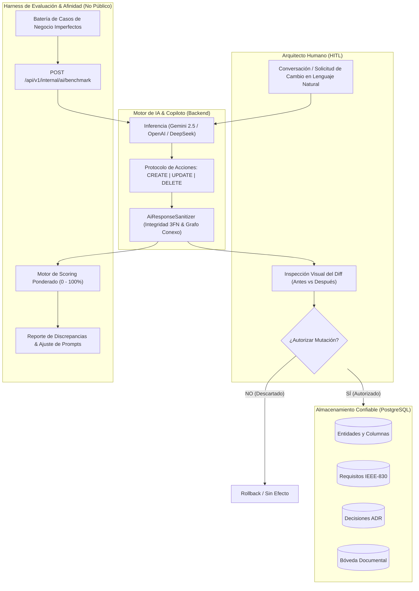
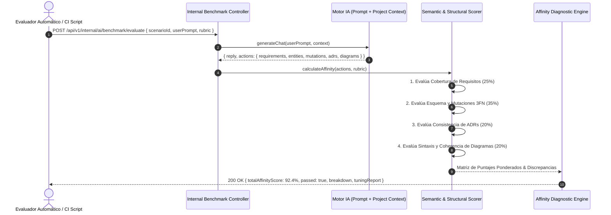

# 🏛️ Plan Maestro: Edición Agéntica Human-in-the-Loop y Benchmark de Afinidad de IA
## DevSculptor Enterprise — Especificación de Ingeniería y Arquitectura

> **Rama de Desarrollo:** `develop`  
> **Estándar:** ISO/IEC/IEEE 42010 / Human-in-the-Loop (HITL) / LLM Evals  
> **Estado:** Aprobado para Implementación  
> **Fecha:** Octubre 2026  
> **Autor:** Nathaniel Muller & AI Architecture Council  

---

## 1. Visión y Justificación del Sistema

El ecosistema actual de **DevSculptor** destaca por su capacidad de **inferencia, generación inicial y normalización determinista** de esquemas de datos (3FN), requisitos (IEEE-830), actas de decisión (ADRs) y modelos visuales (Mermaid y SVG). Sin embargo, la evolución viva de un sistema de software exige dos capacidades avanzadas indispensables para el nivel Enterprise:

1. **Edición Agéntica y Mutaciones Guiadas (Human-in-the-Loop):**
   La IA no debe limitarse a insertar nuevos registros aislados; debe ser capaz de **editar, refactorizar, renombrar y eliminar de forma controlada** entidades del Canvas, columnas existentes, atributos de requisitos, actas de decisión y diagramas. Toda mutación destructiva o aditiva sobre artefactos existentes debe requerir **autorización humana explícita** mediante tarjetas de inspección de cambios (Diff Viewer) antes de consolidarse en la base de datos PostgreSQL.

2. **Harness de Benchmark, Evaluación y Medición de Afinidad Semántica (AI Evaluation Framework):**
   Un sistema de ingeniería robusto no puede depender de la intuición para saber si la IA responde "bien" o "mal". Se requiere un **endpoint interno y una suite automatizada de pruebas de evaluación** que simule conversaciones realistas, ricas en ambigüedad y reglas de negocio, y califique cuantitativamente (de 0% a 100%) el porcentaje de **afinidad y cumplimiento técnico** de las respuestas del modelo frente a una rúbrica esperada (Ground Truth Rubric), reportando discrepancias y guiando el ajuste continuo de prompts.



---

## 2. Especificación Técnica: Edición Agéntica Human-in-the-Loop (HITL)

### 2.1. Protocolo de Acciones Extendido (`devsculptor-actions`)

Se amplía el contrato JSON devuelto por los proveedores de IA para soportar operaciones de ciclo de vida completo: `CREATE`, `UPDATE` y `DELETE`.

#### Estructura del Envelope de Mutación de Entidades (`mutatedEntities`):
```typescript
export type EntityActionType = 'CREATE' | 'UPDATE' | 'DELETE';

export interface ColumnMutation {
  type: 'ADD' | 'MODIFY' | 'DROP';
  column: {
    name: string;
    type?: string;
    isPk?: boolean;
    isFk?: boolean;
    referencesTable?: string;
    referencesColumn?: string;
    cardinality?: '1:1' | '1:N' | 'N:M';
    nullable?: boolean;
    unique?: boolean;
  };
  previousColumnName?: string; // Para renombramientos
}

export interface AiEntityMutation {
  action: EntityActionType;
  targetTableName: string;
  renameTableTo?: string;
  rationale: string; // Justificación arquitectónica del cambio
  columnMutations?: ColumnMutation[];
  newSchemaPreview?: {
    tableName: string;
    columns: CanvasColumn[];
  };
}
```

#### Estructura del Envelope de Mutación de Requisitos (`mutatedRequirements`):
```typescript
export type RequirementActionType = 'CREATE' | 'UPDATE' | 'DELETE';

export interface AiRequirementMutation {
  action: RequirementActionType;
  targetCode: string; // ej. "RF-002"
  rationale: string;
  updates?: {
    title?: string;
    description?: string;
    type?: 'RF' | 'RNF';
    priority?: 'HIGH' | 'MEDIUM' | 'LOW';
    entityRelation?: string[];
  };
}
```

#### Estructura del Envelope de Mutación de Decisiones (`mutatedDecisions`):
```typescript
export type DecisionActionType = 'CREATE' | 'UPDATE' | 'SUPERSEDE';

export interface AiDecisionMutation {
  action: DecisionActionType;
  targetCode: string; // ej. "ADR-001"
  rationale: string;
  status?: 'PROPOSED' | 'ACCEPTED' | 'REJECTED' | 'SUPERSEDED';
  supersededBy?: string;
  updates?: {
    title?: string;
    context?: string;
    decision?: string;
    consequences?: string;
  };
}
```

---

### 2.2. Flujo de Autorización Humana en Frontend (UX / UI)

1. **Detección de Mutación:** Cuando la respuesta del copiloto contiene elementos con `action === 'UPDATE'` o `action === 'DELETE'`, `ChatConsultantView` no inyecta a ciegas.
2. **Tarjeta de Diff Comparativo:**
   - Se muestra un bloque visual con código de color:
     - 🟩 **Verde / Inserción:** Columnas nuevas o campos añadidos.
     - 🟨 **Amarillo / Modificación:** Tipos de dato alterados o claves foráneas re-enlazadas.
     - 🟥 **Rojo / Eliminación:** Columnas o tablas marcadas para remoción con advertencia de impacto referencial.
3. **Botones de Acción:**
   - `[✓ Autorizar y Aplicar en Canvas/Proyecto]`: Despacha la mutación atómica a través de `canvasService.updateEntity` o `requirementsService.update`.
   - `[✕ Rechazar Modificación]`: Cierra la propuesta y mantiene el estado previo en base de datos.
   - `[✏️ Editar Antes de Aplicar]`: Abre el modal nativo de edición manual pre-cargado con los cambios sugeridos.

---

## 3. Especificación Técnica: Harness de Benchmark y Scoring de Afinidad de IA

### 3.1. Arquitectura del Evaluador Semántico (LLM Evaluation Harness)

El evaluador opera a través de un endpoint protegido del backend y un runner CLI de testing:
- **Ruta Privada:** `POST /api/v1/internal/ai/benchmark/evaluate`
- **Cabecera de Seguridad Requerida:** `X-Internal-Benchmark-Key: <ENV.BENCHMARK_SECRET>` (Restringido, ausente de clientes públicos).
- **Entorno de Aislamiento:** Ejecuta contra una base de datos de pruebas o un esquema sandbox efímero sin alterar proyectos productivos.



---

### 3.2. Fórmula Ponderada de Medición de Afinidad

El porcentaje total de afinidad se calcula mediante la media ponderada de 4 dimensiones objetivas:

$$\text{AffinityScore} = (0.35 \times S_{\text{canvas}}) + (0.25 \times S_{\text{req}}) + (0.20 \times S_{\text{adr}}) + (0.20 \times S_{\text{diag}})$$

#### 1. Afinidad del Canvas y Mutaciones Relacionales ($S_{\text{canvas}}$ — 35%)
- **Recall de Columnas y Tipos Clave (40%):** ¿Se propusieron los atributos esenciales requeridos por el dominio?
- **Exactitud de Mutaciones Solicitadas (30%):** Si el escenario pedía explícitamente agregar o alterar una columna, ¿se generó la mutación correcta sin corromper la tabla?
- **Integridad 3FN y Conectividad (30%):** ¿Cero claves foráneas huérfanas? ¿Todas las relaciones son bidireccionalmente coherentes?

#### 2. Afinidad de Requisitos IEEE-830 ($S_{\text{req}}$ — 25%)
- **Cobertura de Intención de Negocio (50%):** Similitud de solapamiento semántico (Jaccard + Palabras Clave de Dominio) frente a los requisitos esperados.
- **Clasificación y Priorización (30%):** Clasificación acertada de RF vs RNF y nivel de severidad (`HIGH`/`MEDIUM`/`LOW`).
- **Trazabilidad (`entityRelation`) (20%):** Asociación correcta con las tablas afectadas.

#### 3. Afinidad de Decisiones Arquitecturales ($S_{\text{adr}}$ — 20%)
- **Identificación del Conflicto Técnico (40%):** ¿El contexto describe adecuadamente el trade-off (ej. concurrencia, bloqueo, latencia, normalización)?
- **Conformidad Estándar Nygard (30%):** Estructura canónica Título, Contexto, Decisión y Consecuencias.
- **Coherencia con las Mutaciones del Canvas (30%):** ¿La decisión técnica justifica las tablas o mutaciones propuestas?

#### 4. Afinidad de Diagramas y Representación Visual ($S_{\text{diag}}$ — 20%)
- **Validez Sintáctica Mermaid (50%):** ¿El código Mermaid compila sin errores sintácticos?
- **Fidelidad Estructural (50%):** ¿Los participantes y las relaciones reflejan fielmente las entidades y requisitos analizados?

---

### 3.3. Banco de Escenarios de Negocio Ambiguos (Ground Truth Scenarios)

El sistema de benchmark incluye una batería inicial de **5 escenarios realistas** formulados como personas conversando de forma informal con la IA:

1. **Escenario 1: Refactorización y Mutación de Catálogo (E-Commerce)**
   - *Prompt:* "Hola, tenemos la tabla `products` pero necesitamos desglosarla porque ahora manejamos variantes de talla y color con código de barras propio por variante, y queremos que el stock ya no esté en products sino en una tabla de bodegas por sucursal. Quita el stock directo de products y crea las tablas nuevas conectadas."
   - *Rúbrica Esperada:*
     - Mutación `UPDATE` en `products` (`dropColumns: ['stock']`).
     - Creación de `product_variants` con `FK -> products` y `barcode UNIQUE`.
     - Creación de `warehouses` y `variant_inventory` (tabla intermedia con stock por bodega).
     - RFs de inventario multi-bodega.

2. **Escenario 2: Agendamiento y Talleres Mecánicos con Bloqueo de Horas**
   - *Prompt:* "Necesito un sistema para mi taller mecánico donde los clientes registren sus autos y pidan citas de servicio. Cada cita dura 1 hora y un mecánico solo puede atender un auto a la vez. No quiero que dos clientes reserven la misma hora para el mismo mecánico. Modifica los requisitos para que incluyan esta regla de concurrencia."
   - *Rúbrica Esperada:*
     - Tablas `vehicles`, `mechanics`, `appointments`.
     - Mutación o creación de índice único o constraint de no-solapamiento (`mechanic_id`, `start_time`).
     - ADR de Bloqueo Pesimista / Concurrencia.
     - Diagrama de secuencia de reserva de citas.

3. **Escenario 3: Fintech & Cobro Recurrente Idempotente**
   - *Prompt:* "Estamos cobrando suscripciones mensuales pero la red a veces se cae y los clientes pagan dos veces. Queremos que el cobro sea idempotente con un token único de Stripe y registrar la auditoría de cada intento de pago."
   - *Rúbrica Esperada:*
     - Tabla `payments` con `idempotency_key UUID UNIQUE`.
     - Tabla `payment_audit_logs`.
     - RNF de idempotencia y tiempo de respuesta.
     - ADR de tokenización y reintentos exponenciales.

4. **Escenario 4: Auditoría de Seguridad y Roles RBAC**
   - *Prompt:* "Queremos restringir el acceso a ciertos endpoints del sistema según roles y que si un usuario intenta entrar a un recurso ajeno quede registrado con su IP y user agent."
   - *Rúbrica Esperada:*
     - Tablas `roles`, `permissions`, `role_permissions`, `access_audits`.
     - RF de validación de matriz de permisos.
     - ADR de Middleware de Autorización desacoplado.

5. **Escenario 5: Logística de Envíos y Trazabilidad de Estados**
   - *Prompt:* "Nuestras órdenes necesitan guías de despacho con tracking de la empresa de transporte, y pasar por estados desde recibido hasta entregado. Actualiza el diagrama de estados para ver todo el flujo."
   - *Rúbrica Esperada:*
     - Tabla `shipments` con `FK -> orders` y columna `status`.
     - Diagrama de estados con transiciones completas.
     - RF de seguimiento de guías de despacho.

---

## 4. Plan de Implementación Paso a Paso (5 Fases)

### Fase 1: Extensión del Protocolo de Mutaciones Agénticas en Backend
- [ ] **1.1:** Actualizar [`ai-provider.interface.ts`](file:///c:/Users/natha/Documents/Repos/DevSculptor/devsculptor-backend/src/modules/ai/providers/ai-provider.interface.ts) con las interfaces `AiEntityMutation`, `AiRequirementMutation` y `AiDecisionMutation`.
- [ ] **1.2:** Enriquecer [`ai.prompts.ts`](file:///c:/Users/natha/Documents/Repos/DevSculptor/devsculptor-backend/src/modules/ai/ai.prompts.ts) con la especificación de mutaciones y ejemplos de prompts para `action: 'UPDATE'` y `action: 'DELETE'`.
- [ ] **1.3:** Extender [`ai.validator.ts`](file:///c:/Users/natha/Documents/Repos/DevSculptor/devsculptor-backend/src/modules/ai/ai.validator.ts) para validar sintaxis de mutaciones, verificar existencia de tablas a mutar y prevenir eliminaciones de tablas con FKs activas sin confirmación.
- [ ] **1.4:** Adaptar `mock.provider.ts`, `gemini.provider.ts` y `openai.provider.ts` para emitir las acciones de mutación cuando el usuario solicita modificar o refactorizar.

### Fase 2: Componentes UI de Autorización y Diff Comparativo en Frontend
- [ ] **2.1:** Diseñar componente `MutationDiffCard.tsx` que presente de forma cristalina qué se va a modificar (campos añadidos en verde, eliminados en rojo, tipos alterados).
- [ ] **2.2:** Integrar botones de autorización explícita ("Autorizar Cambio", "Descartar") en [`ChatConsultantView.tsx`](file:///c:/Users/natha/Documents/Repos/DevSculptor/devsculptor-frontend/src/features/chat/ChatConsultantView.tsx).
- [ ] **2.3:** Implementar en [`useAiChatStore.ts`](file:///c:/Users/natha/Documents/Repos/DevSculptor/devsculptor-frontend/src/stores/useAiChatStore.ts) el despachador de mutaciones atómicas:
  - Aplicar `alterations` al Canvas mediante `useCanvasStore.updateEntity` o agregando/removiendo columnas.
  - Actualizar requisitos y decisiones existentes mediante llamadas REST correspondientes.

### Fase 3: Controlador y Servicio de Benchmark Interno en Backend
- [ ] **3.1:** Crear módulo `devsculptor-backend/src/modules/benchmark/`:
  - `benchmark.controller.ts`: Rutas protegidas para listar escenarios y ejecutar evaluaciones.
  - `benchmark.service.ts`: Orquestador que inyecta prompts al proveedor de IA, captura la respuesta y evalúa contra la rúbrica.
  - `benchmark.evaluator.ts`: Algoritmos de scoring matemático para Canvas, Requisitos, ADRs y Diagramas.
- [ ] **3.2:** Crear catálogo de escenarios precargados en `devsculptor-backend/src/modules/benchmark/scenarios.data.ts`.
- [ ] **3.3:** Añadir clave secreta interna `BENCHMARK_INTERNAL_KEY` en `env.ts`.

### Fase 4: Runner de Automatización y Reporte de Afinidades
- [ ] **4.1:** Crear script CLI ejecutable: `scripts/run-ai-benchmark.ts` invocable mediante `npm run benchmark:ai`.
- [ ] **4.2:** Formatear salida en consola con tablas ANSI detallando:
  - Nombre del Escenario.
  - Score Global de Afinidad (%).
  - Desglose por Dimensión (Canvas, Requisitos, ADRs, Diagramas).
  - Veredicto: `PASSED` (>= 85%) o `FAILED` (< 85%).
  - Lista de discrepancias y directivas de afinamiento recomendadas.

### Fase 5: Validación Cruzada, Pruebas y Aprobación
- [ ] **5.1:** Ejecutar benchmark contra `MockAiProvider` y asegurar 100% de cobertura en los 5 escenarios base.
- [ ] **5.2:** Ejecutar benchmark contra `GeminiProvider` para medir la tasa de afinidad real en lenguaje natural imperfecto.
- [ ] **5.3:** Compilar backend y frontend con cero errores TypeScript y verificar persistencia en PostgreSQL.
- [ ] **5.4:** Presentar informe de métricas y autorizar despliegue en rama `develop`.

---

## 5. Matriz de Impacto en Archivos

| Subsistema | Archivo a Crear o Modificar | Responsabilidad Técnica |
| :--- | :--- | :--- |
| **Documentación** | [`Documentation/Plan_Maestro_Edicion_Agentica_y_Benchmark_Evaluacion_IA.md`](file:///c:/Users/natha/Documents/Repos/DevSculptor/Documentation/Plan_Maestro_Edicion_Agentica_y_Benchmark_Evaluacion_IA.md) *(Nuevo)* | Especificación exhaustiva y canónica de la nueva funcionalidad. |
| **Motor IA (Backend)** | [`ai-provider.interface.ts`](file:///c:/Users/natha/Documents/Repos/DevSculptor/devsculptor-backend/src/modules/ai/providers/ai-provider.interface.ts) | Definición tipada de `AiEntityMutation`, `AiRequirementMutation` y `AiDecisionMutation`. |
| **Motor IA (Backend)** | [`ai.prompts.ts`](file:///c:/Users/natha/Documents/Repos/DevSculptor/devsculptor-backend/src/modules/ai/ai.prompts.ts) | Formato JSON de mutaciones y ejemplos few-shot de refactorización y edición. |
| **Motor IA (Backend)** | [`ai.validator.ts`](file:///c:/Users/natha/Documents/Repos/DevSculptor/devsculptor-backend/src/modules/ai/ai.validator.ts) | Sanitización y validación de impacto de mutaciones sobre esquemas existentes. |
| **Benchmark (Backend)** | `devsculptor-backend/src/modules/benchmark/benchmark.controller.ts` *(Nuevo)* | Endpoint protegido `POST /api/v1/internal/ai/benchmark/evaluate`. |
| **Benchmark (Backend)** | `devsculptor-backend/src/modules/benchmark/benchmark.service.ts` *(Nuevo)* | Orquestación de pruebas de escenarios de lenguaje natural. |
| **Benchmark (Backend)** | `devsculptor-backend/src/modules/benchmark/benchmark.evaluator.ts` *(Nuevo)* | Algoritmo de scoring de afinidad ponderado (0% a 100%). |
| **Benchmark (Backend)** | `devsculptor-backend/src/modules/benchmark/scenarios.data.ts` *(Nuevo)* | Catálogo de casos de prueba ambiguos con rúbricas Ground Truth. |
| **Runner (CLI)** | `devsculptor-backend/scripts/run-ai-benchmark.ts` *(Nuevo)* | Ejecutor automático por terminal para medición continua de calidad. |
| **Chat & Canvas (Frontend)** | `devsculptor-frontend/src/features/chat/MutationDiffCard.tsx` *(Nuevo)* | Componente visual de inspección de cambios (Antes vs Después). |
| **Chat & Canvas (Frontend)** | [`ChatConsultantView.tsx`](file:///c:/Users/natha/Documents/Repos/DevSculptor/devsculptor-frontend/src/features/chat/ChatConsultantView.tsx) | Integración de tarjetas de mutación con botón de autorización humana. |
| **Stores (Frontend)** | [`useAiChatStore.ts`](file:///c:/Users/natha/Documents/Repos/DevSculptor/devsculptor-frontend/src/stores/useAiChatStore.ts) | Despacho y aplicación reactiva de cambios autorizados al Canvas y Requisitos. |

---

## 6. Criterios de Aceptación y Definición de Terminado (DoD)

1. **Gobernanza Human-in-the-Loop:** Ninguna modificación sobre una tabla, requisito o ADR existente se aplicará sin que el usuario haga clic en el botón de autorización correspondiente.
2. **Claridad del Diff:** El usuario puede identificar visualmente con certeza qué columnas se añaden, cuáles se eliminan y cuáles cambian de tipo de dato antes de confirmar.
3. **Robustez del Benchmark:** El endpoint de benchmark procesa escenarios no estructurados y genera métricas de afinidad precisas en menos de 10 segundos por caso de prueba.
4. **Calidad Continua:** El runner de benchmark (`npm run benchmark:ai`) debe reportar un puntaje de afinidad global igual o superior al **85%** en la suite canónica de escenarios de prueba.
5. **Zero Data Loss:** Cualquier mutación fallida o rechazada realiza rollback y mantiene la integridad referencial intacta en PostgreSQL.
