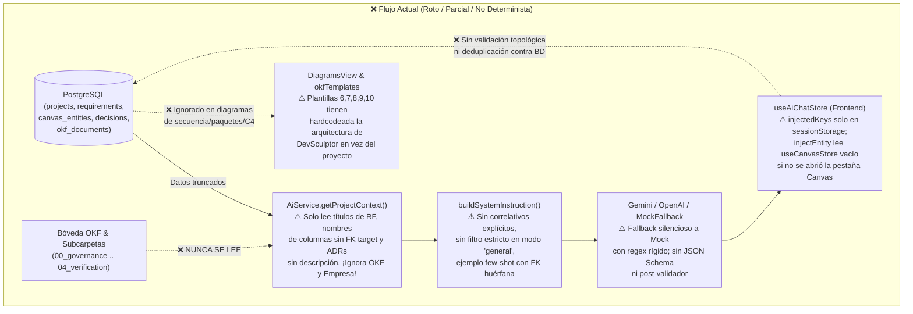
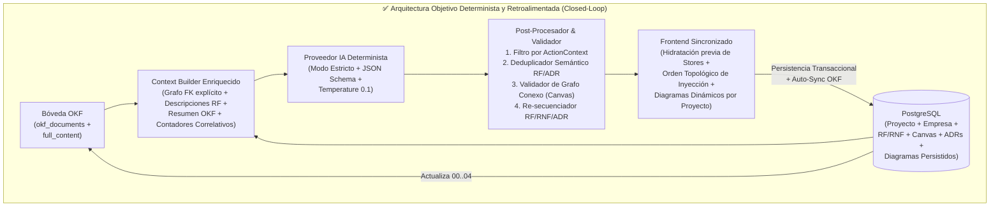

# Plan Maestro de Diagnóstico y Mejora Integral: Motor de IA, Bóveda OKF, Canvas Relacional y Estudio de Diagramado (DevSculptor)

> [!IMPORTANT]
> **Estado del Documento:** Plan de Trabajo y Auditoría Técnica Exhaustiva (**Modo Solo Lectura — Ningún cambio ha sido ejecutado en el código**).
> Este documento consolida las causas raíz exactas detectadas en el código fuente de `DevSculptor` (Backend, Frontend, Base de Datos y Prompts) frente a la especificación oficial del proyecto, y define la hoja de ruta determinista paso a paso para corregirlas.

---

## 1. Diagnóstico Ejecutivo: ¿Por qué la IA y los subsistemas fallan hoy?

Al contrastar la documentación oficial del repositorio ([Backend_Features_and_Sprints_Specification.md](file:///C:/Users/natha/Documents/Repos/DevSculptor/Documentation/Backend/Backend_Features_and_Sprints_Specification.md), [Sprint3_AI_Consultant_Engine_Specification.md](file:///C:/Users/natha/Documents/Repos/DevSculptor/Documentation/Backend/Archive/Sprint3_AI_Consultant_Engine_Specification.md), [Sprint4_OKF_Document_Vault_and_Packaging_Specification.md](file:///C:/Users/natha/Documents/Repos/DevSculptor/Documentation/Consolidated/Archive/Sprint4_OKF_Document_Vault_and_Packaging_Specification.md) y [Sprint6_AI_Diagrams_Injection_and_Granular_Discernment_Specification.md](file:///C:/Users/natha/Documents/Repos/DevSculptor/Documentation/Backend/Archive/Sprint6_AI_Diagrams_Injection_and_Granular_Discernment_Specification.md)) contra la implementación real en `devsculptor-backend` y `devsculptor-frontend`, se identificaron **5 rupturas estructurales en el ciclo de retroalimentación (Feedback Loop)**:



### Resumen de las 5 Causas Raíz Principales

1. **Ceguera de Contexto y Cero Retroalimentación desde el OKF (`ai.service.ts` + `ai.prompts.ts`):**
   - [`AiService.getProjectContext`](file:///C:/Users/natha/Documents/Repos/DevSculptor/devsculptor-backend/src/modules/ai/ai.service.ts#L16-L82) **jamás consulta la tabla `okf_documents` ni los archivos en Supabase Storage (`okf-vault`)**. Todo lo que el usuario ingesta o sincroniza en las subcarpetas del OKF (`00_governance` a `04_verification`) es invisible para la IA.
   - Aun para las tablas que sí consulta (`requirements`, `canvas_entities`, `architecture_decisions`), [`buildSystemInstruction`](file:///C:/Users/natha/Documents/Repos/DevSculptor/devsculptor-backend/src/modules/ai/ai.prompts.ts#L192-L208) **trunca los datos críticos**: envía solo el título del requisito (omite `description`), envía las columnas de las tablas pero **omite a qué tabla apunta cada FK (`referencesTable` y `cardinality`)**, omite `organization` (empresa) y `lead_architect`, y omite la descripción (`context`/`decision`) de los ADRs.
2. **Repetición de Requisitos Funcionales y Re-Inyección Infinita (`ai.prompts.ts` + `useAiChatStore.ts`):**
   - Como el LLM solo recibe `[RF-01] (RF - HIGH) Gestión de Usuarios` sin su `description`, asume que faltan reglas de negocio específicas y vuelve a crear requisitos equivalentes bajo otro código o repite `RF-01`.
   - En el backend no existe un **post-procesador determinista** que calcule `NEXT_RF_CODE` / `NEXT_RNF_CODE`, filtre códigos o títulos duplicados contra la BD y limpie llaves JSON no solicitadas.
   - En el frontend, el bloqueo de botón (`Inyectado`) en [`useAiChatStore.ts`](file:///C:/Users/natha/Documents/Repos/DevSculptor/devsculptor-frontend/src/stores/useAiChatStore.ts#L57-L73) depende exclusivamente de `injectedKeys` guardado en `sessionStorage` y indexado solo por string (`req:RF-01`), **sin cruzar contra los requisitos/tablas/decisiones reales cargados desde PostgreSQL**.
3. **Tablas Inconexas y Huérfanas en el Canvas (`useAiChatStore.ts` + `ai.prompts.ts` + `mock.provider.ts`):**
   - **Bug crítico de estado en Frontend:** En [`useAiChatStore.injectEntity`](file:///C:/Users/natha/Documents/Repos/DevSculptor/devsculptor-frontend/src/stores/useAiChatStore.ts#L368-L410), el código busca las tablas existentes leyendo `useCanvasStore.getState().entities`. Sin embargo, [`useCanvasStore.fetchEntities`](file:///C:/Users/natha/Documents/Repos/DevSculptor/devsculptor-frontend/src/features/canvas/CanvasView.tsx#L58-L62) **solo se ejecuta cuando el usuario abre la vista `CanvasView`**. Si el usuario entra al proyecto y va directo al Consultor IA, `useCanvasStore.getState().entities` está vacío (`[]`), por lo que la inferencia de relaciones falla y todas las tablas se posicionan colisionando o sin resolver padres.
   - **Bug de orden de inyección:** Si la IA sugiere una tabla hija (`order_items`) antes que la tabla padre (`products`), o si sugiere una FK hacia una tabla que aún no ha sido inyectada, la referencia queda huérfana.
   - **El propio prompt induce al error:** El ejemplo *few-shot* en [`ai.prompts.ts`](file:///C:/Users/natha/Documents/Repos/DevSculptor/devsculptor-backend/src/modules/ai/ai.prompts.ts#L142-L157) muestra la tabla `orders` con `user_id` apuntando a `"referencesTable": "users"`, ¡sin incluir la tabla `users` en `suggestedEntities`! El modelo imita este patrón y deja FKs apuntando a tablas inexistentes.
4. **Falta de Determinismo en el Motor de IA y Fallback Silencioso (`gemini.provider.ts` + `mock.provider.ts`):**
   - Cuando el selector de modo en el chat está en `'general'` (`Todo (Auto)`), [`ChatConsultantView.tsx`](file:///C:/Users/natha/Documents/Repos/DevSculptor/devsculptor-frontend/src/features/chat/ChatConsultantView.tsx#L248) envía `actionContext: undefined`. En [`buildSystemInstruction`](file:///C:/Users/natha/Documents/Repos/DevSculptor/devsculptor-backend/src/modules/ai/ai.prompts.ts#L210-L246), solo existen directivas para `'diagrams'`, `'canvas'` y `'requirements'`; **no hay directiva determinista para `'decisions'`, `'conversation'` ni `'general'`**.
   - Si Gemini tarda más de `AI_TIMEOUT_MS` o falla la cuota, [`GeminiProvider`](file:///C:/Users/natha/Documents/Repos/DevSculptor/devsculptor-backend/src/modules/ai/providers/gemini.provider.ts#L82-L92) cae silenciosamente a [`MockAiProvider`](file:///C:/Users/natha/Documents/Repos/DevSculptor/devsculptor-backend/src/modules/ai/providers/mock.provider.ts#L358-L450), el cual concatena **todo el historial de mensajes** (`messages.map(m => m.content).join(' ')`) y usa `if/else` rígidos (`pedido`, `pago`, `auth`, `producto`). Una vez que aparece una palabra clave en el historial, el Mock repite siempre las mismas tablas estáticas.
5. **Estudio de Diagramado Desconectado de la Empresa y del Proyecto (`okfTemplates.ts` + `projectBuilders.ts` + `DiagramsView.tsx`):**
   - Tanto en la pestaña **Mermaid UML** ([`okfTemplates.ts`](file:///C:/Users/natha/Documents/Repos/DevSculptor/devsculptor-frontend/src/features/export/okfTemplates.ts#L345-L685)) como en la pestaña **Interactivos SVG** ([`projectBuilders.ts`](file:///C:/Users/natha/Documents/Repos/DevSculptor/devsculptor-frontend/src/features/diagrams/catalog/projectBuilders.ts#L204-L625)), **5 de los 7 diagramas están hardcodeados con la arquitectura interna de DevSculptor** (`Apple Glass`, `Zustand Stores`, `AiController`, `Supabase Storage: okf-vault`, `AuthPortal MFA TOTP`) en lugar de construirse dinámicamente con las entidades, requisitos, decisiones, estilo arquitectónico y nombre de la empresa (`project.organization`) del proyecto activo.
   - Además, los diagramas generados e inyectados desde el chat (`injectDiagram`) **solo viven en `sessionStorage`** ([`useAiChatStore.ts`](file:///C:/Users/natha/Documents/Repos/DevSculptor/devsculptor-frontend/src/stores/useAiChatStore.ts#L490-L521)) y se pierden al cerrar sesión o cambiar de navegador, sin guardarse en PostgreSQL ni en el OKF.

---

## 2. Puntos Críticos (Prioridad P0 — Bloqueantes de Determinismo y Coherencia)

### 2.1. Ceguera del Contexto RAG en `AiService.getProjectContext` y `buildSystemInstruction`

* **Archivos afectados:**
  * [`devsculptor-backend/src/modules/ai/ai.service.ts`](file:///C:/Users/natha/Documents/Repos/DevSculptor/devsculptor-backend/src/modules/ai/ai.service.ts#L16-L82)
  * [`devsculptor-backend/src/modules/ai/ai.prompts.ts`](file:///C:/Users/natha/Documents/Repos/DevSculptor/devsculptor-backend/src/modules/ai/ai.prompts.ts#L6-L32) y [líneas 192-266](file:///C:/Users/natha/Documents/Repos/DevSculptor/devsculptor-backend/src/modules/ai/ai.prompts.ts#L192-L266)
  * [`devsculptor-backend/src/modules/okf/okf.repository.ts`](file:///C:/Users/natha/Documents/Repos/DevSculptor/devsculptor-backend/src/modules/okf/okf.repository.ts#L15-L60)
* **Diagnóstico detallado:**
  1. **Omisión total de la Bóveda OKF (`okf_documents`):** Aunque el proyecto guarda el índice de los documentos de las subcarpetas (`00_governance/`, `01_requirements/`, `02_architecture/`, `03_data_and_api/`, `04_verification/`) en la tabla `okf_documents` (y los archivos `.md`/`.sql` en el bucket `okf-vault`), `AiService.getProjectContext()` no realiza ningún `SELECT` sobre `okf_documents`.
  2. **Truncamiento en `okf_documents` al ingestar archivos externos:** En [`OkfIngestModal.tsx`](file:///C:/Users/natha/Documents/Repos/DevSculptor/devsculptor-frontend/src/features/export/OkfIngestModal.tsx#L91-L108) y [`okf.repository.ts`](file:///C:/Users/natha/Documents/Repos/DevSculptor/devsculptor-backend/src/modules/okf/okf.repository.ts#L32-L45), solo se guarda `content_preview` truncado a **300 caracteres** (`textContent.slice(0, 300)`). Si el usuario sube un documento de negocio o especificación al OKF, el contenido completo solo va al bucket de Storage y no queda disponible en una columna de texto consultable rápidamente por el motor RAG.
  3. **Omisión de descripciones de Requisitos en el Prompt:** En [`ai.prompts.ts`](file:///C:/Users/natha/Documents/Repos/DevSculptor/devsculptor-backend/src/modules/ai/ai.prompts.ts#L193-L196):
     ```ts
     const reqsSummary = context.requirements.length > 0
       ? context.requirements.map((r) => `  - [${r.code}] (${r.type} - ${r.priority}) ${r.title}`).join('\n')
       : '  (Sin requisitos registrados aún)';
     ```
     La propiedad `r.description` sí se consulta en `ai.service.ts`, pero **jamás se inyecta en `reqsSummary`**. Por eso la IA no sabe qué alcance cubre cada RF y vuelve a proponer requisitos idénticos con distinto nombre.
  4. **Omisión del grafo de llaves foráneas en el Prompt:** En [`ai.prompts.ts`](file:///C:/Users/natha/Documents/Repos/DevSculptor/devsculptor-backend/src/modules/ai/ai.prompts.ts#L198-L203):
     ```ts
     const cols = e.columns.map((c) => `${c.name}:${c.type}${c.isPk ? ' (PK)' : ''}${c.isFk ? ' (FK)' : ''}`).join(', ');
     ```
     Aunque en [`ai.service.ts`](file:///C:/Users/natha/Documents/Repos/DevSculptor/devsculptor-backend/src/modules/ai/ai.service.ts#L59-L66) `columns` ni siquiera extrae `referencesTable` ni `cardinality` del JSONB de PostgreSQL, en el prompt la IA solo ve `user_id:UUID (FK)` sin saber si ya está conectada a `users` o si está rota/huérfana.
  5. **Omisión de Metadatos de Empresa (`organization` y `lead_architect`):** `AiProjectContext.project` solo incluye `name`, `description` y `architecture_style`. No pasa `organization` ni `lead_architect`, impidiendo que tanto la IA como los diagramas generados reflejen el contexto empresarial real.

---

### 2.2. Desconexión de Tablas en el Canvas ERD (Tablas Huérfanas e Inferencia Fallida)

* **Archivos afectados:**
  * [`devsculptor-frontend/src/stores/useAiChatStore.ts`](file:///C:/Users/natha/Documents/Repos/DevSculptor/devsculptor-frontend/src/stores/useAiChatStore.ts#L355-L453)
  * [`devsculptor-frontend/src/features/canvas/BezierConnectors.tsx`](file:///C:/Users/natha/Documents/Repos/DevSculptor/devsculptor-frontend/src/features/canvas/BezierConnectors.tsx#L30-L98)
  * [`devsculptor-backend/src/modules/ai/ai.prompts.ts`](file:///C:/Users/natha/Documents/Repos/DevSculptor/devsculptor-backend/src/modules/ai/ai.prompts.ts#L141-L157)
  * [`devsculptor-backend/src/modules/ai/providers/mock.provider.ts`](file:///C:/Users/natha/Documents/Repos/DevSculptor/devsculptor-backend/src/modules/ai/providers/mock.provider.ts#L406-L435)
* **Diagnóstico detallado:**
  1. **`useCanvasStore` no inicializado al inyectar desde el Chat:** En [`useAiChatStore.ts`](file:///C:/Users/natha/Documents/Repos/DevSculptor/devsculptor-frontend/src/stores/useAiChatStore.ts#L368), `injectEntity` ejecuta `const existingEntities = useCanvasStore.getState().entities;`. Si el usuario no ha visitado previamente la pestaña Canvas en la sesión actual, `existingEntities` es `[]`. Consecuencias directas:
     * El cálculo de posición `count = existingEntities.length` vale `0`, apilando las tablas inyectadas sobre las coordenadas `(80, 80)` encimadas con las tablas que ya existían en la base de datos.
     * La validación `existingEntities.some((e) => e.name.toLowerCase() === entity.tableName.toLowerCase())` no detecta tablas duplicadas ni resuelve tablas destino para las FKs.
  2. **Falta de resolución cruzada dentro del mismo lote (`suggestedEntities`) y orden topológico:**
     * Cuando el usuario pulsa **"Inyectar Todas"** ([`ChatConsultantView.tsx`](file:///C:/Users/natha/Documents/Repos/DevSculptor/devsculptor-frontend/src/features/chat/ChatConsultantView.tsx#L140-L158)), se iteran las entidades en el orden en que llegaron del JSON. Si la primera tabla tiene una FK a la segunda tabla del lote y `referencesTable` venía vacío (dependiendo de la inferencia por sufijo `_id`), la segunda tabla aún no existe en `existingEntities` y la relación no se enlaza.
     * Más grave aún: si la IA propone una tabla `shipments` con `order_id (FK -> orders)`, pero `orders` **no existe en el Canvas ni viene en el lote**, [`BezierConnectors.tsx`](file:///C:/Users/natha/Documents/Repos/DevSculptor/devsculptor-frontend/src/features/canvas/BezierConnectors.tsx#L41-L45) busca `targetEntity` en `entities`, no lo encuentra (`if (!targetEntity || targetEntity.id === entity.id) return;`), y la tabla `shipments` queda **completamente aislada sin conector Bezier**.
  3. **Inconsistencia Singular/Plural en nombres de tablas y FKs:**
     * Si la tabla en el Canvas se llama `clientes` o `usuarios` (en español, plural) y la IA genera una columna `usuario_id` o `cliente_id`, el código actual en [`useAiChatStore.ts`](file:///C:/Users/natha/Documents/Repos/DevSculptor/devsculptor-frontend/src/stores/useAiChatStore.ts#L375-L386) prueba `${baseName}s` (`usuarios` -> OK) pero para palabras terminadas en consonante como `rol_id` -> `rols` o `orden_id` -> `ordens` (en vez de `roles` / `ordenes` con `+es`) falla al emparejar la tabla destino.
  4. **Tablas sin ninguna FK ni nadie que apunte a ellas (Islas):**
     * No existe un validador de conectividad de grafo en el backend (`AiService`) que verifique que el conjunto `CanvasActual ∪ suggestedEntities` forme un **grafo conexo** (donde ninguna tabla quede con grado `0` si hay más de una entidad en el modelo).

---

### 2.3. Duplicación de Requisitos Funcionales (RF/RNF) y Re-Inyección No Bloqueada

* **Archivos afectados:**
  * [`devsculptor-frontend/src/stores/useAiChatStore.ts`](file:///C:/Users/natha/Documents/Repos/DevSculptor/devsculptor-frontend/src/stores/useAiChatStore.ts#L305-L353) y [líneas 523-526](file:///C:/Users/natha/Documents/Repos/DevSculptor/devsculptor-frontend/src/stores/useAiChatStore.ts#L523-L526)
  * [`devsculptor-frontend/src/features/chat/ChatConsultantView.tsx`](file:///C:/Users/natha/Documents/Repos/DevSculptor/devsculptor-frontend/src/features/chat/ChatConsultantView.tsx#L112-L138) y [líneas 404-465](file:///C:/Users/natha/Documents/Repos/DevSculptor/devsculptor-frontend/src/features/chat/ChatConsultantView.tsx#L404-L465)
  * [`devsculptor-backend/src/modules/requirements/requirements.service.ts`](file:///C:/Users/natha/Documents/Repos/DevSculptor/devsculptor-backend/src/modules/requirements/requirements.service.ts#L14-L41)
* **Diagnóstico detallado:**
  1. **`isItemInjected` solo mira `sessionStorage`:**
     * En [`useAiChatStore.ts`](file:///C:/Users/natha/Documents/Repos/DevSculptor/devsculptor-frontend/src/stores/useAiChatStore.ts#L523-L526), `isItemInjected(key)` solo comprueba `Boolean(get().injectedKeys[key])`.
     * Si el requisito `RF-01` ya existe en PostgreSQL (creado antes o en otra sesión), o si la IA sugiere un requisito con título idéntico a uno ya existente en la base de datos pero con código `RF-09`, `isItemInjected` devuelve `false` y permite inyectarlo o falla con error 409 (`ConflictError`) recién al hacer clic.
  2. **Falta de Desduplicación Semántica/Léxica y Re-Secuenciación en el Backend:**
     * En [`ai.service.ts`](file:///C:/Users/natha/Documents/Repos/DevSculptor/devsculptor-backend/src/modules/ai/ai.service.ts#L84-L115), la respuesta del proveedor (`provider.generateConsultation`) se devuelve cruda al frontend sin pasar por un filtro de saneamiento que:
       1. Descarte cualquier requisito en `suggestedRequirements` cuyo `title` normalizado (sin tildes, minúsculas, tokens clave) tenga alta similitud (Jaccard / Levenshtein $\ge 0.75$) con un requisito ya existente en `context.requirements`.
       2. Recalcule determinísticamente los códigos correlativos (`RF-0X`, `RNF-0Y`) a partir del máximo correlativo real en la base de datos (`maxRf + 1`, `maxRnf + 1`) para garantizar cero colisiones de código.
  3. **Pérdida de `entity_relation` al guardar en Base de Datos:**
     * El DTO de la IA (`AiSuggestedRequirement`) incluye `entity_relation?: string[]` (qué tablas del Canvas satisfacen ese requisito), pero la tabla `requirements` en PostgreSQL y [`RequirementsService.create`](file:///C:/Users/natha/Documents/Repos/DevSculptor/devsculptor-backend/src/modules/requirements/requirements.service.ts#L33-L40) **no guardan `entity_relation`**. Al perderse esta relación en la BD, cuando el contexto vuelve a cargarse en la siguiente consulta, la IA ya no sabe qué requisitos cubren qué tablas.

---

### 2.4. Estudio de Diagramado (`DiagramsView`) Desconectado del Contexto Real de la Empresa y del Proyecto

* **Archivos afectados:**
  * [`devsculptor-frontend/src/features/export/okfTemplates.ts`](file:///C:/Users/natha/Documents/Repos/DevSculptor/devsculptor-frontend/src/features/export/okfTemplates.ts#L305-L717)
  * [`devsculptor-frontend/src/features/diagrams/catalog/projectBuilders.ts`](file:///C:/Users/natha/Documents/Repos/DevSculptor/devsculptor-frontend/src/features/diagrams/catalog/projectBuilders.ts#L30-L720)
  * [`devsculptor-frontend/src/features/diagrams/DiagramsView.tsx`](file:///C:/Users/natha/Documents/Repos/DevSculptor/devsculptor-frontend/src/features/diagrams/DiagramsView.tsx#L102-L265)
  * [`devsculptor-frontend/src/stores/useAiChatStore.ts`](file:///C:/Users/natha/Documents/Repos/DevSculptor/devsculptor-frontend/src/stores/useAiChatStore.ts#L490-L521)
* **Diagnóstico detallado:**
  1. **Plantillas Mermaid (`okfTemplates.ts`) estáticas y con bugs de relaciones:**
     * **Template 5 (`class-diagram`, [líneas 306-340](file:///C:/Users/natha/Documents/Repos/DevSculptor/devsculptor-frontend/src/features/export/okfTemplates.ts#L306-L340)):** Dibuja las clases a partir de `ctx.entities`, pero **jamás genera las flechas de relación (`ClassA --> ClassB`)** entre ellas. Todas las clases aparecen sueltas.
     * **Template 11 (`erd-relational-model`, [líneas 691-716](file:///C:/Users/natha/Documents/Repos/DevSculptor/devsculptor-frontend/src/features/export/okfTemplates.ts#L691-L716)):** Genera bloques `erDiagram` con las entidades y columnas de `ctx.entities`, pero **omite por completo las líneas de cardinalidad (`ENTITY_A ||--o{ ENTITY_B : "fk"`)**. Por eso el diagrama ER en Mermaid muestra todas las tablas desconectadas.
     * **Templates 6, 7, 8, 9 y 10 (`package-diagram`, `sequence-diagram`, `state-diagram`, `component-diagram`, `deployment-diagram`, [líneas 345-685](file:///C:/Users/natha/Documents/Repos/DevSculptor/devsculptor-frontend/src/features/export/okfTemplates.ts#L345-L685)):** Tienen **texto 100% estático de DevSculptor** (ej. `UI[" Presentation Layer (Apple Glass)"]`, `AI["AiController / Gemini 2.5"]`, `VLT["Supabase Storage: okf-vault"]`, `AuthPortal`, `MFA TOTP`). Ignoran por completo las tablas, requisitos, decisiones y la empresa (`organization`) del proyecto del usuario.
  2. **Constructores Interactivos SVG (`projectBuilders.ts`) estáticos y con enlaces falsos:**
     * `buildProjectModularPackagesSpec`, `buildProjectSequenceE2eSpec`, `buildProjectC4ComponentsSpec` y `buildProjectCloudDeploymentSpec` devuelven **nodos fijos hardcodeados** (`SPA React 18`, `Express Controllers`, `Vercel Edge Network`) sin leer `entities`, `requirements`, `decisions` ni `project.organization`.
     * En `buildProjectUmlClassesSpec` ([líneas 89-93](file:///C:/Users/natha/Documents/Repos/DevSculptor/devsculptor-frontend/src/features/diagrams/catalog/projectBuilders.ts#L89-L93)) y `buildProjectErdMapSpec` ([líneas 707-709](file:///C:/Users/natha/Documents/Repos/DevSculptor/devsculptor-frontend/src/features/diagrams/catalog/projectBuilders.ts#L707-L709)), la comparación `col.referencesTable === target.name` es **sensible a mayúsculas/minúsculas** (`===` exacto sin `.toLowerCase()`), y si no encuentra FKs exactas, ejecuta un fallback artificial que conecta la tabla `i` con la `i+1` en fila india (`fk-auto-${i}`).
  3. **Diagramas Inyectados por la IA son Volátiles (`sessionStorage`):**
     * Cuando la IA genera un diagrama a medida del proyecto en `suggestedDiagrams` y el usuario pulsa **"Inyectar al Estudio de Diagramado"**, [`injectDiagram`](file:///C:/Users/natha/Documents/Repos/DevSculptor/devsculptor-frontend/src/stores/useAiChatStore.ts#L490-L521) solo lo guarda en `sessionStorage` (`useAiChatStore`). No se persiste en PostgreSQL ni se empaqueta en el OKF (`02_architecture/`), y tampoco sobreescribe/actualiza los diagramas base del Estudio de Diagramado.

---

## 3. Puntos de Mejora Estructural (Prioridad P1 — Arquitectura de Ciclo Cerrado)



### 3.1. Retroalimentación Completa desde la Bóveda OKF (`okf_documents`) hacia la IA
* **Problema:** Los documentos de las subcarpetas del OKF (`00_governance`, `01_requirements`, `02_architecture`, `03_data_and_api`, `04_verification`) y los documentos externos ingestados no alimentan el prompt del Consultor IA.
* **Mejora Estructural:**
  1. Agregar la columna `content_markdown TEXT` (o ampliar la lectura desde `okf_documents`) en una migración `007_okf_full_content_and_project_diagrams.sql` para almacenar el contenido textual estructurado de los documentos ingestados/compilados en `okf_documents` (además de `content_preview` de 300 caracteres).
  2. En [`AiService.getProjectContext`](file:///C:/Users/natha/Documents/Repos/DevSculptor/devsculptor-backend/src/modules/ai/ai.service.ts#L16-L82), incluir en el `Promise.all` la consulta a `okf_documents` (`SELECT document_id, document_type, canonical_path, title, tags, content_preview, content_markdown, freshness_status FROM okf_documents WHERE project_id = $1`).
  3. En [`buildSystemInstruction`](file:///C:/Users/natha/Documents/Repos/DevSculptor/devsculptor-backend/src/modules/ai/ai.prompts.ts#L192-L266), agregar la sección **`5. BÓVEDA DOCUMENTAL OKF (CONOCIMIENTO CONSOLIDADO EN SUBCARPETAS)`**, inyectando el índice canónico y los extractos clave de los documentos de gobernanza, visión de empresa y reglas de negocio que ya estén guardados en el OKF del proyecto.

### 3.2. Motor Post-Procesador Determinista en el Backend (`AiResponseSanitizer`)
* **Problema:** Confiar únicamente en que el LLM obedezca un prompt de texto libre nunca es 100% determinista.
* **Mejora Estructural:** Crear una capa de validación determinista en TypeScript (`devsculptor-backend/src/modules/ai/ai.validator.ts`) que se ejecute **después** de `parseDevSculptorActions()` y **antes** de responder al controlador:
  1. **Poda estricta por `actionContext` (Hard Gate):**
     * Si `actionContext === 'conversation'` -> Vaciar `actions = null`.
     * Si `actionContext === 'requirements'` -> Conservar solo `suggestedRequirements` (eliminar `suggestedEntities`, `suggestedDecisions`, `suggestedDiagrams`).
     * Si `actionContext === 'canvas'` -> Conservar solo `suggestedEntities`.
     * Si `actionContext === 'decisions'` -> Conservar solo `suggestedDecisions`.
     * Si `actionContext === 'diagrams'` -> Conservar solo `suggestedDiagrams`.
  2. **Deduplicación Determinista de Requisitos y Re-numeración Correlativa:**
     * Comparar cada requisito sugerido contra `context.requirements` usando normalización léxica (minúsculas, sin acentos, eliminación de stopwords y similitud de tokens Jaccard $\ge 0.70$). Si ya existe un requisito equivalente en la BD, **eliminarlo de `suggestedRequirements`**.
     * Numerar secuencialmente los requisitos sobrevivientes usando el contador real de la BD (`maxRf + 1`, `maxRnf + 1`), garantizando que jamás se repita un código existente.
  3. **Garantía de Grafo Conexo para `suggestedEntities` (Zero Orphan Tables):**
     * Construir el conjunto de nombres de tablas `allTables = Set(context.entities.map(e => e.name) ∪ suggestedEntities.map(e => e.tableName))`.
     * Para cada columna con sufijo `_id` (que no sea PK), si no tiene `referencesTable`, inferir el nombre de tabla en singular/plural (soportando español `+s`/`+es` e inglés `+s`/`+ies`).
     * Si una columna FK apunta a una `referencesTable` que **no existe en `allTables`**, auto-generar en `suggestedEntities` la entidad maestra faltante con su PK (`id: UUID`), `name: VARCHAR(150)`, `created_at: TIMESTAMPTZ` (o enlazarla a la tabla semánticamente más cercana de `allTables`).
     * Si una entidad sugerida no tiene ninguna FK saliente ni ninguna otra tabla (existente o sugerida) tiene una FK entrante hacia ella, inyectar automáticamente una FK de vinculación hacia la entidad núcleo del dominio o desde la tabla pivote correspondiente.
     * Ordenar `suggestedEntities` mediante **Ordenamiento Topológico (Kahn's Algorithm / DFS)** de modo que las tablas padres (sin dependencias o que solo dependen de tablas ya en BD) aparezcan primero en el arreglo y las tablas hijas/pivote después.

### 3.3. Generación Dinámica de Todos los Diagramas (Mermaid e Interactivos SVG) Basada en el Proyecto y la Empresa
* **Problema:** Los diagramas de Paquetes, Secuencia, Estados, Componentes C4 y Despliegue en `DiagramsView` muestran siempre la arquitectura de DevSculptor en lugar de la arquitectura del proyecto y empresa del usuario.
* **Mejora Estructural:**
  1. En [`okfTemplates.ts`](file:///C:/Users/natha/Documents/Repos/DevSculptor/devsculptor-frontend/src/features/export/okfTemplates.ts) y [`projectBuilders.ts`](file:///C:/Users/natha/Documents/Repos/DevSculptor/devsculptor-frontend/src/features/diagrams/catalog/projectBuilders.ts), reemplazar todos los nodos estáticos por constructores dirigidos por los datos reales de `OkfExportContext` / `ProjectDiagramInput` (`project.name`, `project.organization`, `project.architecture_style`, `entities`, `requirements`, `decisions`):
     * **Diagrama de Clases UML y Mapa ER (`class-diagram`, `erd-relational-model`):** Generar explícitamente todas las flechas de asociación/composición y líneas `||--o{` a partir de `col.isFk` y `col.referencesTable` (comparando con `.toLowerCase().trim()`), sin fallbacks de cadena falsa `i -> i+1`.
     * **Diagrama de Paquetes (`package-diagram`):** Agrupar dinámicamente las entidades reales del Canvas por subdominios/módulos y enlazarlas con los requisitos funcionales (`RF-XX`) y el estilo arquitectónico (`project.architecture_style`) de la organización (`project.organization`).
     * **Diagrama de Secuencia E2E (`sequence-diagram`):** Construir los participantes y mensajes a partir de los Requisitos Funcionales de prioridad `HIGH` y las tablas principales conectadas por FKs en el proyecto (ej. Actor -> Frontend de `project.name` -> Servicio de Dominio -> Tablas reales `entities[0..n]`).
     * **Diagrama de Máquina de Estados (`state-diagram`):** Detectar la entidad transaccional principal del proyecto (aquella con columna `status`/`estado`/`state` o mayor cantidad de FKs) y modelar las transiciones de estado acordes al dominio del proyecto.
     * **Diagrama C4 de Componentes y Despliegue Cloud (`component-diagram`, `deployment-diagram`):** Parametrizar los contenedores y nodos de infraestructura según `project.architecture_style` (ej. Microservicios, Hexagonal, Monolito Modular, Event-Driven, Serverless) y las Decisiones de Arquitectura (`ADR-XX`) aprobadas en el proyecto.
  2. **Persistencia de Diagramas Inyectados por la IA en PostgreSQL:**
     * Guardar los diagramas generados por la IA como documentos tipo `DIAGRAM` en `okf_documents` (subcarpeta `02_architecture/ai_diagrams/`) o en una tabla `project_diagrams`, de forma que persistan entre sesiones, se carguen al abrir `DiagramsView` y se incluyan automáticamente en el paquete `.zip` del OKF.

---

## 4. Puntos por Pulir (Prioridad P2 — UX, Estado en Frontend y Resiliencia)

| # | Componente / Archivo | Problema Detectado | Acción de Pulido |
| :--- | :--- | :--- | :--- |
| **P2.1** | [`useAiChatStore.ts`](file:///C:/Users/natha/Documents/Repos/DevSculptor/devsculptor-frontend/src/stores/useAiChatStore.ts#L305-L526) | `isItemInjected` solo revisa `sessionStorage`. Al recargar o entrar desde otro navegador, permite re-inyectar RFs, tablas y ADRs que ya están en PostgreSQL. | Sincronizar `isItemInjected` contra los datos reales del proyecto (`existingRequirements`, `existingEntities`, `existingDecisions`) comparando tanto por código (`RF-01`) como por nombre/título normalizado (`tableName.toLowerCase()`, `title.toLowerCase()`). |
| **P2.2** | [`useAiChatStore.ts`](file:///C:/Users/natha/Documents/Repos/DevSculptor/devsculptor-frontend/src/stores/useAiChatStore.ts#L368-L410) | `injectEntity` lee `useCanvasStore.getState().entities` sin verificar si el store ya fue hidratado desde el backend. | Antes de calcular coordenadas o inferir FKs en `injectEntity`, verificar si `useCanvasStore.getState().entities` está vacío y ejecutar `await useCanvasStore.getState().fetchEntities(projectId)` para tener siempre las tablas reales de la BD. |
| **P2.3** | [`ChatConsultantView.tsx`](file:///C:/Users/natha/Documents/Repos/DevSculptor/devsculptor-frontend/src/features/chat/ChatConsultantView.tsx#L140-L158) | `handleInjectAllEntities` inyecta las entidades en orden arbitrario y una por una, haciendo que la primera tabla no vea a la segunda si la segunda es su padre. | Ejecutar un **ordenamiento topológico** en `handleInjectAllEntities` (padres primero, hijos después) y hacer un segundo pase de actualización (`updateEntity`) si existen referencias cíclicas o diferidas dentro del mismo lote. |
| **P2.4** | [`mock.provider.ts`](file:///C:/Users/natha/Documents/Repos/DevSculptor/devsculptor-backend/src/modules/ai/providers/mock.provider.ts#L358-L435) | `scopeText` concatena todos los mensajes históricos (`messages.map(m => m.content).join(' ')`) y `order_items` referencia `products` sin crear `products`. | Usar únicamente `lastUserMsg` para detectar la intención actual del turno (usando el contexto del proyecto como respaldo), y asegurar que toda FK en el Mock apunte a una tabla existente en `context.entities` o creada en el mismo lote. |
| **P2.5** | [`gemini.provider.ts`](file:///C:/Users/natha/Documents/Repos/DevSculptor/devsculptor-backend/src/modules/ai/providers/gemini.provider.ts#L50-L92) | `temperature` por defecto no está fijada para determinismo arquitectónico y no se informa cuando ocurre fallback al Mock. | Fijar `temperature: 0.15` en `generationConfig` de Gemini y `OpenAiProvider` para respuestas deterministas, y aumentar `AI_TIMEOUT_MS` por defecto a `45000ms` (45s) para prompts con contexto extenso. |
| **P2.6** | [`decisions.repository.ts`](file:///C:/Users/natha/Documents/Repos/DevSculptor/devsculptor-backend/src/modules/decisions/decisions.service.ts#L19-L33) & [`requirements.service.ts`](file:///C:/Users/natha/Documents/Repos/DevSculptor/devsculptor-backend/src/modules/requirements/requirements.service.ts#L33-L41) | `requirements` pierde `entity_relation` al persistirse, y `architecture_decisions` no persiste su código `ADR-XXX`. | Persistir `entity_relation TEXT[]` en `requirements` y `code VARCHAR(50)` en `architecture_decisions` para mantener trazabilidad inmutable entre sesiones. |

---

## 5. Hoja de Ruta / Plan de Trabajo Paso a Paso (Sin Ejecutar)

A continuación se detalla el plan de implementación estructurado en **5 Fases Secuenciales**, diseñado para ejecutarse sin romper la compatibilidad actual del proyecto.

### Fase 1: Base de Datos y Persistencia de Trazabilidad Completa
**Objetivo:** Asegurar que PostgreSQL almacene el contenido completo del OKF, la trazabilidad requisito-entidad (`entity_relation`), el código inmutable de los ADRs (`code`) y los diagramas generados por la IA.

1. **Crear migración SQL `devsculptor-backend/src/database/migrations/007_ai_context_and_diagrams_persistence.sql`:**
   - En `requirements`: `ALTER TABLE requirements ADD COLUMN IF NOT EXISTS entity_relation TEXT[] DEFAULT '{}';`
   - En `architecture_decisions`: `ALTER TABLE architecture_decisions ADD COLUMN IF NOT EXISTS code VARCHAR(50);`
   - En `okf_documents`: `ALTER TABLE okf_documents ADD COLUMN IF NOT EXISTS content_markdown TEXT;`
2. **Actualizar DTOs y Repositorios Backend:**
   - Actualizar [`requirements.dto.ts`](file:///C:/Users/natha/Documents/Repos/DevSculptor/devsculptor-backend/src/modules/requirements/requirements.service.ts) y `requirements.repository.ts` para aceptar y devolver `entity_relation`.
   - Actualizar [`decisions.dto.ts`](file:///C:/Users/natha/Documents/Repos/DevSculptor/devsculptor-backend/src/modules/decisions/decisions.service.ts) y `decisions.repository.ts` para persistir o autogenerar correlativamente `code` (`ADR-001`, `ADR-002`...).
   - Actualizar [`okf.dto.ts`](file:///C:/Users/natha/Documents/Repos/DevSculptor/devsculptor-backend/src/modules/okf/okf.repository.ts) y `okf.repository.ts` para guardar `content_markdown` al sincronizar o ingestar documentos en las subcarpetas del OKF.

---

### Fase 2: Enriquecimiento del Contexto RAG y Retroalimentación OKF en el Backend
**Objetivo:** Que la IA lea todo el proyecto (incluyendo Empresa, descripciones de RF/RNF, relaciones FK del Canvas y documentos de las subcarpetas del OKF).

1. **Ampliar [`AiService.getProjectContext`](file:///C:/Users/natha/Documents/Repos/DevSculptor/devsculptor-backend/src/modules/ai/ai.service.ts#L16-L82):**
   - Incluir `organization` y `lead_architect` del proyecto en `AiProjectContext.project`.
   - En el mapeo de `canvas_entities`, extraer explícitamente `referencesTable: c.referencesTable || c.references_table` y `cardinality: c.cardinality` de cada columna.
   - En el mapeo de `requirements`, incluir `description` y `entity_relation`.
   - Consultar `okf_documents` del `projectId` e incluir en `AiProjectContext.okfDocuments` el listado de documentos de las subcarpetas (`canonical_path`, `title`, `document_type`, `freshness_status`, y extracto de `content_markdown` / `content_preview`).
   - Calcular determinísticamente en `AiService` los contadores actuales y siguientes códigos disponibles: `nextRfCode`, `nextRnfCode`, `nextAdrCode`.
2. **Reestructurar [`buildSystemInstruction`](file:///C:/Users/natha/Documents/Repos/DevSculptor/devsculptor-backend/src/modules/ai/ai.prompts.ts#L192-L266):**
   - Inyectar en el encabezado del proyecto la **Empresa/Organización** (`context.project.organization`) y el **Arquitecto Líder** (`context.project.lead_architect`).
   - En `reqsSummary`, mostrar código, tipo, prioridad, título, **descripción resumida** y **entidades vinculadas (`entity_relation`)**, seguido de una instrucción explícita: `PROHIBIDO volver a sugerir cualquiera de estos requisitos o sus reglas equivalentes. El siguiente RF debe iniciar en ${nextRfCode} y el siguiente RNF en ${nextRnfCode}.`
   - En `entitiesSummary`, mostrar para cada columna FK su destino exacto: `user_id:UUID (FK -> users [1:N])`, o marcar `⚠️ SIN_RELACION` si alguna tabla existente está desconectada para que la IA pueda proponer conectarla.
   - Agregar la sección **`5. DOCUMENTACIÓN EN BÓVEDA OKF (SUBCARPETAS DEL PROYECTO)`** con el contenido de los documentos registrados en `okf_documents`.
   - Corregir el ejemplo *few-shot* de [`ai.prompts.ts`](file:///C:/Users/natha/Documents/Repos/DevSculptor/devsculptor-backend/src/modules/ai/ai.prompts.ts#L141-L157) para que incluya tanto la tabla padre (`users`) como la tabla hija (`orders`), eliminando el mal ejemplo de FK huérfana.
   - Completar `modeDirective` para cubrir los 6 modos posibles (`conversation`, `requirements`, `canvas`, `decisions`, `diagrams`, `general`).

---

### Fase 3: Validador y Post-Procesador Determinista de Salida de IA (`AiResponseSanitizer`)
**Objetivo:** Garantizar determinismo absoluto en lo que devuelve `/api/v1/projects/:projectId/ai/chat`, sin importar pequeñas variaciones del LLM.

1. **Crear `devsculptor-backend/src/modules/ai/ai.validator.ts` e invocarlo en `AiService.chat`:**
   - **Paso 1 (Filtro de Modo):** Eliminar del objeto `actions` cualquier arreglo que no corresponda al `actionContext` solicitado.
   - **Paso 2 (Deduplicación de Requisitos):** Filtrar de `suggestedRequirements` cualquier ítem cuyo código o cuyo título/descripción normalizado ya exista en `context.requirements` (comparando también contra los documentos de `01_requirements/` en el OKF). Re-indexar códigos desde `nextRfCode` / `nextRnfCode`.
   - **Paso 3 (Deduplicación de ADRs):** Filtrar de `suggestedDecisions` cualquier decisión cuyo título normalizado ya exista en `context.decisions` y re-indexar desde `nextAdrCode`.
   - **Paso 4 (Validador de Conectividad de Grafo y Orden Topológico del Canvas):**
     - Normalizar todos los `tableName` a `snake_case`.
     - Resolver toda columna `*_id` sin `referencesTable` buscando coincidencias en `context.entities` y `suggestedEntities` (soportando pluralización en español `+s`/`+es` e inglés `+s`/`+ies`).
     - Si una `referencesTable` apunta a una tabla que no existe ni en el Canvas actual ni en `suggestedEntities`, **auto-generar la tabla padre en `suggestedEntities`** con su `id (PK)` y atributos base para que jamás se cree una FK rota.
     - Verificar que ninguna tabla en `suggestedEntities` tenga grado de conexión `0` (aislada); si está aislada, inferir o crear la clave foránea hacia la entidad maestra del dominio.
     - Ordenar `suggestedEntities` topológicamente (padres antes que hijos).

---

### Fase 4: Sincronización de Stores en Frontend, Hidratación de Canvas y Bloqueo Anti-Duplicados
**Objetivo:** Que el Frontend nunca inyecte a ciegas, posicione y conecte todas las tablas en el Canvas al primer intento, y reconozca qué artefactos ya están en la base de datos.

1. **Hidratación garantizada en [`useAiChatStore.injectEntity`](file:///C:/Users/natha/Documents/Repos/DevSculptor/devsculptor-frontend/src/stores/useAiChatStore.ts#L355-L453):**
   - Al inicio de `injectEntity`, si `useCanvasStore.getState().entities.length === 0`, llamar a `await useCanvasStore.getState().fetchEntities(projectId)` antes de calcular posiciones o inferir FKs.
   - Mejorar el inferidor de plurales en español/inglés (`+s`, `+es`, `z -> ces`, `y -> ies`) y comparar nombres de tabla de forma insensible a mayúsculas/minúsculas.
2. **Inyección en Lote con Resolución en Dos Pases (`ChatConsultantView.tsx`):**
   - En `handleInjectAllEntities`, ordenar primero las entidades topológicamente (las que no dependen de otras nuevas van primero) y, tras crear todas, verificar si alguna referencia cruzada quedó pendiente para actualizarla.
3. **Verificación Real contra Base de Datos en `isItemInjected` (`ChatConsultantView.tsx` + `useAiChatStore.ts`):**
   - Cargar al montar `ChatConsultantView` los resúmenes de `requirements`, `canvas_entities` y `decisions` del proyecto activo.
   - Marcar un requisito sugerido como **"Ya en Proyecto / Inyectado"** si su `code` o su `title` normalizado ya figura en los requisitos de la BD (o en `injectedKeys`).
   - Marcar una entidad sugerida como **"Ya en Canvas"** si `ent.tableName.toLowerCase()` ya existe en `useCanvasStore.entities` (o ofrecer el botón **"Fusionar Columnas Nuevas"** en lugar de duplicar o fallar).

---

### Fase 5: Estudio de Diagramado Dinámico por Empresa/Proyecto y Persistencia en OKF
**Objetivo:** Que todos los diagramas en `DiagramsView` y en la exportación OKF se generen fielmente a partir de la arquitectura, empresa, tablas, requisitos y ADRs del proyecto activo, y que los diagramas de la IA se persistan en la base de datos.

1. **Corregir y Dinamizar [`okfTemplates.ts`](file:///C:/Users/natha/Documents/Repos/DevSculptor/devsculptor-frontend/src/features/export/okfTemplates.ts):**
   - **Template 5 (`class-diagram`):** Agregar el bloque de generación de relaciones UML (`ParentClass "1" --> "*" ChildClass : fk_column`) iterando las columnas `isFk && referencesTable` de `ctx.entities`.
   - **Template 11 (`erd-relational-model`):** Agregar las líneas de relación Mermaid (`PARENT_TABLE ||--o{ CHILD_TABLE : "fk_name"`) al inicio del `erDiagram` para que todas las tablas aparezcan conectadas.
   - **Templates 6, 7, 8, 9 y 10 (`package-diagram`, `sequence-diagram`, `state-diagram`, `component-diagram`, `deployment-diagram`):** Reemplazar el contenido estático de DevSculptor por generadores dinámicos que utilicen `ctx.project.name`, `ctx.project.organization`, `ctx.project.architecture_style`, `ctx.entities`, `ctx.requirements` y `ctx.decisions`.
2. **Corregir y Dinamizar [`projectBuilders.ts`](file:///C:/Users/natha/Documents/Repos/DevSculptor/devsculptor-frontend/src/features/diagrams/catalog/projectBuilders.ts) (Diagramas Interactivos SVG):**
   - Normalizar con `.toLowerCase().trim()` la búsqueda de `col.referencesTable` en `buildProjectUmlClassesSpec` y `buildProjectErdMapSpec`, y eliminar los enlaces falsos `assoc-auto-${i}` / `fk-auto-${i}` cuando sí existen relaciones reales.
   - Reescribir `buildProjectModularPackagesSpec`, `buildProjectSequenceE2eSpec`, `buildProjectC4ComponentsSpec` y `buildProjectCloudDeploymentSpec` para que construyan los nodos, carriles (*lanes*) y aristas (*edges*) dinámicamente a partir de las entidades, requisitos `RF`/`RNF`, decisiones `ADR`, estilo arquitectónico y nombre de la empresa (`project.organization`) del proyecto.
3. **Persistencia de Diagramas Inyectados por la IA en BD y Bóveda OKF:**
   - En [`useAiChatStore.injectDiagram`](file:///C:/Users/natha/Documents/Repos/DevSculptor/devsculptor-frontend/src/stores/useAiChatStore.ts#L490-L521), además de actualizar el estado en memoria para respuesta inmediata, sincronizar el diagrama hacia el backend (`okfVaultService.syncProjectVaultManifest` bajo la ruta `02_architecture/diagrams/${diagramId}.md` con `document_type: 'DIAGRAM'`).
   - En [`DiagramsView.tsx`](file:///C:/Users/natha/Documents/Repos/DevSculptor/devsculptor-frontend/src/features/diagrams/DiagramsView.tsx) y [`okfDocumentProcessor.ts`](file:///C:/Users/natha/Documents/Repos/DevSculptor/devsculptor-frontend/src/features/export/okfDocumentProcessor.ts), hidratar los diagramas guardados en el OKF del proyecto al abrir la vista e incluirlos automáticamente dentro de la carpeta `02_architecture/` al exportar el paquete `.zip`.

---

## 6. Matriz de Impacto y Archivos que se Tocarán al Ejecutar el Plan

| Subsistema | Archivos a Modificar / Crear | Resultado Esperado |
| :--- | :--- | :--- |
| **Base de Datos** | `devsculptor-backend/src/database/migrations/007_ai_context_and_diagrams_persistence.sql` *(Nuevo)* | Soporte en BD para `entity_relation`, `code` en ADRs y `content_markdown` completo en `okf_documents`. |
| **Motor IA & RAG (Backend)** | [`ai.service.ts`](file:///C:/Users/natha/Documents/Repos/DevSculptor/devsculptor-backend/src/modules/ai/ai.service.ts), [`ai.prompts.ts`](file:///C:/Users/natha/Documents/Repos/DevSculptor/devsculptor-backend/src/modules/ai/ai.prompts.ts), `ai.validator.ts` *(Nuevo)*, [`gemini.provider.ts`](file:///C:/Users/natha/Documents/Repos/DevSculptor/devsculptor-backend/src/modules/ai/providers/gemini.provider.ts), [`mock.provider.ts`](file:///C:/Users/natha/Documents/Repos/DevSculptor/devsculptor-backend/src/modules/ai/providers/mock.provider.ts) | Lectura del OKF, descripciones completas de RF, FKs explícitas, temperatura baja determinista, cero requisitos repetidos y grafo de tablas 100% conexo. |
| **Servicios Core (Backend)** | [`requirements.service.ts`](file:///C:/Users/natha/Documents/Repos/DevSculptor/devsculptor-backend/src/modules/requirements/requirements.service.ts), [`decisions.service.ts`](file:///C:/Users/natha/Documents/Repos/DevSculptor/devsculptor-backend/src/modules/decisions/decisions.service.ts), [`okf.repository.ts`](file:///C:/Users/natha/Documents/Repos/DevSculptor/devsculptor-backend/src/modules/okf/okf.repository.ts) | Trazabilidad persistente entre requisitos, tablas y documentos de las subcarpetas del OKF. |
| **Chat & Canvas (Frontend)** | [`useAiChatStore.ts`](file:///C:/Users/natha/Documents/Repos/DevSculptor/devsculptor-frontend/src/stores/useAiChatStore.ts), [`ChatConsultantView.tsx`](file:///C:/Users/natha/Documents/Repos/DevSculptor/devsculptor-frontend/src/features/chat/ChatConsultantView.tsx), [`useCanvasStore.ts`](file:///C:/Users/natha/Documents/Repos/DevSculptor/devsculptor-frontend/src/stores/useCanvasStore.ts) | Hidratación automática del Canvas antes de inyectar, orden topológico de tablas, bloqueo real de ítems ya inyectados contra PostgreSQL. |
| **Diagramado & OKF (Frontend)** | [`okfTemplates.ts`](file:///C:/Users/natha/Documents/Repos/DevSculptor/devsculptor-frontend/src/features/export/okfTemplates.ts), [`projectBuilders.ts`](file:///C:/Users/natha/Documents/Repos/DevSculptor/devsculptor-frontend/src/features/diagrams/catalog/projectBuilders.ts), [`DiagramsView.tsx`](file:///C:/Users/natha/Documents/Repos/DevSculptor/devsculptor-frontend/src/features/diagrams/DiagramsView.tsx), [`okfDocumentProcessor.ts`](file:///C:/Users/natha/Documents/Repos/DevSculptor/devsculptor-frontend/src/features/export/okfDocumentProcessor.ts) | Diagramas UML/Mermaid e Interactivos SVG generados 100% con el contexto de la empresa y del proyecto activo, y persistencia real de diagramas IA en el OKF. |
