# Plan de Trabajo Maestro: Pulido Visual, Copiloto Lateral, Plantillas y Preparación Pre-Hosting

> **Documento:** `Documentation/Plan_Trabajo_Pulido_Pre_Hosting.md`  
> **Fecha:** 29 de Septiembre, 2026  
> **Estado:** Propuesta Técnica de Refinamiento & Estabilización Previa a Despliegue (Pre-Sprint 5)  
> **Objetivo:** Auditar el código actual, definir las áreas de mejora estética y funcional, e implementar las funcionalidades clave solicitadas (Copiloto lateral permanente con tamaño adaptable, motor de plantillas de documentación y exportación multi-formato), preparando la aplicación para ser alojada en la nube sin romper ninguna funcionalidad existente.

---

## 1. Diagnóstico y Estado Actual del Sistema (Línea Base)

DevSculptor cuenta actualmente con una arquitectura madura en **Monolito Modular Layered MVC (Backend Node/Express con TypeScript)** y **Single Page Application (Frontend React 19 + Vite + Zustand + visionOS Glassmorphism)**:

### 🟢 Lo que ya está implementado y funcionando:
1. **Autenticación & RBAC:** Control de acceso con JWT, roles `USER`, `ADMIN` y `SUPERADMIN` (cuenta `nmullersm@gmail.com` promovida a `SUPERADMIN`), middleware `requireSuperAdmin` con Fail-Safe 404.
2. **Consola Maestra de Superadmin:** 4 pestañas operativas (Bóveda Global con árbol OKF, Telemetría/KPIs, Auditoría Transversal y Gestión de Usuarios).
3. **Gestión de Proyectos, Requisitos y ADRs:** Operaciones CRUD completas, máquina de estados finitos en ADRs (PROPOSED, ACCEPTED, REJECTED, SUPERSEDED) con recálculo automático de métricas y modal de ratificación *Human-in-the-Loop*.
4. **Modelador ERD & Canvas:** Lienzo reactivo con conectores Bezier, marcadores Crow's Foot, normalización 3FN, generación multi-motor (PostgreSQL, MySQL, SQLite, Oracle) y TypeScript DTOs / JSON Schema / Pydantic.
5. **Bóveda OKF Canónica:** Procesador documental determinista, generación de hashes SHA-256 de estado, manifiesto maestro `/INDEX.md` con protocolo de lectura secuencial para IA, y modal de ingesta inteligente con soporte dual (mecánico y Gemini AI).

### 🔍 Fricciones y Oportunidades de Mejora Identificadas:
1. **Copiloto Desacoplado del Flujo de Trabajo:**  
   El chat interactivo con IA solo existe en la pestaña de pantalla completa `ChatConsultantView`. Cuando el arquitecto está en el Canvas modelando tablas, redactando requisitos o evaluando ADRs, el panel lateral derecho (`CopilotInspector`) únicamente muestra métricas numéricas estáticas y botones de redirección. No es posible conversar con la IA ni pedirle cambios mientras se observa el Canvas o los Requisitos.
2. **Rigidez del Layout Lateral:**  
   El panel lateral derecho tiene un ancho fijo (`260px`) y solo se muestra en pantallas `xl` (>= 1280px). No existen controles para colapsarlo, expandirlo o redimensionarlo para leer cómodas respuestas de arquitectura o código.
3. **Falta de Motor de Plantillas en Proyectos:**  
   Existe la tabla `global_vault_templates` en base de datos para la Bóveda Global del Superadmin, pero en el espacio de trabajo del proyecto no existe un botón o modal que permita al usuario "Cargar desde Plantilla" un requisito estándar (ej: Auth OAuth2, PCI-DSS, CRUD) o un ADR típico (ej: Clean Architecture, PostgreSQL vs MongoDB).
4. **Exportaciones Fragmentadas:**  
   Las exportaciones se realizan por separado (código DDL en Canvas, markdown en ADRs, ZIP en modal OKF). Falta un informe ejecutivo consolidado imprimible (PDF / Whitepaper completo) que resuma todo el proyecto para stakeholders o entregas académicas.

---

## 2. Ejes de Trabajo y Especificación de Mejoras

```mermaid
graph TD
    A[DevSculptor Studio] --> B[Eje 1: Copiloto Lateral & Layout Adaptable]
    A --> C[Eje 2: Motor de Plantillas de Documentación]
    A --> D[Eje 3: Exportación Multi-Formato & White Paper]
    A --> E[Eje 4: Pulido Visual & UX visionOS]
    A --> F[Eje 5: Robustez Backend & Pre-Hosting]

    B --> B1[Chat Lateral Docked con Estado Compartido]
    B --> B2[Control Expandir / Compactar / Colapsar]
    B --> B3[Auto-Adaptación del Espacio Central]

    C --> C1[Catálogo de Plantillas Canónicas]
    C --> C2[Modal Instanciar Plantilla en Requisitos/ADRs/Canvas]
    C --> C3[Inyección No Destructiva]

    D --> D1[Dossier Técnico Imprimible PDF / HTML]
    D --> D2[White Paper Markdown Consolidado]
    D --> D3[Exportación OpenAPI 3.0 / Postman]

    E --> E1[Notificaciones Toast Flotantes]
    E --> E2[Scrollbars & Contraste Polar/Obsidian]
    E --> E3[Atajos de Teclado Ergonómicos]

    F --> F1[Verificación de Pool Supabase]
    F --> F2[CORS Dinámico para Hosting]
    F --> F3[Healthchecks & Resiliencia AI Fallback]
```



---

### EJE 1: Copiloto Lateral Interactivo & Layout Adaptable

#### 1.1. Arquitectura del Copiloto Lateral (`DockedCopilotChat`)
* **Compartición de Estado:** Utilizará el mismo store global `useAiChatStore.ts` que ya opera en `ChatConsultantView.tsx`. Si el usuario envía un mensaje o pide una sugerencia en la barra lateral mientras está en el Canvas, el historial de conversación, las inyecciones de tablas y los requisitos permanecen 100% sincronizados.
* **Componente Modular `CopilotInspector.tsx` con Selector de Vista:**
  - Encabezado con selector de modo: **[ 💬 Chat Asistente ]** y **[ 📊 Métricas & Salud ]**.
  - En modo Chat: Feed de mensajes compacto, renderizado de markdown, píldoras con sugerencias detectadas (RF, RNF, Tablas, ADRs) y botones de acción rápida *"Inyectar al Canvas"* / *"Inyectar a Requisitos"*.
  - Campo de entrada optimizado con auto-grow y atajo `Enter` para enviar y `Shift+Enter` para salto de línea.

#### 1.2. Controles de Tamaño y Redimensionamiento Adaptable
* **Ampliación de `useLayoutStore.ts`:**
  ```typescript
  type CopilotWidthMode = 'collapsed' | 'compact' | 'expanded'; // 0px | 340px | 520px
  ```
* **Botones de Control en la Cabecera del Panel:**
  - ⇥ **Colapsar:** Oculta el panel a un botón pill flotante lateral derecho (*"Copiloto"* con indicador verde pulsante) para dar 100% de espacio al Canvas en monitores pequeños o laptops.
  - ↔ **Alternar Compacto / Expandido:** Permite alternar rápidamente entre 340px (ancho ideal para consultar mientras se navega) y 520px (ancho expandido para leer esquemas DDL o especificaciones técnicas extensas generadas por la IA).
* **Adaptación Dinámica del Lienzo Central:**
  - El elemento `<main>` utilizará transiciones suaves de ancho (`transition-[flex,width] duration-300 ease-in-out`).
  - Al expandir o colapsar el copiloto lateral, el Canvas de modelado relacional reajustará automáticamente su viewport sin resetear la posición de las tablas ni reiniciar los conectores Bezier.
* **Comportamiento Inteligente:** Cuando el usuario navega a la pestaña 1 (`view-chat`), el copiloto lateral derecho cambia automáticamente a modo *Métricas* o se colapsa, evitando tener dos chats duplicados en la misma pantalla.

---

### EJE 2: Motor de Plantillas de Documentación (Templates Engine)

#### 2.1. Catálogo Canónico de Plantillas
Creación de un catálogo estandarizado de plantillas de software de alta calidad, clasificadas en 4 categorías:
1. **Plantillas de Requisitos (SRS):**
   - *Módulo de Autenticación & Seguridad RBAC* (RFs de login, MFA, bloqueo de fuerza bruta, tokens JWT, RNF de cifrado bcrypt).
   - *Módulo Transaccional / E-Commerce* (Catálogo de productos, carrito de compras, checkout, pasarela de pago, webhook idempotente).
   - *Módulo de Auditoría y Trazabilidad* (Registro de eventos, inmutabilidad, exportación CSV).
2. **Plantillas de Decisiones de Arquitectura (ADR - MADR 3.0):**
   - *Selección de Base de Datos Relacional vs NoSQL*.
   - *Adopción de Arquitectura Monolito Modular vs Microservicios*.
   - *Estrategia de Caché en Capa de Aplicación (Redis / In-Memory)*.
   - *Políticas de Aislamiento Multi-Inquilino (RLS vs Base de Datos Separada)*.
3. **Plantillas de Modelado Relacional (Canvas DDL):**
   - *Esquema Core de Usuarios, Roles y Permisos*.
   - *Esquema E-Commerce (Órdenes, Clientes, Productos, Pagos)*.
   - *Esquema Bóveda de Documentos & Tags Semánticos*.

#### 2.2. Modal de Instanciación en Proyecto (`TemplatePickerModal.tsx`)
* Un botón accesible en la barra superior de cada módulo:
  - En Requisitos: **"Cargar desde Plantilla"** (`library_books`).
  - En Decisiones: **"Nuevo ADR desde Plantilla"** (`post_add`).
  - En Canvas: **"Esquemas Predefinidos"** (`dataset`).
* Interfaz con buscador, selector de tags y previsualización previa antes de aplicar.
* **Inyección Segura y No Destructiva:** Al seleccionar una plantilla, los ítems se incorporan a la base de datos del proyecto activo mediante `POST /requirements`, `POST /decisions` o `POST /canvas` preservando la integridad de los datos preexistentes.

---

### EJE 3: Exportación en Múltiples Formatos & White Paper Unificado

#### 3.1. White Paper Markdown Consolidado (`PROJECT_WHITE_PAPER.md`)
* Generación con 1 clic de un documento técnico único que consolida la totalidad del proyecto:
  1. Identidad del Sistema, Visión y Estilo de Arquitectura.
  2. Catálogo Oficial de Requisitos (IEEE-830).
  3. Registro Consolidado de ADRs Ratificados.
  4. Diccionario de Datos Relacional y DDL del motor seleccionado.
  5. Diagrama de Arquitectura / ERD en formato Mermaid embebido.
  6. Hashes de Integridad SHA-256.

#### 3.2. Exportación a Dossier Técnico Imprimible (PDF / HTML Estilizado)
* Vista modal de vista previa de impresión con hoja de estilos `@media print`:
  - Tipografía ejecutiva limpia (Inter / Roboto Mono), márgenes formales, numeración de páginas, saltos de página inteligentes (`page-break-inside: avoid`).
  - Botón **"Imprimir / Guardar como PDF"** que invoca `window.print()` con estilos listos para entregar a comités de evaluación o clientes.

#### 3.3. Exportación OpenAPI 3.0 / Swagger JSON
* En el Canvas, además de SQL DDL, TypeScript DTOs, JSON Schema y Python Pydantic, añadir una pestaña de exportación **OpenAPI 3.0 (YAML/JSON)** que infiera automáticamente los endpoints CRUD RESTful (`/api/v1/{entidad}`) a partir de las tablas y columnas modeladas.

---

### EJE 4: Pulido Visual, Micro-Animaciones y Experiencia visionOS

1. **Scrollbars Finos Glassmórficos:**
   - Estandarización de `custom-scrollbar` en todos los componentes desplazables (código monospace, lista de tablas, mensajes del chat), eliminando barras nativas anchas de Windows.
2. **Sistema Flotante de Toasts (`VisionToast`):**
   - Reemplazar alertas de texto discretas por notificaciones emergentes con bisel de cristal (`success`, `error`, `info`) con autocierre configurable (ej: *"Requisito inyectado exitosamente"*, *"Copiado al portapapeles"*).
3. **Contraste y Reflejos en Ambos Temas:**
   - Asegurar legibilidad ratio WCAG AA tanto en **Obsidian Crystal** (modo oscuro espacial) como en **Snow Spatial Glass** (modo polar claro).
4. **Atajos de Teclado (Power User Keyboard Shortcuts):**
   - `Ctrl + \` / `Cmd + \`: Alternar visibilidad del Copiloto lateral.
   - `Ctrl + E`: Abrir Modal de Exportación OKF.
   - `Ctrl + Enter` (en chat): Enviar mensaje.
   - `Esc`: Cerrar cualquier modal o drawer abierto.

---

### EJE 5: Optimización de Código sin Romper Funcionalidades (Quick Wins)

1. **Memoización React y Render Throttling:**
   - Envolver componentes de alto costo (renderizado de conectores SVG Bezier en Canvas y bloques Markdown del Chat) con `React.memo` para garantizar 60 FPS estables.
2. **Debounce en Búsquedas:**
   - Aplicar `useDebounce` (200ms) en los buscadores de Requisitos, Decisiones y Bóveda OKF para evitar filtrados excesivos por cada pulsación de tecla.
3. **Resiliencia en Llamadas de IA:**
   - Timeout explícito de 30s con reintento automático (*exponential backoff*) y fallback fluido al *Heuristic Mock Provider* en caso de cuota agotada de la API Key de Gemini.

---

### EJE 6: Preparación para Hosting y Despliegue en Producción

1. **Variables de Entorno y Configuración:**
   - Archivo `.env.production.example` documentado con:
     `DATABASE_URL`, `JWT_SECRET`, `GEMINI_API_KEY`, `CORS_ORIGINS`, `NODE_ENV=production`.
2. **CORS Dinámico para Hosting:**
   - El middleware en `devsculptor-backend/src/app.ts` ya soporta whitelist por comas y LAN/Tailscale; se añadirá soporte para dominios de hosting automático (`*.vercel.app`, `*.onrender.com`, `*.railway.app`).
3. **Script de Verificación de Salud Pre-Vuelo:**
   - Verificación de conexión a PostgreSQL Supabase con reintento de conexión automática si la base de datos se suspende por inactividad.

---

## 3. Plan de Fases Propuesto para Ejecución Progresiva

| Fase | Alcance Técnico | Entregables Principales | Impacto en Código |
| :---: | :--- | :--- | :---: |
| **Fase 1** | **Copiloto Lateral Interactivo & Rediseño de Layout Resizable** | Componente `DockedCopilotChat`, selector de pestañas en `CopilotInspector`, ampliación de `useLayoutStore` (modos `collapsed`, `compact`, `expanded`), animación fluida del workspace. | Adición frontend en `features/studio` y `stores`. Cero impacto en backend. |
| **Fase 2** | **Motor de Plantillas de Documentación en Proyectos** | Catálogo de plantillas canónicas (SRS, MADR, DB), modal `TemplatePickerModal`, servicio de inyección limpia en Requisitos, ADRs y Canvas. | Servicio frontend y nuevos fixtures/plantillas. Backend reutiliza rutas existentes. |
| **Fase 3** | **Exportación Consolidada (PDF Ejecutivo & White Paper)** | Generador de White Paper Markdown único, vista de impresión PDF con estilos visionOS, exportador OpenAPI 3.0 en Canvas. | Nuevos procesadores en `features/export` y `canvas/scriptGenerators`. |
| **Fase 4** | **Pulido Visual, Toasts Flotantes & Atajos de Teclado** | Sistema de Toasts `useToastStore` + `VisionToast`, refinamiento de scrollbars, hotkeys globales (`Ctrl+\`, `Ctrl+E`). | Mejoras transversales de UI/UX sin alterar lógica de negocio. |
| **Fase 5** | **Auditoría Pre-Hosting & Estabilización Final** | Prueba de build en modo producción, validación de variables de entorno, checklist de hosting y pruebas de extremo a extremo. | Configuración y verificación. |

---

## 4. Compromisos de Seguridad y Estabilidad

- **Cero rotura de funciones:** Ninguna implementación modificará los esquemas de base de datos existentes ni alterará el comportamiento de los endpoints ya auditados.
- **Validación continua:** Cada fase incluirá verificación de compilación estricta (`npm run build` en frontend y backend) y ejecución de las suites de pruebas unitarias.
- **Protocolo Git estricto:** Los cambios se desarrollarán de manera controlada y los commits solo se ejecutarán bajo tu orden explícita.
