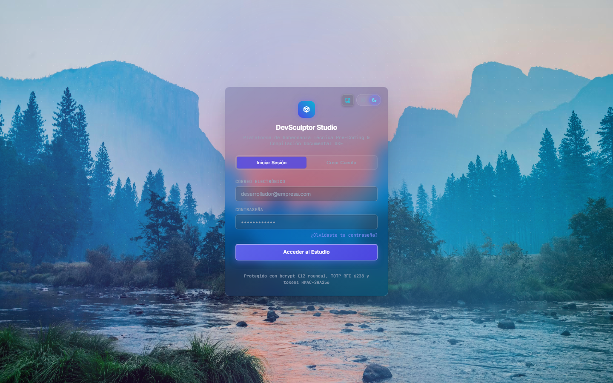
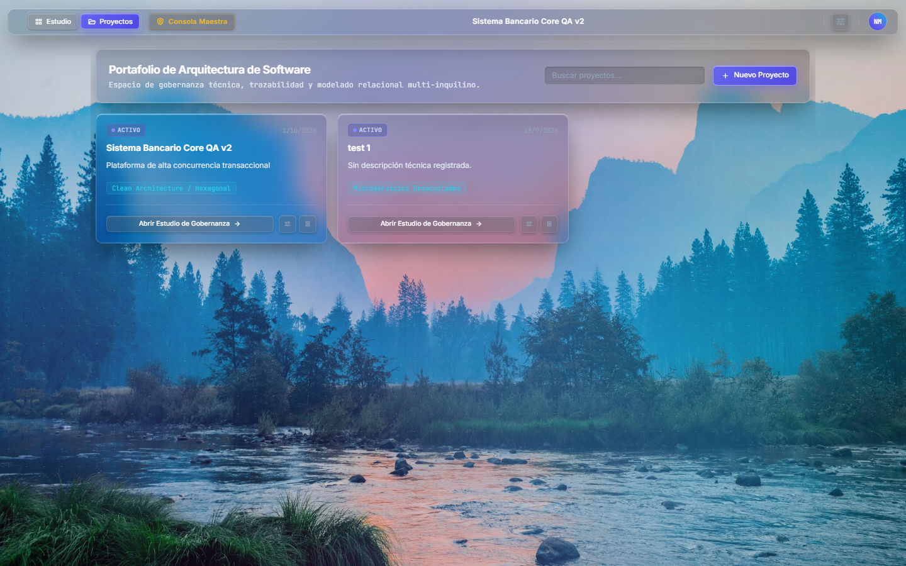
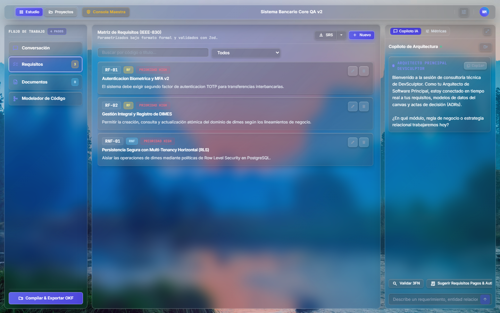
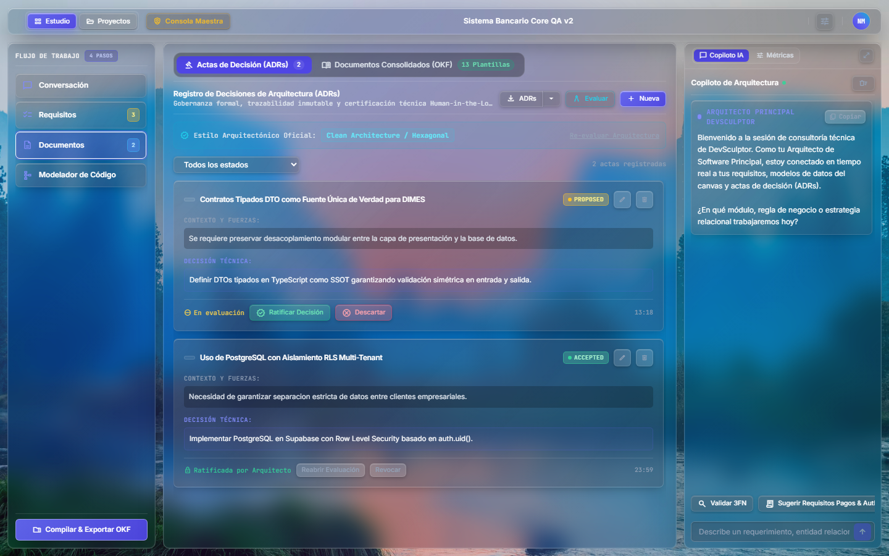
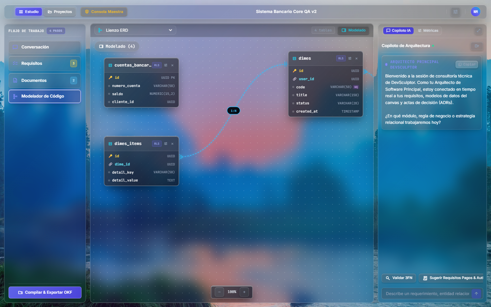
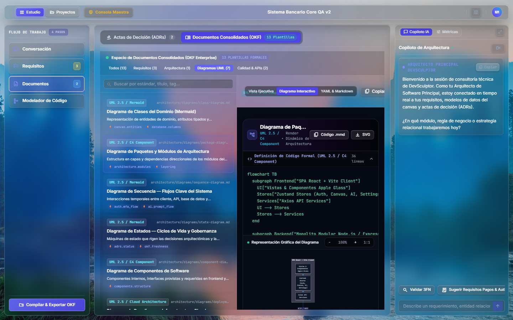
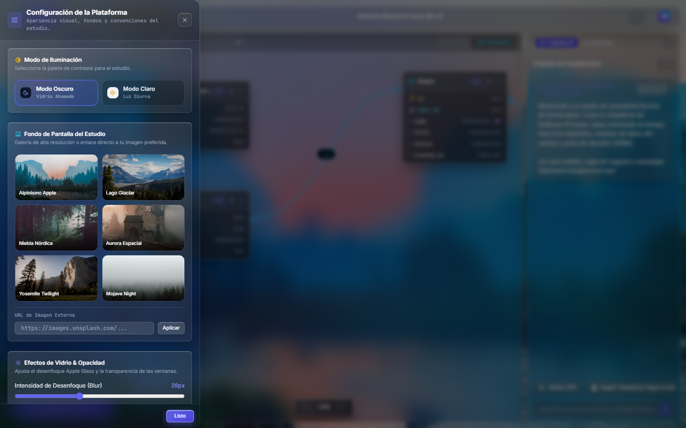
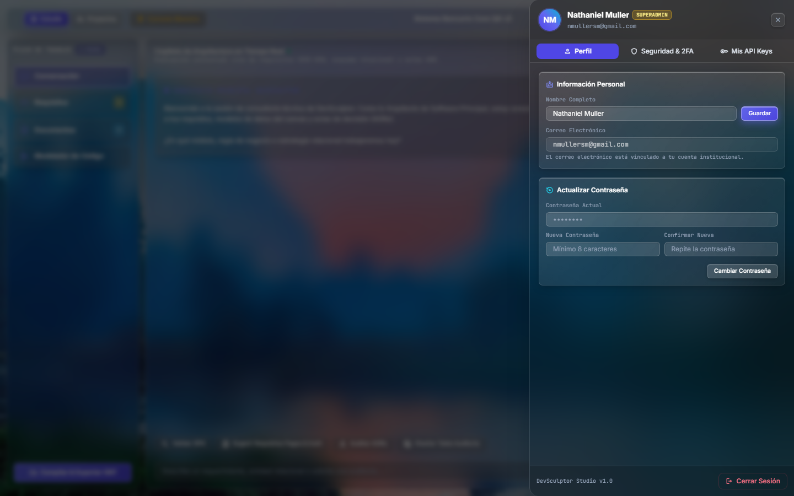

<div align="center">

# 💎 DevSculptor
### Plataforma de Gobernanza Técnica Pre-Código & Documentación Asistida por IA

[](LICENSE)
[](https://www.typescriptlang.org/)
[](https://react.dev/)
[](https://nodejs.org/)
[](https://www.postgresql.org/)
[](https://supabase.com/)
[](https://tailwindcss.com/)
[](Documentation/Backend/Security_Hardening_and_Audit_Remediation_Report.md)
[-success?logo=security)](Documentation/Backend/Supabase_Security_and_Performance_Report.md)
[-success)](Documentation/Consolidated/DevSculptor_Master_Technical_Architecture_and_Specifications.md)

<p align="center">
  <b>Mitigando el fenómeno del <i>"vibe coding"</i> mediante disciplina de diseño de software, trazabilidad inmutable y especificaciones deterministas para agentes de IA.</b>
</p>

[📚 Catálogo de Documentación](Documentation/README.md) • [📐 Especificación Técnica Maestra](Documentation/Consolidated/DevSculptor_Master_Technical_Architecture_and_Specifications.md) • [🛡️ Informe de Seguridad](Documentation/Backend/Security_Hardening_and_Audit_Remediation_Report.md) • [📸 Galería de Capturas](Documentation/screenshots/) • [🧪 Plan Integral de Pruebas](Documentation/Consolidated/Plan_de_Pruebas_Integral_DevSculptor.md)

</div>

---

## 🌟 ¿Qué es DevSculptor?

**DevSculptor** es un entorno de ingeniería de software orientado a la **gobernanza técnica pre-código**. Nace como respuesta a la proliferación del *"vibe coding"* (la generación desestructurada de código mediante LLMs sin validación arquitectónica ni diseño previo).

DevSculptor proporciona a los equipos de desarrollo un flujo riguroso y colaborativo que transforma la ideación conceptual en especificaciones formales inmutables listas para producción:

1. **Captura Jerárquica de Requisitos (IEEE-830)**: Redacción asistida de requisitos funcionales (RF) y no funcionales (RNF) con niveles de severidad y generación automática de tests.
2. **Registro de Decisiones Arquitectónicas (ADRs)**: Catálogo inmutable con máquina de estados finitos (`PROPOSED`, `ACCEPTED`, `REJECTED`, `SUPERSEDED`) y protocolo de ratificación *Human-in-the-Loop*.
3. **Modelador Relacional ERD & Auditor 3FN**: Lienzo interactivo con conectores Bezier dinámicos, notación Crow's Foot, evaluación algorítmica de Tercera Forma Normal (3FN) y generación simultánea de DDL para **PostgreSQL**, **MySQL**, **SQLite** y **Oracle 21c**.
4. **Bóveda OKF (Open Knowledge Framework)**: Generador determinista de documentación viva con hashing criptográfico SHA-256 y manifiesto maestro `/INDEX.md` diseñado para alimentar asistentes de desarrollo (Claude Code, Cursor, Copilot) sin alucinación arquitectónica.
5. **Motor Visualizador Mermaid & Exportación Ejecutiva**: Renderizador SVG vectorial interactivo con zoom (+/-), ajuste 100% y descarga en formatos `.mmd`, `.svg`, HTML imprimible y Markdown.
6. **Bóveda de Credenciales de Usuario (BYOK)**: Almacenamiento seguro en navegador para que el usuario utilice sus propias API Keys de Gemini o OpenAI con comprobador de latencia (*Ping Test*).

---

## 📸 Recorrido Visual de la Plataforma

| Portal de Acceso (visionOS Liquid Glass) | Hub Central de Proyectos & Madurez |
| :---: | :---: |
|  |  |
| *Acceso seguro con autenticación Argon2id y JWT* | *Listado de proyectos y cálculo dinámico de madurez arquitectónica* |

| Matriz de Requisitos IEEE-830 | Registro Formal de Decisiones (ADRs) |
| :---: | :---: |
|  |  |
| *Captura asistida y priorización de requisitos técnicos* | *Máquina de estados finitos con ratificación Human-in-the-Loop* |

| Lienzo Relacional ERD & Motor 3FN | Visualizador de Diagramas Mermaid SVG |
| :---: | :---: |
|  |  |
| *Modelado visual, conectores Bezier y multi-dialecto DDL* | *Renderizado vectorial reactivo con zoom escalable y descarga* |

| Cajón de Configuración de Plataforma | Cajón Lateral de Perfil, 2FA y BYOK |
| :---: | :---: |
|  |  |
| *Control de vidrio, temas y wallpapers de alta resolución* | *Slide-over a pantalla completa para perfil, seguridad y API keys* |

---

## 🏛️ Topología y Arquitectura del Sistema

El sistema implementa una arquitectura desacoplada pero de alta cohesión:

```
┌─────────────────────────────────────────────────────────────────────────────┐
│                    ARQUITECTURA GENERAL DE DEVSCULPTOR                      │
├─────────────────────────────────────────────────────────────────────────────┤
│  FRONTEND (SPA) - React 19 + TypeScript + Vite + Tailwind CSS + Zustand     │
│  ├── Sistema de Diseño visionOS Liquid Glassmorphism (Modo Claro/Oscuro)   │
│  ├── Barra Superior Minimalista (TopBar) & Portales Laterales (Drawers)    │
│  ├── Lienzo Relacional ERD con Conectores Bezier SVG & Auditor 3FN          │
│  ├── Motor Visualizador Vectorial Mermaid SVG (Strict Mode) & Compilador MMD│
│  ├── Sanitización Estricta contra XSS mediante DOMPurify                    │
│  └── Bóveda Local de Claves (BYOK Scoped) para Proveedores de IA            │
├─────────────────────────────────────────────────────────────────────────────┤
│  BACKEND (API REST) - Node.js 20+ con Express & Monolito Modular Layered MVC│
│  ├── Controladores (HTTP Validation Zod & Middleware de Rate Limiting)      │
│  ├── Servicios (Lógica de Negocio, Criptografía SHA-256 & Transacciones)   │
│  ├── Repositorios (Consultas Parametrizadas SQL & Multi-Dialecto)           │
│  ├── Motor de Consultoría IA (Google Gemini 2.0 Flash / OpenAI & Fallbacks) │
│  ├── Seguridad Transversal (Bcrypt Dummy Timing Defense, JWT Typings, 2FA)  │
│  ├── Cifrado Simétrico Autenticado AES-256-GCM para Secretos MFA & Vault   │
│  ├── Revocación de Sesiones en Vivo mediante token_version                  │
│  ├── Validador DNS Anti-SSRF (safeUrl.ts) con Bloqueo de Redes Privadas     │
│  └── Suite Automatizada de Pruebas con Vitest & Supertest (25/25 Passing)   │
├─────────────────────────────────────────────────────────────────────────────┤
│  PERSISTENCIA & STORAGE - PostgreSQL 15+ en Supabase Cloud                 │
│  ├── Cobertura 100% de Row Level Security (RLS) en las 11 Tablas           │
│  ├── Procedimiento Almacenado de Madurez (sp_calculate_project_maturity)   │
│  ├── Disparadores de Auditoría y Triggers de Trazabilidad Histórica        │
│  ├── Cero Advertencias y Cero Errores en Supabase Security Advisors         │
│  └── Buckets Privados de Documentos OKF con Aislamiento auth.uid()         │
└─────────────────────────────────────────────────────────────────────────────┘
```

---

## 🚀 Inicio Rápido y Ejecución Local

### Prerrequisitos
* **Node.js** v20.x o superior
* **npm** v10.x o superior
* Proyecto activo en **Supabase** (PostgreSQL 15+)

### 1. Clonar el Repositorio
```bash
git clone https://github.com/NMullerSM/DevSculptor.git
cd DevSculptor
```

### 2. Configuración del Backend
```bash
cd devsculptor-backend
npm install
```

Crea un archivo `.env` en `devsculptor-backend/` basándote en `.env.example`:
```env
PORT=3000
NODE_ENV=development
DATABASE_URL=postgresql://postgres:[PASSWORD]@[HOST]:5432/postgres
JWT_SECRET=tu_clave_secreta_jwt_muy_segura
GEMINI_API_KEY=tu_api_key_de_gemini
SUPABASE_URL=https://[TU_PROYECTO].supabase.co
SUPABASE_SERVICE_ROLE_KEY=tu_service_role_key
```

Iniciar servidor de desarrollo:
```bash
npm run dev
# Backend activo en http://localhost:3000
```

### 3. Configuración del Frontend
```bash
cd ../devsculptor-frontend
npm install
```

Iniciar cliente web:
```bash
npm run dev
# Frontend activo en http://localhost:5173
```

### 4. Pruebas Automatizadas y Verificación de Calidad
```bash
cd ../devsculptor-backend

# Ejecutar suite completa de 25 pruebas con Vitest
npm run test

# Verificar adherencia a reglas de linting (ESLint 9 Flat Config)
npm run lint

# Validar tipado TypeScript y compilar assets
npm run build
```

---

## 📁 Estructura del Repositorio

```
DevSculptor/
├── .github/                          # Pipelines de Integración Continua (CI GitHub Actions)
│   └── workflows/ci.yml              # Test runner, typecheck y linter automatizado
├── Documentation/                    # Catálogo maestro de documentación técnica
│   ├── README.md                     # Índice general de documentación
│   ├── Backend/                      # Convenciones, ADRs, guías MVC, RLS y seguridad
│   ├── Frontend/                     # Sistema visionOS, UX/UI, specs cliente y sanitización
│   ├── Consolidated/                 # Especificación técnica maestra, informes de sprint y QA
│   └── screenshots/                  # Galería completa de capturas de pantalla del sistema
├── devsculptor-backend/              # Servidor API REST Monolito Modular Layered MVC
│   ├── src/
│   │   ├── config/                   # Base de datos, variables de entorno y logger Pino
│   │   ├── middlewares/              # Autenticación JWT, Rate Limiting, RBAC y errores
│   │   ├── modules/                  # Módulos: auth, projects, requirements, decisions, canvas, ai, admin, okf
│   │   ├── shared/                   # Excepciones tipadas, safeUrl anti-SSRF, cifrado AES-256-GCM
│   │   └── test/                     # Suites de pruebas de integración y seguridad Vitest
│   ├── vitest.config.mts             # Configuración del test runner Vitest
│   ├── eslint.config.mjs             # Configuración ESLint 9 Flat Config
│   └── package.json
├── devsculptor-frontend/             # Cliente SPA React 19 + TypeScript + Vite
│   ├── src/
│   │   ├── components/               # UI Atómica visionOS, layout AppleTopBar, modales y diagramas
│   │   ├── features/                 # Módulos: auth, studio, requirements, decisions, canvas, settings, export
│   │   ├── services/                 # Clientes API tipados Axios (auth, projects, ai, decisions, etc.)
│   │   ├── stores/                   # Manejadores de estado reactivo Zustand
│   │   ├── styles/                   # Tokens de vidrio líquido, micro-animaciones y Tailwind
│   │   └── utils/                    # Sanitización DOMPurify (sanitizeHtml.ts)
│   └── package.json
└── README.md                         # Este documento maestro
```

---

## 📑 Catálogo de Documentación Canónica

Para una revisión detallada de la arquitectura, consulte los documentos en [`Documentation/`](Documentation/README.md):

* **[Especificación Técnica Maestra](Documentation/Consolidated/DevSculptor_Master_Technical_Architecture_and_Specifications.md)**: Documento exhaustivo con detalles de diseño, DDL relacionales y protocolos de IA.
* **[Informe de Hardening de Seguridad Backend](Documentation/Backend/Security_Hardening_and_Audit_Remediation_Report.md)**: Auditoría integral de seguridad, mitigación de vulnerabilidades OWASP, tipado JWT, anti-SSRF y cifrado AES-256-GCM.
* **[Informe de Hardening y Sanitización Frontend](Documentation/Frontend/Security_Hardening_and_DOM_Sanitization_Report.md)**: Sanitización con DOMPurify, Mermaid strict mode y scoping estricto de credenciales BYOK.
* **[Auditoría de Seguridad y Rendimiento Supabase](Documentation/Backend/Supabase_Security_and_Performance_Report.md)**: Cobertura RLS al 100% y resolución oficial de 0 advertencias en Security Advisors.
* **[Informe Consolidado de Avance por Sprints](Documentation/Consolidated/Project_Sprints_Consolidated_Progress_Report.md)**: Estado integral de madurez del proyecto por fases y matriz DoD cumplida al 100%.
* **[Plan Integral de Pruebas (QA)](Documentation/Consolidated/Plan_de_Pruebas_Integral_DevSculptor.md)**: Matriz completa de casos de prueba unitarios, de integración y end-to-end.
* **[Convenciones de Backend](Documentation/Backend/Backend_Conventions_and_Architecture_Guidelines.md)**: Guía metodológica de ingeniería del servidor.
* **[Convenciones de Frontend & UX/UI](Documentation/Frontend/Frontend_Conventions_and_UX_UI_Guidelines.md)**: Guía de tokens de diseño y ergonomía visual.
* **[Catálogo de ADRs Fundacionales](Documentation/Backend/Sprint1ADRs.md)**: Las 8 actas arquitectónicas estructurales de DevSculptor.

---

## 👨‍💻 Autor y Créditos

* **Desarrollador & Arquitecto:** Nathaniel Muller San Martín ([@NMullerSM](https://github.com/NMullerSM))
* **Institución:** Duoc UC — Escuela de Informática y Telecomunicaciones
* **Asignatura:** Taller de Integración de Software (PTY4479)
* **Licencia:** MIT License
